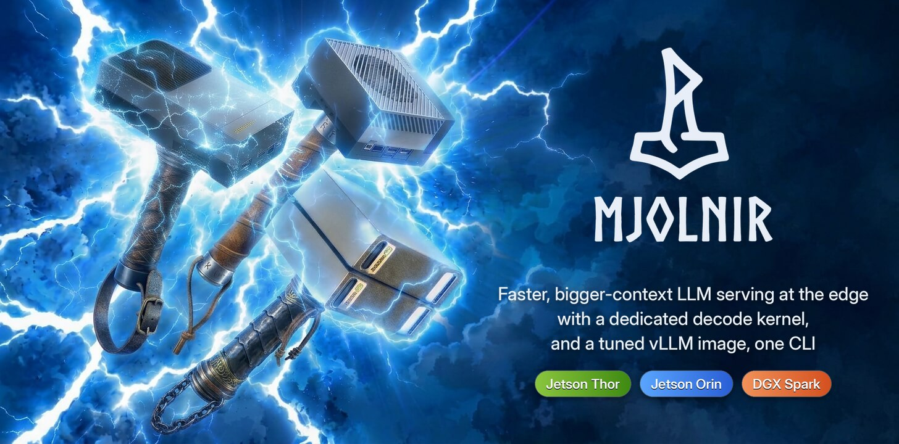
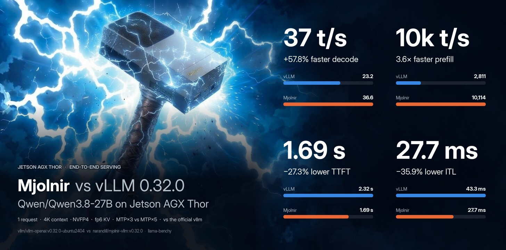

<p align="center">
  
</p>

<p align="center">
  <a href="https://pypi.org/project/mjolnir-kernel/"></a>
  <a href="https://pypi.org/project/mjolnir-cli/"></a>
  <a href="https://hub.docker.com/r/narandill/mjolnir-vllm"></a>
  
  
  <a href="https://github.com/thor-arena/mjolnir/actions/workflows/ci.yml"></a>
  
</p>

<p align="center">
  ⭐ Star us on GitHub — it motivates us a lot!
</p>

<p align="center">
  <b><em>Mjölnir</em></b> — <em>faster, bigger-context LLM serving on the <b>Jetson AGX Thor</b>: a dedicated decode kernel, a tuned vLLM image and a CLI that serves, benchmarks and documents it.</em>
</p>

<p align="center">
  <a href="#-key-features">Features</a> •
  <a href="#quickstart">Quickstart</a> •
  <a href="#jetson-thor-benchmarks">Benchmarks</a> •
  <a href="https://thor-arena.github.io/mjolnir/">Interactive charts</a> •
  <a href="#platforms">Platforms</a> •
  <a href="docs/platforms/thor/README.md#kernel">Case study</a> •
  <a href="#contributing">Contributing</a>
</p>

## What is ⚡ Mjolnir?

> *Mjölnir* is Old Norse for "Thor's hammer" — pronounced **"MYOL-nir"**.

**Mjolnir makes LLM serving on the NVIDIA Jetson AGX Thor faster and roomier**: a decode-attention kernel written for this one chip (`sm_110`, CuTe DSL on `tcgen05` tensor cores, `TMEM` and `TMA`), a 6-bit KV cache format for vLLM, a patched vLLM image that runs it, and a CLI that serves models from YAML configs and benchmarks every claim:

```bash
mjolnir serve up    # or: vllm serve <model> --attention-backend MJOLNIR
```

Every generated token re-reads the whole KV cache, so on a 273 GB/s edge GPU **decode speed is a memory problem**. Stock vLLM 0.32.0 runs FlashAttention&nbsp;2 on Thor, which has no fp8 KV path and reads twice the bytes; FlashInfer is the fastest stock option. Mjolnir is built for this exact chip: 20 SMs, 2 CTAs per SM, a 32 MiB L2, LPDDR5X.

## ⚡ Key Features

<p align="center">

</p>

<details>
<summary>How the % and × here are calculated</summary>

- **Throughput** (decode, prefill — tokens/s, higher is better): change = (Mjolnir − official) ÷ official × 100. `+57%` = 1.57× the tokens per second. On the infographic a change of +100% or more is written as the multiple Mjolnir ÷ official (`+200%` = `3×`).
- **Latency** (TTFT, ITL — milliseconds, lower is better): change = (Mjolnir − official) ÷ official × 100, so a negative value is a **latency reduction**: `−27%` = 27% fewer milliseconds. It is *not* the reciprocal speedup official ÷ Mjolnir − 1, which reads larger for the same pair.
- **Worked example** (4K context, 1 request): TTFT 2,319 → 1,686 ms: (1,686 − 2,319) ÷ 2,319 × 100 = **−27.3%** (a latency reduction of 27.3%). The reciprocal speedup would be 2,319 ÷ 1,686 = 1.38× (+37.6%) — the same measurement, a different convention.
- **Values**: the mean over the measured runs per cell (6 measured after 2 warm-ups, llama-benchy): decode = generated tokens ÷ generation time per request (summed over requests at higher concurrency), prefill = prompt tokens ÷ prompt-processing time, TTFT = time to the first content token, ITL = 1000 ÷ the per-request decode rate.
- **Colors**: green = better by at least 3%, grey = within ±3% (`E2E_NOISE_PCT`), red = worse by at least that. With speculative decoding a single decode cell moves more between runs (acceptance depends on the prompt), so repeat (`--repeat`) before reading a few-% difference.

</details><br />

<table width="100%">
  <tr>
    <td width="33%" valign="top" align="center">
      <br>
      <h3>🚀&nbsp;<a href="docs/platforms/thor/README.md#end-to-end">Faster decode</a></h3>
      <p><b>+58% tokens/s</b> vs the official vLLM image. MTP with <b>5 draft tokens</b>: an fp8 lm_head and a 64K draft vocabulary.</p>
      <br>
    </td>
    <td width="33%" valign="top" align="center">
      <br>
      <h3>⏱️&nbsp;<a href="docs/platforms/thor/README.md#end-to-end">Faster prompts</a></h3>
      <p><b>+260%</b> prefill throughput, <b>−27%</b> time to first token.</p>
      <br>
    </td>
    <td width="33%" valign="top" align="center">
      <br>
      <h3>🧠&nbsp;<a href="docs/platforms/thor/kernel/kv-cache-size.md">More context per GB</a></h3>
      <p>The 6-bit <code>e2m3</code> KV cache holds <b>+31% tokens</b> in the same memory.</p>
      <br>
    </td>
  </tr>
  <tr>
    <td width="33%" valign="top" align="center">
      <br>
      <h3>🎯&nbsp;<a href="docs/platforms/thor/kernel/accuracy.md">Same accuracy</a></h3>
      <p>Tool calling within <b>±3.6 points</b> of the stock FlashInfer fp8 baseline.</p>
      <br>
    </td>
    <td width="33%" valign="top" align="center">
      <br>
      <h3>🐳&nbsp;<a href="docker/vllm-thor/PATCHES.md">Dockerized</a></h3>
      <p>Official vLLM 0.32.0 + Mjolnir + Jetson Thor patches.</p>
      <br>
    </td>
    <td width="33%" valign="top" align="center">
      <br>
      <h3>📄&nbsp;<a href="configs/Qwen/Qwen3.8-27B/README.md">Models as Code</a></h3>
      <p>Each model is a YAML file of serve flags. <code>mjolnir serve up</code> does the rest.</p>
      <br>
    </td>
  </tr>
  <tr>
    <td width="33%" valign="top" align="center">
      <br>
      <h3>🧪&nbsp;<a href="docs/faq/fp6-kv.md">Calibrated per model</a></h3>
      <p>KV-cache scales and the draft vocabulary come from <code>mjolnir calibrate</code> and ship next to the config.</p>
      <br>
    </td>
    <td width="33%" valign="top" align="center">
      <br>
      <h3>📊&nbsp;<a href="docs/methodology/benchmarking.md">Benchmarks you can rerun</a></h3>
      <p>Kernel, serving and accuracy benches in one CLI, raw JSON for every table, chart and number on this page.</p>
      <br>
    </td>
    <td width="33%" valign="top" align="center">
      <br>
      <h3>🔬&nbsp;<a href="docs/faq/autoresearch.md">Autoresearch</a></h3>
      <p>An agent loop proposes, tests and logs kernel experiments; every try leaves data behind.</p>
      <br>
    </td>
  </tr>
</table>

## Quickstart

> [!IMPORTANT]
> Requirements: Jetson AGX Thor (JetPack 7.x, `sm_110a`), Docker + NVIDIA Container Toolkit, [`uv`](https://docs.astral.sh/uv/).

```bash
# the CLI (the package is mjolnir-cli; the command is `mjolnir`)
uv tool install mjolnir-cli

# one-time: Thor host setup for stable numbers (clocks, power mode, fans, swap)
mjolnir hw setup

# serve: Qwen3.8-27B NVFP4 on the Mjolnir image, --attention-backend MJOLNIR, port 6001
mjolnir serve up
```

```bash
curl -s http://localhost:6001/v1/chat/completions \
  -H 'content-type: application/json' \
  -d '{"model": "Qwen/Qwen3.8-27B", "messages": [{"role": "user", "content": "hi"}], "max_tokens": 64}'
```

**Use the image directly** (any model, any vLLM flags):

```bash
docker run --rm -it --gpus all --ipc host -p 8000:8000 -e VLLM_KV_CACHE_LAYOUT=HND \
  narandill/mjolnir-vllm:v0.32.0 <model> --kv-cache-dtype fp8 --attention-backend MJOLNIR
```

## Supported Hardware

Mjolnir is detection-first: the CLI resolves the host platform (never a silent
guess), every platform gets [its own page](docs/platforms/README.md) and — once
kernel results exist for its headline model — its own kernel case study.

| platform | status | kernel | host requirements |
|---|---|---|---|
| **[Jetson AGX Thor](docs/platforms/thor/README.md)** | ✅ supported | [case study](docs/platforms/thor/README.md#kernel) | JetPack 7.x |
| **[DGX Spark](docs/platforms/spark/README.md)** | ⏳ research | — | DGX OS + CUDA 13 |
| **[Jetson Orin](docs/platforms/orin/README.md)** | ⏳ research | — | JetPack 7.2.1+ (L4T 39.2.1, CUDA 13.2) |


## Supported Models

| model | [Jetson AGX Thor](docs/platforms/thor/README.md) | [DGX Spark](docs/platforms/spark/README.md) | [Jetson Orin](docs/platforms/orin/README.md) |
|---|---|---|---|
| [Qwen3.8-27B](configs/Qwen/Qwen3.8-27B/README.md) | <span title="NVFP4_MJOLNIR_E2M3_LMH8_VT64K">✅ 39.2 t/s</span> | ✅ | <span title="AWQ_MJOLNIR_E2M3_VT64K">✅ 22.2 t/s</span> |
| [Qwen3.6-35B-A3B](configs/nvidia/Qwen3.6-35B-A3B/README.md) | <span title="NVFP4_MJOLNIR_E2M3">✅ 126.2 t/s</span> | — | — |


> <sub>✅ at least one of the model's configs serves natively on the platform · ❌ every config targeting it is explicitly unavailable there · — no config targets it. t/s (when shown): decode tokens/s at 1 request and 0 context — the fastest config's latest run, its name in the cell's hover title · from [benchmarks/history.jsonl](benchmarks/history.jsonl).</sub>

### Model Configs

A served model is a file, not a command line: each config is the `vllm serve` flags in YAML — model, quantization, KV-cache dtype, attention backend, speculative decoding, context length — in its own directory, `configs/<vendor>/<model>/<config>/config.yaml`; what YAML cannot carry (the fp8 lm_head, the draft vocabulary) goes into the config dir's optional `.env` sidecar of `KEY=VALUE` switches, the model's calibration files (`kv_scales/<format>.json`, `draft_vocab.json`) sit next to the config dirs, and your own configs drop into `~/.local/share/mjolnir/configs/` (same layout) to appear next to the repo's:

```bash
configs/Qwen/Qwen3.8-27B/
├── NVFP4_MJOLNIR_E2M3_LMH8_VT64K/          # attention-backend: MJOLNIR · kv-cache-dtype: fp6_e2m3 · MTP, 5 drafts
│   ├── config.yaml
│   └── .env                           # MJOLNIR_LM_HEAD=fp8 · MJOLNIR_DRAFT_VOCAB={configs}/draft_vocab.json
├── NVFP4/
│   └── config.yaml                    # the stock FlashInfer baseline, same model and limits
├── kv_scales/e2m3.json                # per-channel KV scales (mjolnir calibrate)
└── draft_vocab.json                   # the drafter's vocabulary (mjolnir calibrate --draft-vocab)
```

```bash
mjolnir model use                               # pick the model and config (interactive)
mjolnir serve up --config NVFP4_MJOLNIR_E2M3    # or serve one explicitly
```

- **One file per variant** — an A/B is two configs, not two shell histories: `mjolnir bench ab --backends NVFP4,NVFP4_MJOLNIR_E2M3_LMH8_VT64K`.
- **The same config everywhere** — `serve`, `bench`, `verify` and `calibrate` read the same YAML and `.env`, so a benchmark measures exactly what you serve.
- **Yours without forking** — drop configs into `~/.local/share/mjolnir/configs/` (same layout); they appear next to the repo's.

More: [adding a model config](docs/faq/new-model-config.md) · [the default model and config](docs/faq/default-model-quant.md) · [serving](docs/faq/serve-server.md) · [which setting wins](docs/faq/settings-precedence.md) · [fp6 KV and calibration](docs/faq/fp6-kv.md).

## The CLI

```bash
mjolnir                                      # help + next steps
mjolnir serve [up|down|status|logs]          # the vLLM container on the Mjolnir image
mjolnir model | image                        # pick the active model config / vLLM image
mjolnir calibrate [--draft-vocab]            # fp6 KV-cache scales (and the drafter's vocabulary) per model
mjolnir verify <stage>                       # kernel correctness + ncu benchmarks -> benchmarks/raw/verify
mjolnir verify bench | all                   # every benchmark stage (all = + correctness)
mjolnir verify show | list                   # re-print saved results
mjolnir bench e2e | compare                  # official vLLM image vs Mjolnir: decode, prefill, TTFT, ITL
mjolnir bench perf | ab | accuracy           # serving benchmarks, A/B legs, model quality
mjolnir plot --readme [--site DIR]           # charts + README + docs (+ the interactive site) from raw data
mjolnir autoresearch [init|run|ledger]       # the autonomous kernel-research loop
mjolnir gate | hw | litellm | perses         # clean-window gate, Thor host setup, side stacks
```

Every command, sub-command and option, with defaults: **[the CLI reference](docs/cli.md)** — generated from the commands themselves; `mjolnir <command> --help` prints the same.

## Contributing

**Mjolnir** is meant to be a **community case study**: every claim is reproducible with one command, and every experiment — kept or discarded — leaves raw data behind.

- **Run the benchmarks on your Thor** — `mjolnir verify bench` writes JSON you can open a PR with; the README, docs and charts re-render from it.
- **Try a kernel idea** — change `src/mjolnir/mjolnir/arch/thor/` (the Thor kernel family), prove it with `mjolnir verify correctness` and an `mjolnir verify ab --variants ...` run, and send the raw result with the PR.
- **Let the agents try** — `mjolnir autoresearch run` drives an OpenCode research loop (web + arXiv research, implementation, debugging) where every experiment is logged on [the ledger](research/README.md).
- Guidelines: [CONTRIBUTING.md](.github/CONTRIBUTING.md) · [docs index](docs/README.md).

## Repository layout

```
├── src/
│   ├── mjolnir/                the kernel package (PyPI: mjolnir-kernel, import `mjolnir`)
│   │   └── mjolnir/            arch/{thor,orin}/ (kernel families) · runner.py · backend.py
│   └── mjolnir-cli/            the CLI package (PyPI: mjolnir-cli, command `mjolnir`)
│       └── mjolnir_cli/        verify/ · charts.py · readme.py · autoresearch.py · serve/bench/...
├── docker/vllm-thor/           the image: Dockerfile, patches/, apply/verify gates, PATCHES.md
├── configs/                    model configs (NVFP4_MJOLNIR_E2M3_LMH8_VT64K default, NVFP4 = FlashInfer, NVFP4_FA2)
├── benchmarks/raw/verify/      raw verify results (one JSON per stage run) — the charts' only input
├── assets/benchmarks/          generated charts (`*.png`)
├── docs/platforms/             per-platform pages + the kernel case studies (rendered)
├── research/                   the autoresearch program + ledger
└── .opencode/                  OpenCode agents (autoresearch, researchers, engineer, debugger)
```

## Security

The served API is unauthenticated; expose it deliberately. See [SECURITY.md](.github/SECURITY.md).

## License

Mjolnir is open source under the [Apache License 2.0](LICENSE) — the license of vLLM and FlashInfer, which it builds on — with one exception: the kernel, [`src/mjolnir/mjolnir/arch/thor/decode.py`](src/mjolnir/mjolnir/arch/thor/decode.py), is derived from an NVIDIA CUTLASS CuTe DSL example and stays under that example's **BSD-3-Clause** license, with NVIDIA's notice kept at the top of the file.

### Third-party
Third-party code, the vLLM / FlashInfer / FlashAttention files the image patches, and what the [`narandill/mjolnir-vllm`](https://hub.docker.com/r/narandill/mjolnir-vllm) image redistributes are listed in [NOTICE](NOTICE).

---

<br />

<p align="center"><sub>⚡ Mjölnir — built on and for the edge ❤️.</sub></p>
<p align="center"><sub>Generated from <code>README.md.j2</code> by <code>mjolnir plot --readme</code>.</sub></p>
