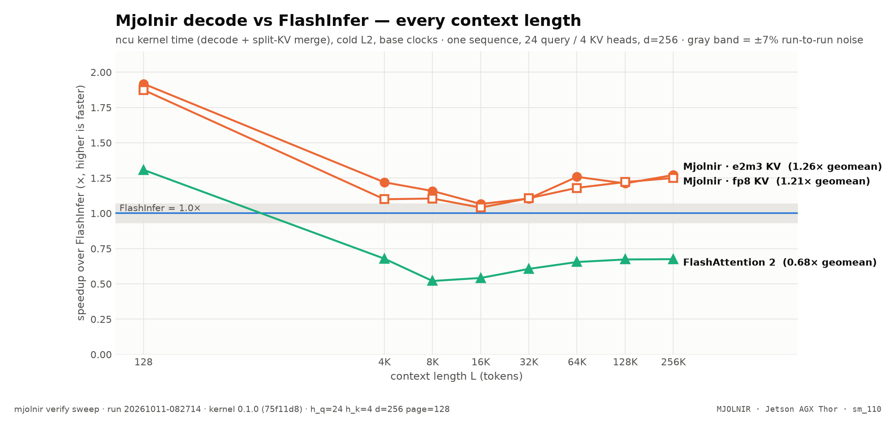
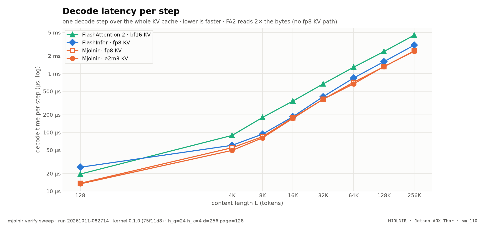
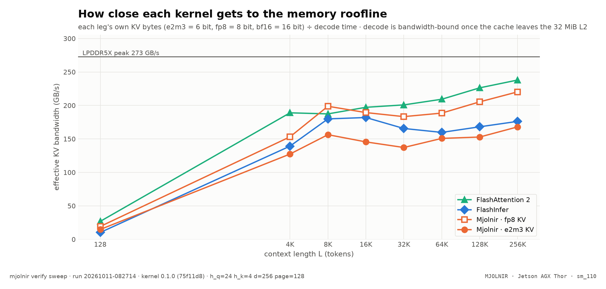

<p align="center">
  
</p>

<p align="center">
  <a href="https://pypi.org/project/mjolnir-kernel/"></a>
  <a href="https://pypi.org/project/mjolnir-cli/"></a>
  <a href="https://hub.docker.com/r/narandill/mjolnir-vllm"></a>
  
  
  <a href="https://github.com/thor-arena/mjolnir/actions/workflows/ci.yml"></a>
  
</p>

<p align="center">
  <b><em>Mjölnir</em></b> <sup>(MYOL-nir)</sup> — <em>a decode-attention kernel built for exactly one GPU: the <b>Jetson AGX Thor</b>.</em>
</p>

<p align="center">
  <a href="#quickstart">Quickstart</a> •
  <a href="#benchmarks">Benchmarks</a> •
  <a href="https://thor-arena.github.io/mjolnir/">Interactive charts</a> •
  <a href="#how-the-kernel-works">How it works</a> •
  <a href="docs/kernel/README.md">Case study</a> •
  <a href="#contributing">Contributing</a>
</p>

## What is ⚡ Mjolnir?

> *Mjölnir* is Old Norse for "Thor's hammer" — pronounced **"MYOL-nir"**.

**Mjolnir is a paged fp8 decode-attention kernel for the NVIDIA Jetson AGX Thor (`sm_110`)**, written in CuTe DSL on Blackwell's `tcgen05` tensor cores, TMEM and TMA, and shipped as a vLLM attention backend:

```bash
vllm serve <model> --attention-backend MJOLNIR
```

Every generated token re-reads the whole KV cache, so on a 273 GB/s edge GPU **decode speed is a memory problem**. Stock vLLM 0.30.0 runs FlashAttention 2 on Thor, which has no fp8 KV path and reads twice the bytes; FlashInfer is the fastest stock option. Mjolnir is built for this exact chip: 20 SMs, 2 CTAs per SM, a 32 MiB L2, LPDDR5X.


<p align="center">
<picture>
  <source media="(prefers-color-scheme: dark)" srcset="assets/benchmarks/kernel-speedup-dark.png">
  
</picture>
</p>

| decode kernel, one step (ncu, cold L2) | result |
|---|---|
| **vs FlashInfer**, geomean over L = 128 4K 8K 16K 32K 64K 128K 256K | **1.26× faster** (from 1.07× at 16K to 1.92× at 128) |
| **vs FlashAttention 2** (stock vLLM's sm_110 default) | **1.85× faster** |
| faster than FlashInfer beyond the ±7% noise band | **7 of 8** context lengths |
| at the longest context (256K tokens) | **1.27×** vs FlashInfer |
| one decode step at 64K tokens | **667.7 µs** (FlashInfer 840.3 µs, FlashAttention 2 1.28 ms) |
| fp8 KV (what `--attention-backend MJOLNIR` serves today) | **1.21×** vs FlashInfer, geomean |
| correctness vs a bit-faithful emulator | **86 / 86** checks pass |


<sub>Every number above is computed from the raw results of `mjolnir verify sweep` (run `20261011-082714`, [`benchmarks/raw/verify/`](benchmarks/raw/verify/)) when this README is rendered — no hand-typed numbers. Hover the [interactive version](https://thor-arena.github.io/mjolnir/) for any point.</sub>

## Quickstart

> [!NOTE]
> Requirements: Jetson AGX Thor (JetPack 7.x, `sm_110a`), Docker + NVIDIA Container Toolkit, [`uv`](https://docs.astral.sh/uv/).

```bash
# the CLI (the package is mjolnir-cli; the command is `mjolnir`)
uv tool install mjolnir-cli

# one-time: Thor host setup for stable numbers (clocks, power mode, fans, swap)
mjolnir hw setup

# serve: Qwen3.8-27B NVFP4 on the Mjolnir image, --attention-backend MJOLNIR, port 6001
mjolnir serve up
```

```bash
curl -s http://localhost:6001/v1/chat/completions \
  -H 'content-type: application/json' \
  -d '{"model": "Qwen/Qwen3.8-27B", "messages": [{"role": "user", "content": "hi"}], "max_tokens": 64}'
```

**Use the image directly** (any model, any vLLM flags):

```bash
docker run --rm -it --gpus all --ipc host -p 8000:8000 -e VLLM_KV_CACHE_LAYOUT=HND \
  narandill/mjolnir-vllm:v0.30.0 <model> --kv-cache-dtype fp8 --attention-backend MJOLNIR
```

**Or bring your own vLLM 0.30.0**: `pip install mjolnir-kernel` registers the backend as `CUSTOM` through vLLM's plugin system (`--attention-backend CUSTOM`); [`thor-mjolnir-attention-backend.patch`](docker/vllm-thor/patches/thor-mjolnir-attention-backend.patch) adds the `MJOLNIR` name.

## Benchmarks

All kernel numbers are **ncu kernel time** (decode + split-KV merge), cold L2, base clocks, one sequence with 24 query / 4 KV heads, head dim 256, 128-token pages — the attention shape of Qwen3.8-27B — at **every context length from 128 to 256K tokens**. Legs:

| leg | what runs | KV cache |
|---|---|---|
| **Mjolnir · e2m3 KV** | this kernel, its fastest config (6-bit KV read directly by the tensor cores) | e2m3, head-major pages |
| **Mjolnir · fp8 KV** | this kernel, what `--attention-backend MJOLNIR` serves today | fp8 e4m3, head-major pages |
| **FlashInfer** | tensor-core decode as vLLM's FlashInfer backend runs it | fp8 e4m3, NHD pages |
| **FlashAttention 2** | `vllm_flash_attn` FA2 — stock vLLM 0.30.0's `sm_110` default | bf16 (FA2 has no fp8 KV) |

The box is shared with a live server, so ±7% between runs is noise; ratios inside that band are drawn gray. Methodology: [`docs/methodology/benchmarking.md`](docs/methodology/benchmarking.md).

<picture>
  <source media="(prefers-color-scheme: dark)" srcset="assets/benchmarks/kernel-latency-dark.png">
  
</picture>

| L | FlashInfer | FA2 | Mjolnir fp8 | Mjolnir e2m3 | fp8 vs FI | e2m3 vs FI | fp8 vs FA2 | e2m3 vs FA2 |
|---|--:|--:|--:|--:|--:|--:|--:|--:|
| **128** | 25.5 µs | 19.5 µs | 13.6 µs | **13.3 µs** | $\color{#16a34a}{\mathbf{1.87\times}}$ | $\color{#16a34a}{\mathbf{1.92\times}}$ | $\color{#16a34a}{\mathbf{1.43\times}}$ | $\color{#16a34a}{\mathbf{1.47\times}}$ |
| **4K** | 60.3 µs | 88.8 µs | 54.8 µs | **49.4 µs** | $\color{#16a34a}{\mathbf{1.10\times}}$ | $\color{#16a34a}{\mathbf{1.22\times}}$ | $\color{#16a34a}{\mathbf{1.62\times}}$ | $\color{#16a34a}{\mathbf{1.80\times}}$ |
| **8K** | 93.3 µs | 179.1 µs | 84.4 µs | **80.5 µs** | $\color{#16a34a}{\mathbf{1.10\times}}$ | $\color{#16a34a}{\mathbf{1.16\times}}$ | $\color{#16a34a}{\mathbf{2.12\times}}$ | $\color{#16a34a}{\mathbf{2.22\times}}$ |
| **16K** | 184.4 µs | 340.3 µs | 177.2 µs | **172.9 µs** | $\color{grey}{1.04\times}$ | $\color{grey}{1.07\times}$ | $\color{#16a34a}{\mathbf{1.92\times}}$ | $\color{#16a34a}{\mathbf{1.97\times}}$ |
| **32K** | 405.3 µs | 668.4 µs | **366.1 µs** | 366.9 µs | $\color{#16a34a}{\mathbf{1.11\times}}$ | $\color{#16a34a}{\mathbf{1.10\times}}$ | $\color{#16a34a}{\mathbf{1.83\times}}$ | $\color{#16a34a}{\mathbf{1.82\times}}$ |
| **64K** | 840.3 µs | 1.28 ms | 711.8 µs | **667.7 µs** | $\color{#16a34a}{\mathbf{1.18\times}}$ | $\color{#16a34a}{\mathbf{1.26\times}}$ | $\color{#16a34a}{\mathbf{1.80\times}}$ | $\color{#16a34a}{\mathbf{1.92\times}}$ |
| **128K** | 1.60 ms | 2.37 ms | **1.31 ms** | 1.32 ms | $\color{#16a34a}{\mathbf{1.22\times}}$ | $\color{#16a34a}{\mathbf{1.21\times}}$ | $\color{#16a34a}{\mathbf{1.82\times}}$ | $\color{#16a34a}{\mathbf{1.80\times}}$ |
| **256K** | 3.05 ms | 4.51 ms | 2.44 ms | **2.40 ms** | $\color{#16a34a}{\mathbf{1.25\times}}$ | $\color{#16a34a}{\mathbf{1.27\times}}$ | $\color{#16a34a}{\mathbf{1.85\times}}$ | $\color{#16a34a}{\mathbf{1.88\times}}$ |
| geomean |  |  |  |  | $\color{#16a34a}{\mathbf{1.21\times}}$ | $\color{#16a34a}{\mathbf{1.26\times}}$ | $\color{#16a34a}{\mathbf{1.79\times}}$ | $\color{#16a34a}{\mathbf{1.85\times}}$ |

<sub>Bold = fastest at that L. Ratio columns: baseline time ÷ this kernel's time (green = faster beyond noise).</sub>

<picture>
  <source media="(prefers-color-scheme: dark)" srcset="assets/benchmarks/kernel-bandwidth-dark.png">
  
</picture>

### Official vLLM image vs Mjolnir

> Pending: `mjolnir bench e2e` (serves the official vLLM image, then the Mjolnir image, and benchmarks both).

## How the kernel works

A decode step is one query token per sequence against the whole KV cache: at 64K tokens that is 128 MiB of K and V per layer, read once. The design goal is to keep the LPDDR5X busy and everything else out of the way.

| | design choice | why on Thor |
|---|---|---|
| ⚙️ | **Warp-specialized tcgen05 pipeline** — a TMA warp streams K/V pages through an SMEM ring, an MMA warp runs `S = QKᵀ` and `O += PV` on the tensor cores into TMEM, softmax warpgroups read S from TMEM and write P | the tensor cores and TMEM keep scores off the register file; the TMA engine walks the page table so the SMs never issue loads |
| 📐 | **Occupancy-pinned split-KV** — every step fills exactly 2 CTAs × 20 SMs; long sequences split into chunks, a small reduction kernel merges them | one full wave at every L; a fixed padded grid replays under full CUDA graphs |
| 🧊 | **fp8 everything** — Q quantized per (sequence, KV head) on the fly, fp8 KV, P stored as e4m3 | one MMA kind, no conversion warps, half the KV bytes of bf16 |
| 🗂️ | **Head-major (HND) pages** — each KV head's page is one contiguous block | longer DRAM bursts per TMA box: [hndsweep](docs/kernel/hndsweep.md) |
| 🪶 | **6-bit KV (e2m3) read directly by the MMA** (`kind::f8f6f4`, TMA unpacks to byte containers) | 25% fewer bytes at near-fp8 accuracy: [kvfmt](docs/kernel/kvfmt.md), [quant](docs/kernel/quant.md) |
| 🚿 | **L2 evict-first on K/V loads**, a 3-stage ring for fp6 | KV is streamed once; keep L2 for the rest of the model: [ring](docs/kernel/ring.md), [ab](docs/kernel/ab.md) |

The full walkthrough — one chapter per experiment, each with its chart, data table and the command that reproduces it — is the **[kernel case study](docs/kernel/README.md)**:

| chapter | question it answers |
|---|---|
| [Correctness matrix](docs/kernel/correctness.md)  | kernel vs the bit-faithful emulator: every layout, format, page size, q_len, Q dtype |
| [Headline L-sweep](docs/kernel/sweep.md)  | Mjolnir vs FlashInfer vs FlashAttention 2, ncu kernel time at every L |
| [Head-major pages](docs/kernel/hndsweep.md)  | FlashInfer on NHD and HND vs Mjolnir on HND — is HND a kernel win or a layout win? |
| [KV layouts and formats](docs/kernel/kvfmt.md) *(pending)* | fp8 / fp6 / fp4 / nvfp4 KV on NHD / interleaved / HND pages (ncu + wall clock) |
| [KV format accuracy](docs/kernel/quant.md) *(pending)* | relative L2 error of each KV format vs unquantized KV, at every L |
| [Full profiles per KV format](docs/kernel/fp6prof.md) *(pending)* | full ncu profiles: L2 sectors vs requests vs time, warp stalls, per KV format |
| [KV ring depth](docs/kernel/ring.md) *(pending)* | TMA→MMA ring depth (--kv_stages) sweep at every L |
| [L2 prefetch](docs/kernel/prefetch.md) *(pending)* | TMA L2 prefetch distance (--l2_prefetch) sweep |
| [Programmatic dependent launch](docs/kernel/pdl.md) *(pending)* | PDL on/off wall clock (decode overlaps the previous kernel; merge launches early) |
| [Flag A/B](docs/kernel/ab.md) *(pending)* | any harness flag sets, ncu + wall clock (default: evict-first x PDL) |


## What's in the image

[`narandill/mjolnir-vllm:v0.30.0`](https://hub.docker.com/r/narandill/mjolnir-vllm) = the official `vllm/vllm-openai:v0.30.0` image + the `mjolnir-kernel` package + a hand-adapted patch stack for Thor. Tags follow the upstream vLLM version.

| patch | what it does |
|---|---|
| **`thor-mjolnir-attention-backend`** | adds `MJOLNIR` to vLLM's attention-backend enum → `--attention-backend MJOLNIR` |
| [#50885](https://github.com/vllm-project/vllm/pull/50885) | FULL cudagraph mode for speculative decode on the FlashInfer-native backend |
| [#49652](https://github.com/vllm-project/vllm/pull/49652) | draft-decode cudagraphs under dynamic speculative decoding |
| [#54165](https://github.com/vllm-project/vllm/pull/54165) | Mamba/GDN `copy_kv_cache` restore under speculative decode |
| [#55390](https://github.com/vllm-project/vllm/pull/55390) | MTP `draft_spec_decode` annotation for the draft group |
| [#55519](https://github.com/vllm-project/vllm/pull/55519) | no false-positive KV-reuse warning on the GDN hybrid |
| Thor `sm_110` patches | GDN prefill enablement, FA4 hd256 fp8-KV + 1-CTA decode, fused draft-decode plan advance, DSpark non-causal draft cudagraph, draft-cudagraph shape gate |

Details: [`docker/vllm-thor/PATCHES.md`](docker/vllm-thor/PATCHES.md).

## The CLI

```bash
mjolnir                                 # help + next steps
mjolnir serve [up|down|status|logs]     # the vLLM container (Mjolnir image)
mjolnir model | image                   # pick the model config / image
mjolnir verify <stage>                  # correctness + ncu benchmarks -> benchmarks/raw/verify
mjolnir verify bench | all              # every benchmark stage (all = + correctness)
mjolnir verify show | list              # re-print saved results
mjolnir bench e2e | compare            # official vLLM image vs Mjolnir: decode, prefill, TTFT, ITL
mjolnir bench perf | ab                 # end-to-end serving benchmarks -> history.jsonl
mjolnir plot --readme [--site DIR]      # charts + README + docs (+ interactive site) from raw data
mjolnir autoresearch init|run|ledger    # the autonomous kernel-research loop
mjolnir gate | hw | litellm | perses    # clean-window gate, host setup, side stacks
```

Every `verify` stage defaults to L = 128 4K 8K 16K 32K 64K 128K 256K; `--ls`, `--iters`, `--image`, `--dry-run` work everywhere.

## Contributing

Mjolnir is meant to be a **community case study**: every claim is reproducible with one command, and every experiment — kept or discarded — leaves raw data behind.

- **Run the benchmarks on your Thor** — `mjolnir verify bench` writes JSON you can open a PR with; the README, docs and charts re-render from it.
- **Try a kernel idea** — change `src/mjolnir/mjolnir/t5_decode.py`, prove it with `mjolnir verify correctness` and an `mjolnir verify ab --variants ...` run, and send the raw result with the PR.
- **Let the agents try** — `mjolnir autoresearch run` drives an OpenCode research loop (web + arXiv research, implementation, debugging) where every experiment is logged on [the ledger](research/README.md).
- Guidelines: [CONTRIBUTING.md](.github/CONTRIBUTING.md) · [docs index](docs/README.md).

## Repository layout

```
├── src/
│   ├── mjolnir/                the kernel package (PyPI: mjolnir-kernel, import `mjolnir`)
│   │   └── mjolnir/            t5_decode.py (kernel + harness) · runner.py · backend.py
│   └── mjolnir-cli/            the CLI package (PyPI: mjolnir-cli, command `mjolnir`)
│       └── mjolnir_cli/        verify/ · charts.py · readme.py · autoresearch.py · serve/bench/...
├── docker/vllm-thor/           the image: Dockerfile, patches/, apply/verify gates, PATCHES.md
├── configs/                    model configs (NVFP4_MJOLNIR default, NVFP4 = FlashInfer, NVFP4_FA2)
├── benchmarks/raw/verify/      raw verify results (one JSON per stage run) — the charts' only input
├── assets/benchmarks/          generated charts (light + dark)
├── docs/kernel/                the kernel case study (rendered from *.md.j2 + raw data)
├── research/                   the autoresearch program + ledger
└── .opencode/                  OpenCode agents (autoresearch, researchers, engineer, debugger)
```

## Security

The served API is unauthenticated; expose it deliberately. See [SECURITY.md](.github/SECURITY.md).

## License

[MIT](LICENSE)

<p align="center"><sub>⚡ Mjölnir — built on and for the edge.</sub></p>
<p align="center"><sub>Generated from <code>README.md.j2</code> by <code>mjolnir plot --readme</code>.</sub></p>
