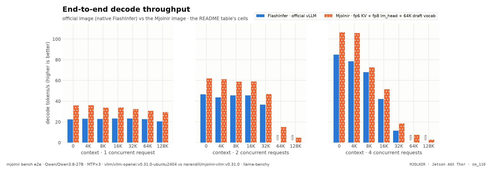

<p align="center">
  
</p>

<p align="center">
  <a href="https://pypi.org/project/mjolnir-kernel/"></a>
  <a href="https://pypi.org/project/mjolnir-cli/"></a>
  <a href="https://hub.docker.com/r/narandill/mjolnir-vllm"></a>
  
  
  <a href="https://github.com/thor-arena/mjolnir/actions/workflows/ci.yml"></a>
  
</p>

<p align="center">
  <b><em>Mjölnir</em></b> <sup>(MYOL-nir)</sup> — <em>a decode-attention kernel built for exactly one GPU: the <b>Jetson AGX Thor</b>.</em>
</p>

<p align="center">
  <a href="#quickstart">Quickstart</a> •
  <a href="#benchmarks">Benchmarks</a> •
  <a href="https://thor-arena.github.io/mjolnir/">Interactive charts</a> •
  <a href="#how-the-kernel-works">How it works</a> •
  <a href="docs/kernel/README.md">Case study</a> •
  <a href="#contributing">Contributing</a>
</p>

## What is ⚡ Mjolnir?

> *Mjölnir* is Old Norse for "Thor's hammer" — pronounced **"MYOL-nir"**.

**Mjolnir is a paged fp8 decode-attention kernel for the NVIDIA Jetson AGX Thor (`sm_110`)**, written in CuTe DSL on Blackwell's `tcgen05` tensor cores, `TMEM` and `TMA`, and shipped as a vLLM attention backend:

```bash
vllm serve <model> --attention-backend MJOLNIR
```

Every generated token re-reads the whole KV cache, so on a 273 GB/s edge GPU **decode speed is a memory problem**. Stock vLLM 0.31.0 runs FlashAttention 2 on Thor, which has no fp8 KV path and reads twice the bytes; FlashInfer is the fastest stock option. Mjolnir is built for this exact chip: 20 SMs, 2 CTAs per SM, a 32 MiB L2, LPDDR5X.

<p align="center">
<picture>
  <source media="(prefers-color-scheme: dark)" srcset="assets/opening-infographic.png">
  
</picture>
</p>

> <sub>End to end on a Jetson AGX Thor (MTP, 3 speculative tokens), one request at 128K context: decode <b>+44.0%</b>, prefill <b>+197.9%</b>, time to first token <b>168.46 s → 57.47 s (−65.9%)</b>, inter-token latency <b>49.2 ms → 34.1 ms (−30.8%)</b> vs the official vLLM image — <a href="#official-vllm-image-vs-mjolnir">all cells</a>.</sub>

<details>
<summary>How the % and × here are calculated</summary>

- **Throughput** (decode, prefill — tokens/s, higher is better): change = (Mjolnir − official) ÷ official × 100. `+57%` = 1.57× the tokens per second. On the infographic a change of +100% or more is written as the multiple Mjolnir ÷ official (`+200%` = `3×`).
- **Latency** (TTFT, ITL — milliseconds, lower is better): change = (Mjolnir − official) ÷ official × 100, so a negative value is a **latency reduction**: `−27%` = 27% fewer milliseconds. It is *not* the reciprocal speedup official ÷ Mjolnir − 1, which reads larger for the same pair.
- **Worked example** (128K context, 1 request): TTFT 168,458 → 57,472 ms: (57,472 − 168,458) ÷ 168,458 × 100 = **−65.9%** (a latency reduction of 65.9%). The reciprocal speedup would be 168,458 ÷ 57,472 = 2.93× (+193.1%) — the same measurement, a different convention.
- **Values**: the mean over the measured runs per cell (6 measured after 2 warm-ups, llama-benchy): decode = generated tokens ÷ generation time per request (summed over requests at higher concurrency), prefill = prompt tokens ÷ prompt-processing time, TTFT = time to the first content token, ITL = 1000 ÷ the per-request decode rate.
- **Colors**: green = better by at least 3%, grey = within ±3% (`E2E_NOISE_PCT`), red = worse by at least that. With speculative decoding a single decode cell moves more between runs (acceptance depends on the prompt), so repeat (`--repeat`) before reading a few-% difference.

</details>

<p align="center">
<picture>
  <source media="(prefers-color-scheme: dark)" srcset="assets/benchmarks/kernel-speedup-dark.png">
  
</picture>
</p>

| decode kernel, one step (ncu, cold L2) | result |
|---|---|
| **vs FlashInfer**, geomean over L = 128 4K 8K 16K 32K 64K 128K 256K | **1.24× faster** (from 0.99× at 16K to 1.64× at 128) |
| **vs FlashAttention 2** (stock vLLM's sm_110 default) | **2.00× faster** |
| faster than FlashInfer beyond the ±3% noise band | **7 of 8** context lengths |
| at the longest context (256K tokens) | **1.31×** vs FlashInfer |
| one decode step at 64K tokens | **599.8&nbsp;µs** (FlashInfer 783.9&nbsp;µs, FlashAttention 2 1.28&nbsp;ms) |
| fp8 KV (`NVFP4_MJOLNIR`; the default serves e2m3 KV) | **1.15×** vs FlashInfer, geomean |
| correctness vs a bit-faithful emulator | **90 / 90** checks pass |


> [!NOTE]
> <sub>Every number above is computed from the raw results of `mjolnir verify sweep` (run `20261012-202029`, [`benchmarks/raw/verify/`](benchmarks/raw/verify/)) when this README is rendered — no hand-typed numbers. Hover the [interactive version](https://thor-arena.github.io/mjolnir/) for any point.</sub>

<details>
<summary>How the % and × here are calculated</summary>

- **Time per decode step** = Nsight Compute kernel time (`gpu__time_duration`) of the decode kernel **plus** its split-KV merge kernel, at base clocks with a cold L2, median over the iterations. The reference (FlashInfer, FlashAttention 2) is measured the same way, at the same L, in the same run.
- **Speedup ×** = reference time ÷ Mjolnir time. `1.24×` means Mjolnir needs 1 ÷ 1.24 = 81% of the reference's time per step (19% less time); below 1 the reference is faster.
- **Geomean over L** = exp(mean of ln(speedup at each L)): every context length weighs the same, and one large ratio cannot dominate the way it would in an arithmetic mean.
- **Colors / "beyond the noise band"**: green = speedup ≥ 1.03, grey = within ±3%, red ≤ 0.97. ±3% (`NOISE_PCT`) is how far a same-run ratio moves between repeated runs on a dedicated Thor.

</details>

## Quickstart

> [!IMPORTANT]
> Requirements: Jetson AGX Thor (JetPack 7.x, `sm_110a`), Docker + NVIDIA Container Toolkit, [`uv`](https://docs.astral.sh/uv/).

```bash
# the CLI (the package is mjolnir-cli; the command is `mjolnir`)
uv tool install mjolnir-cli

# one-time: Thor host setup for stable numbers (clocks, power mode, fans, swap)
mjolnir hw setup

# serve: Qwen3.8-27B NVFP4 on the Mjolnir image, --attention-backend MJOLNIR, port 6001
mjolnir serve up
```

```bash
curl -s http://localhost:6001/v1/chat/completions \
  -H 'content-type: application/json' \
  -d '{"model": "Qwen/Qwen3.8-27B", "messages": [{"role": "user", "content": "hi"}], "max_tokens": 64}'
```

**Use the image directly** (any model, any vLLM flags):

```bash
docker run --rm -it --gpus all --ipc host -p 8000:8000 -e VLLM_KV_CACHE_LAYOUT=HND \
  narandill/mjolnir-vllm:v0.31.0 <model> --kv-cache-dtype fp8 --attention-backend MJOLNIR
```

**Or bring your own vLLM 0.31.0**: `pip install mjolnir-kernel` registers the backend as `CUSTOM` through vLLM's plugin system (`--attention-backend CUSTOM`); [`thor-mjolnir-attention-backend.patch`](docker/vllm-thor/patches/thor-mjolnir-attention-backend.patch) adds the `MJOLNIR` name.

## Benchmarks

All kernel numbers are **ncu kernel time** (decode + split-KV merge), cold L2, base clocks, one sequence with 24 query / 4 KV heads, head dim 256, 128-token pages — the attention shape of Qwen3.8-27B — at **every context length from 128 to 256K tokens**. Legs:

| leg | what runs | KV cache |
|---|---|---|
| **Mjolnir · e2m3 KV** | this kernel, the default (6-bit KV read directly by the tensor cores; served by `NVFP4_MJOLNIR_E2M3_LMH8_VT64K`) | e2m3, head-major pages |
| **Mjolnir · fp8 KV** | this kernel on fp8 KV (`NVFP4_MJOLNIR`) | fp8 e4m3, head-major pages |
| **FlashInfer** | tensor-core decode as vLLM's FlashInfer backend runs it | fp8 e4m3, NHD pages |
| **FlashAttention 2** | `vllm_flash_attn` FA2 — stock vLLM 0.31.0's `sm_110` default | bf16 <sup>(FA2 has no fp8 KV)</sup> |

Measured on a dedicated Thor: a same-run ratio repeats within ±3% between runs, so ratios inside that band are drawn gray (L=16K is the exception — it is bimodal across runs; see [`docs/methodology/benchmarking.md`](docs/methodology/benchmarking.md)).

<picture>
  <source media="(prefers-color-scheme: dark)" srcset="assets/benchmarks/kernel-latency-dark.png">
  
</picture>

| L | FlashInfer | FA2 | Mjolnir fp8 | Mjolnir e2m3 | fp8 vs FI | e2m3 vs FI | fp8 vs FA2 | e2m3 vs FA2 |
|---|--:|--:|--:|--:|--:|--:|--:|--:|
| **128** | 21.5&nbsp;µs | 19.7&nbsp;µs | 13.5&nbsp;µs | **13.1&nbsp;µs** | $\color{#16a34a}{\mathbf{1.59\times}}$ | $\color{#16a34a}{\mathbf{1.64\times}}$ | $\color{#16a34a}{\mathbf{1.45\times}}$ | $\color{#16a34a}{\mathbf{1.50\times}}$ |
| **4K** | 61.2&nbsp;µs | 94.9&nbsp;µs | 56.5&nbsp;µs | **50.2&nbsp;µs** | $\color{#16a34a}{\mathbf{1.08\times}}$ | $\color{#16a34a}{\mathbf{1.22\times}}$ | $\color{#16a34a}{\mathbf{1.68\times}}$ | $\color{#16a34a}{\mathbf{1.89\times}}$ |
| **8K** | 94.9&nbsp;µs | 180.6&nbsp;µs | **88.2&nbsp;µs** | 89.0&nbsp;µs | $\color{#16a34a}{\mathbf{1.08\times}}$ | $\color{#16a34a}{\mathbf{1.07\times}}$ | $\color{#16a34a}{\mathbf{2.05\times}}$ | $\color{#16a34a}{\mathbf{2.03\times}}$ |
| **16K** | 174.1&nbsp;µs | 355.3&nbsp;µs | **167.1&nbsp;µs** | 176.2&nbsp;µs | $\color{#16a34a}{\mathbf{1.04\times}}$ | $\color{grey}{0.99\times}$ | $\color{#16a34a}{\mathbf{2.13\times}}$ | $\color{#16a34a}{\mathbf{2.02\times}}$ |
| **32K** | 375.2&nbsp;µs | 664.3&nbsp;µs | 343.0&nbsp;µs | **324.4&nbsp;µs** | $\color{#16a34a}{\mathbf{1.09\times}}$ | $\color{#16a34a}{\mathbf{1.16\times}}$ | $\color{#16a34a}{\mathbf{1.94\times}}$ | $\color{#16a34a}{\mathbf{2.05\times}}$ |
| **64K** | 783.9&nbsp;µs | 1.28&nbsp;ms | 670.5&nbsp;µs | **599.8&nbsp;µs** | $\color{#16a34a}{\mathbf{1.17\times}}$ | $\color{#16a34a}{\mathbf{1.31\times}}$ | $\color{#16a34a}{\mathbf{1.91\times}}$ | $\color{#16a34a}{\mathbf{2.14\times}}$ |
| **128K** | 1.41&nbsp;ms | 2.41&nbsp;ms | 1.27&nbsp;ms | **1.08&nbsp;ms** | $\color{#16a34a}{\mathbf{1.11\times}}$ | $\color{#16a34a}{\mathbf{1.31\times}}$ | $\color{#16a34a}{\mathbf{1.91\times}}$ | $\color{#16a34a}{\mathbf{2.24\times}}$ |
| **256K** | 2.70&nbsp;ms | 4.63&nbsp;ms | 2.42&nbsp;ms | **2.06&nbsp;ms** | $\color{#16a34a}{\mathbf{1.12\times}}$ | $\color{#16a34a}{\mathbf{1.31\times}}$ | $\color{#16a34a}{\mathbf{1.92\times}}$ | $\color{#16a34a}{\mathbf{2.25\times}}$ |
| geomean |  |  |  |  | $\color{#16a34a}{\mathbf{1.15\times}}$ | $\color{#16a34a}{\mathbf{1.24\times}}$ | $\color{#16a34a}{\mathbf{1.86\times}}$ | $\color{#16a34a}{\mathbf{2.00\times}}$ |

> <sub>Bold = fastest at that `L`. Ratio columns: baseline time ÷ this kernel's time (green = faster beyond noise).</sub>

<details>
<summary>How the % and × here are calculated</summary>

- **Time per decode step** = Nsight Compute kernel time (`gpu__time_duration`) of the decode kernel **plus** its split-KV merge kernel, at base clocks with a cold L2, median over the iterations. The reference (FlashInfer, FlashAttention 2) is measured the same way, at the same L, in the same run.
- **Speedup ×** = reference time ÷ Mjolnir time. `1.24×` means Mjolnir needs 1 ÷ 1.24 = 81% of the reference's time per step (19% less time); below 1 the reference is faster.
- **Geomean over L** = exp(mean of ln(speedup at each L)): every context length weighs the same, and one large ratio cannot dominate the way it would in an arithmetic mean.
- **Colors / "beyond the noise band"**: green = speedup ≥ 1.03, grey = within ±3%, red ≤ 0.97. ±3% (`NOISE_PCT`) is how far a same-run ratio moves between repeated runs on a dedicated Thor.

</details>

<picture>
  <source media="(prefers-color-scheme: dark)" srcset="assets/benchmarks/kernel-bandwidth-dark.png">
  
</picture>

### Official vLLM image vs Mjolnir

Native vLLM 0.31.0 — FlashInfer, on the **official** `vllm/vllm-openai` image, untouched — against the Mjolnir backend on the Mjolnir image: same model, same serving config — **speculative decoding on both sides: MTP, 3 speculative tokens** — measured back to back by `mjolnir bench e2e` (llama-benchy, gated clean windows). Native backends are never measured on the Mjolnir image: it patches FlashInfer paths too.

<picture>
  <source media="(prefers-color-scheme: dark)" srcset="assets/benchmarks/e2e-decode-dark.png">
  
</picture>

Each cell: official → **Mjolnir** and the relative change of the value — **throughput change** for decode and prefill (+ = more tokens/s), **latency change** for TTFT and ITL (− = fewer milliseconds, a latency reduction, not a reciprocal speedup). Green = better beyond the ±3% noise band, grey = within it, red = worse beyond it. With speculative decoding the decode rate also depends on how many draft tokens are accepted, which varies by prompt, so single decode cells move by more than the band from run to run.

| context | requests | decode (t/s, ↑) · throughput change | prefill (t/s, ↑) · throughput change | TTFT (ms, ↓) · latency change | ITL (ms, ↓) · latency change |
|--:|--:|--:|--:|--:|--:|
| no ctx | 1 | 22.5 → **36.0** $\color{#16a34a}{\text{+60.0\\%}}$ | 2,929 → *n/a* | 833 → **570** $\color{#16a34a}{\text{−31.6\\%}}$ | 45.0 → **28.0** $\color{#16a34a}{\text{−37.7\\%}}$ |
| 4K | 1 | 23.1 → **36.0** $\color{#16a34a}{\text{+56.2\\%}}$ | 2,820 → **8,854** $\color{#16a34a}{\text{+214.0\\%}}$ | 2,314 → **1,659** $\color{#16a34a}{\text{−28.3\\%}}$ | 43.5 → **27.9** $\color{#16a34a}{\text{−36.0\\%}}$ |
| 8K | 1 | 22.8 → **33.6** $\color{#16a34a}{\text{+47.8\\%}}$ | 2,562 → **5,159** $\color{#16a34a}{\text{+101.4\\%}}$ | 4,132 → **2,949** $\color{#16a34a}{\text{−28.6\\%}}$ | 44.4 → **30.1** $\color{#16a34a}{\text{−32.2\\%}}$ |
| 16K | 1 | 23.2 → **33.9** $\color{#16a34a}{\text{+46.1\\%}}$ | 2,205 → **4,025** $\color{#16a34a}{\text{+82.5\\%}}$ | 8,493 → **5,544** $\color{#16a34a}{\text{−34.7\\%}}$ | 43.3 → **29.6** $\color{#16a34a}{\text{−31.7\\%}}$ |
| 32K | 1 | 23.2 → **32.4** $\color{#16a34a}{\text{+39.5\\%}}$ | 1,762 → **3,403** $\color{#16a34a}{\text{+93.1\\%}}$ | 19,894 → **11,196** $\color{#16a34a}{\text{−43.7\\%}}$ | 43.2 → **31.1** $\color{#16a34a}{\text{−28.2\\%}}$ |
| 64K | 1 | 22.6 → **30.7** $\color{#16a34a}{\text{+35.9\\%}}$ | 1,255 → **2,902** $\color{#16a34a}{\text{+131.3\\%}}$ | 54,008 → **24,257** $\color{#16a34a}{\text{−55.1\\%}}$ | 44.3 → **32.8** $\color{#16a34a}{\text{−26.1\\%}}$ |
| 128K | 1 | 20.5 → **29.5** $\color{#16a34a}{\text{+44.0\\%}}$ | 791 → **2,356** $\color{#16a34a}{\text{+197.9\\%}}$ | 168,458 → **57,472** $\color{#16a34a}{\text{−65.9\\%}}$ | 49.2 → **34.1** $\color{#16a34a}{\text{−30.8\\%}}$ |
| no ctx | 2 | 46.5 → **62.0** $\color{#16a34a}{\text{+33.3\\%}}$ | 2,744 → **3,604** $\color{#16a34a}{\text{+31.3\\%}}$ | 1,433 → **1,034** $\color{#16a34a}{\text{−27.8\\%}}$ | 40.5 → **30.3** $\color{#16a34a}{\text{−25.2\\%}}$ |
| 4K | 2 | 43.6 → **61.1** $\color{#16a34a}{\text{+40.2\\%}}$ | 2,728 → **3,588** $\color{#16a34a}{\text{+31.5\\%}}$ | 4,444 → **3,348** $\color{#16a34a}{\text{−24.7\\%}}$ | 43.1 → **31.5** $\color{#16a34a}{\text{−26.9\\%}}$ |
| 8K | 2 | 45.6 → **58.9** $\color{#16a34a}{\text{+29.3\\%}}$ | 2,515 → **3,472** $\color{#16a34a}{\text{+38.0\\%}}$ | 8,081 → **5,727** $\color{#16a34a}{\text{−29.1\\%}}$ | 42.1 → **31.5** $\color{#16a34a}{\text{−25.1\\%}}$ |
| 16K | 2 | 45.6 → **59.1** $\color{#16a34a}{\text{+29.8\\%}}$ | 2,195 → **3,350** $\color{#16a34a}{\text{+52.7\\%}}$ | 16,734 → **10,884** $\color{#16a34a}{\text{−35.0\\%}}$ | 42.3 → **31.3** $\color{#16a34a}{\text{−26.0\\%}}$ |
| 32K | 2 | 36.7 → **46.9** $\color{#16a34a}{\text{+27.7\\%}}$ | 1,752 → **3,108** $\color{#16a34a}{\text{+77.4\\%}}$ | 39,043 → **21,790** $\color{#16a34a}{\text{−44.2\\%}}$ | 47.3 → **36.3** $\color{#16a34a}{\text{−23.4\\%}}$ |
| 64K | 2 | *n/a* → **15.1** | *n/a* → **2,758** | *n/a* → **42,871** | *n/a* → **81.5** |
| 128K | 2 | *n/a* → **4.7** | *n/a* → **2,270** | *n/a* → **93,486** | *n/a* → **227.6** |
| no ctx | 4 | 85.0 → **106.6** $\color{#16a34a}{\text{+25.4\\%}}$ | 2,912 → **3,399** $\color{#16a34a}{\text{+16.7\\%}}$ | 2,781 → **2,280** $\color{#16a34a}{\text{−18.0\\%}}$ | 44.1 → **31.9** $\color{#16a34a}{\text{−27.5\\%}}$ |
| 4K | 4 | 78.5 → **105.8** $\color{#16a34a}{\text{+34.9\\%}}$ | 2,722 → **3,477** $\color{#16a34a}{\text{+27.7\\%}}$ | 8,993 → **6,888** $\color{#16a34a}{\text{−23.4\\%}}$ | 46.8 → **33.4** $\color{#16a34a}{\text{−28.7\\%}}$ |
| 8K | 4 | 68.1 → **72.6** $\color{#16a34a}{\text{+6.6\\%}}$ | 2,491 → **3,393** $\color{#16a34a}{\text{+36.2\\%}}$ | 16,121 → **11,168** $\color{#16a34a}{\text{−30.7\\%}}$ | 49.1 → **39.0** $\color{#16a34a}{\text{−20.6\\%}}$ |
| 16K | 4 | 42.0 → **51.3** $\color{#16a34a}{\text{+22.2\\%}}$ | 2,172 → **3,249** $\color{#16a34a}{\text{+49.6\\%}}$ | 32,309 → **20,890** $\color{#16a34a}{\text{−35.3\\%}}$ | 60.0 → **47.6** $\color{#16a34a}{\text{−20.7\\%}}$ |
| 32K | 4 | 11.6 → **18.5** $\color{#16a34a}{\text{+59.5\\%}}$ | 1,738 → **3,033** $\color{#16a34a}{\text{+74.5\\%}}$ | 65,787 → **36,590** $\color{#16a34a}{\text{−44.4\\%}}$ | 161.8 → **107.4** $\color{#16a34a}{\text{−33.6\\%}}$ |
| 64K | 4 | *n/a* → **7.4** | *n/a* → **2,705** | *n/a* → **70,428** | *n/a* → **268.9** |
| 128K | 4 | *n/a* → **2.9** | *n/a* → **2,211** | *n/a* → **156,647** | *n/a* → **698.1** |

> <sub>official: `vllm/vllm-openai:v0.31.0-ubuntu2404 · NVFP4 (vLLM 0.31.0 (official image))` · Mjolnir: `narandill/mjolnir-vllm:v0.31.0 · NVFP4_MJOLNIR_E2M3_LMH8_VT64K (Mjolnir fp6 KV + fp8 lm_head + 64K draft vocab)` · TTFT = time to first token; ITL = inter-token latency (1000 / per-request decode rate) · from [`benchmarks/history.jsonl`](benchmarks/history.jsonl).</sub>

<details>
<summary>How the % and × here are calculated</summary>

- **Throughput** (decode, prefill — tokens/s, higher is better): change = (Mjolnir − official) ÷ official × 100. `+57%` = 1.57× the tokens per second. On the infographic a change of +100% or more is written as the multiple Mjolnir ÷ official (`+200%` = `3×`).
- **Latency** (TTFT, ITL — milliseconds, lower is better): change = (Mjolnir − official) ÷ official × 100, so a negative value is a **latency reduction**: `−27%` = 27% fewer milliseconds. It is *not* the reciprocal speedup official ÷ Mjolnir − 1, which reads larger for the same pair.
- **Worked example** (128K context, 1 request): TTFT 168,458 → 57,472 ms: (57,472 − 168,458) ÷ 168,458 × 100 = **−65.9%** (a latency reduction of 65.9%). The reciprocal speedup would be 168,458 ÷ 57,472 = 2.93× (+193.1%) — the same measurement, a different convention.
- **Values**: the mean over the measured runs per cell (6 measured after 2 warm-ups, llama-benchy): decode = generated tokens ÷ generation time per request (summed over requests at higher concurrency), prefill = prompt tokens ÷ prompt-processing time, TTFT = time to the first content token, ITL = 1000 ÷ the per-request decode rate.
- **Colors**: green = better by at least 3%, grey = within ±3% (`E2E_NOISE_PCT`), red = worse by at least that. With speculative decoding a single decode cell moves more between runs (acceptance depends on the prompt), so repeat (`--repeat`) before reading a few-% difference.

</details>

## How the kernel works

A decode step is one query token per sequence against the whole KV cache: at 64K tokens that is 128 MiB of K and V per layer, read once. The design goal is to keep the LPDDR5X busy and everything else out of the way.

| | design choice | why on Thor |
|---|---|---|
| ⚙️ | **Warp-specialized `tcgen05` pipeline** — a TMA warp streams K/V pages through an SMEM ring, an MMA warp runs `S = QKᵀ` and `O += PV` on the tensor cores into TMEM, softmax warpgroups read S from TMEM and write P | the tensor cores and TMEM keep scores off the register file; the TMA engine walks the page table so the SMs never issue loads |
| 📐 | **Occupancy-pinned split-KV** — every step fills exactly 2 CTAs × 20 SMs; long sequences split into chunks, a small reduction kernel merges them | one full wave at every L; a fixed padded grid replays under full CUDA graphs |
| 🧊 | **fp8 everything** — Q quantized per (sequence, KV head) on the fly, fp8 KV, P stored as e4m3 | one MMA kind, no conversion warps, half the KV bytes of bf16 |
| 🗂️ | **Head-major (HND) pages** — each KV head's page is one contiguous block | longer DRAM bursts per TMA box: [hndsweep](docs/kernel/hndsweep.md) |
| 🪶 | **6-bit KV (e2m3) read directly by the MMA** (`kind::f8f6f4`, TMA unpacks to byte containers) | 25% fewer bytes at near-fp8 accuracy: [kvfmt](docs/kernel/kvfmt.md), [quant](docs/kernel/quant.md), [capacity](docs/kernel/kv-cache-size.md) |
| 🚿 | **L2 evict-first on K/V loads**, a 2-stage ring for fp6 | KV is streamed once; keep L2 for the rest of the model: [ring](docs/kernel/ring.md), [ab](docs/kernel/ab.md) |

The full walkthrough — one chapter per experiment, each with its chart, data table and the command that reproduces it — is the **[kernel case study](docs/kernel/README.md)**:

| chapter | question it answers |
|---|---|
| [Correctness matrix](docs/kernel/correctness.md)  | kernel vs the bit-faithful emulator: every layout, format, page size, q_len, Q dtype |
| [Headline L-sweep](docs/kernel/sweep.md)  | Mjolnir vs FlashInfer vs FlashAttention 2, ncu kernel time at every L |
| [Head-major pages](docs/kernel/hndsweep.md)  | FlashInfer on NHD and HND vs Mjolnir on HND — is HND a kernel win or a layout win? |
| [KV layouts and formats](docs/kernel/kvfmt.md)  | fp8 / fp6 / fp4 / nvfp4 KV on NHD / interleaved / HND pages (ncu + wall clock) |
| [KV format accuracy](docs/kernel/quant.md)  | relative L2 error of each KV format vs unquantized KV, at every L |
| [KV cache capacity](docs/kernel/kv-cache-size.md)  | tokens of KV each config fits (vLLM's startup sizing), and the concurrency that buys per context |
| [Speculative decoding](docs/kernel/spec.md)  | MTP acceptance per draft position and decode t/s for 1-4 draft tokens, per config — the best draft count |
| [Full profiles per KV format](docs/kernel/fp6prof.md)  | full ncu profiles: L2 sectors vs requests vs time, warp stalls, per KV format |
| [KV ring depth](docs/kernel/ring.md)  | TMA→MMA ring depth (--kv_stages) sweep at every L |
| [L2 prefetch](docs/kernel/prefetch.md)  | TMA L2 prefetch distance (--l2_prefetch) sweep |
| [Programmatic dependent launch](docs/kernel/pdl.md)  | PDL on/off wall clock (decode overlaps the previous kernel; merge launches early) |
| [Flag A/B](docs/kernel/ab.md)  | any harness flag sets, ncu + wall clock (default: evict-first x PDL) |
| [Accuracy](docs/kernel/accuracy.md) *(pending)* | Does a serving config keep the model's answers? Tool calling (standard + Hard Mode), GSM8K / MMLU / IFEval on demand |


## What's in the image

[`narandill/mjolnir-vllm:v0.31.0`](https://hub.docker.com/r/narandill/mjolnir-vllm) = the official `vllm/vllm-openai:v0.31.0` image + the `mjolnir-kernel` package + a hand-adapted patch stack for Thor. Tags follow the upstream vLLM version.

| patch | what it does |
|---|---|
| **`thor-mjolnir-attention-backend`** | adds `MJOLNIR` to vLLM's attention-backend enum → `--attention-backend MJOLNIR` |
| [#50885](https://github.com/vllm-project/vllm/pull/50885) | FULL cudagraph mode for speculative decode on the FlashInfer-native backend |
| [#49652](https://github.com/vllm-project/vllm/pull/49652) | draft-decode cudagraphs under dynamic speculative decoding |
| [#54165](https://github.com/vllm-project/vllm/pull/54165) | Mamba/GDN `copy_kv_cache` restore under speculative decode |
| [#55519](https://github.com/vllm-project/vllm/pull/55519) | no false-positive KV-reuse warning on the GDN hybrid |
| Thor `sm_110` patches | GDN prefill enablement, FA4 hd256 fp8-KV + 1-CTA decode, fused draft-decode plan advance, DSpark non-causal draft cudagraph, draft-cudagraph shape gate, the `MJOLNIR` backend name + FA4 fallback default, the `fp6_e2m3` KV cache dtype |

> [!TIP]
> Details: [`docker/vllm-thor/PATCHES.md`](docker/vllm-thor/PATCHES.md).

## The CLI

```bash
mjolnir                                 # help + next steps
mjolnir serve [up|down|status|logs]     # the vLLM container (Mjolnir image)
mjolnir model | image                   # pick the model config / image
mjolnir verify <stage>                  # correctness + ncu benchmarks -> benchmarks/raw/verify
mjolnir verify bench | all              # every benchmark stage (all = + correctness)
mjolnir verify show | list              # re-print saved results
mjolnir bench e2e | compare             # official vLLM image vs Mjolnir: decode, prefill, TTFT, ITL
mjolnir bench perf | ab                 # end-to-end serving benchmarks -> history.jsonl
mjolnir plot --readme [--site DIR]      # charts + README + docs (+ interactive site) from raw data
mjolnir autoresearch init|run|ledger    # the autonomous kernel-research loop
mjolnir gate | hw | litellm | perses    # clean-window gate, host setup, side stacks
```

> [!TIP]
> Every `verify` stage defaults to `L = 128 4K 8K 16K 32K 64K 128K 256K`; `--ls`, `--iters`, `--image`, `--dry-run` work everywhere.

## Contributing

Mjolnir is meant to be a **community case study**: every claim is reproducible with one command, and every experiment — kept or discarded — leaves raw data behind.

- **Run the benchmarks on your Thor** — `mjolnir verify bench` writes JSON you can open a PR with; the README, docs and charts re-render from it.
- **Try a kernel idea** — change `src/mjolnir/mjolnir/t5_decode.py`, prove it with `mjolnir verify correctness` and an `mjolnir verify ab --variants ...` run, and send the raw result with the PR.
- **Let the agents try** — `mjolnir autoresearch run` drives an OpenCode research loop (web + arXiv research, implementation, debugging) where every experiment is logged on [the ledger](research/README.md).
- Guidelines: [CONTRIBUTING.md](.github/CONTRIBUTING.md) · [docs index](docs/README.md).

## Repository layout

```
├── src/
│   ├── mjolnir/                the kernel package (PyPI: mjolnir-kernel, import `mjolnir`)
│   │   └── mjolnir/            t5_decode.py (kernel + harness) · runner.py · backend.py
│   └── mjolnir-cli/            the CLI package (PyPI: mjolnir-cli, command `mjolnir`)
│       └── mjolnir_cli/        verify/ · charts.py · readme.py · autoresearch.py · serve/bench/...
├── docker/vllm-thor/           the image: Dockerfile, patches/, apply/verify gates, PATCHES.md
├── configs/                    model configs (NVFP4_MJOLNIR_E2M3_LMH8_VT64K default, NVFP4 = FlashInfer, NVFP4_FA2)
├── benchmarks/raw/verify/      raw verify results (one JSON per stage run) — the charts' only input
├── assets/benchmarks/          generated charts (light + dark)
├── docs/kernel/                the kernel case study (rendered from *.md.j2 + raw data)
├── research/                   the autoresearch program + ledger
└── .opencode/                  OpenCode agents (autoresearch, researchers, engineer, debugger)
```

## Security

The served API is unauthenticated; expose it deliberately. See [SECURITY.md](.github/SECURITY.md).

## License

Mjolnir is open source under the [Apache License 2.0](LICENSE) — the license of vLLM and FlashInfer, which it builds on — with one exception: the kernel, [`src/mjolnir/mjolnir/t5_decode.py`](src/mjolnir/mjolnir/t5_decode.py), is derived from an NVIDIA CUTLASS CuTe DSL example and stays under that example's **BSD-3-Clause** license, with NVIDIA's notice kept at the top of the file. Third-party code, the vLLM / FlashInfer / FlashAttention files the image patches, and what the [`narandill/mjolnir-vllm`](https://hub.docker.com/r/narandill/mjolnir-vllm) image redistributes are listed in [NOTICE](NOTICE).

<p align="center"><sub>⚡ Mjölnir — built on and for the edge.</sub></p>
<p align="center"><sub>Generated from <code>README.md.j2</code> by <code>mjolnir plot --readme</code>.</sub></p>
