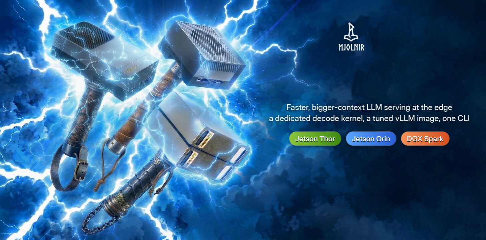
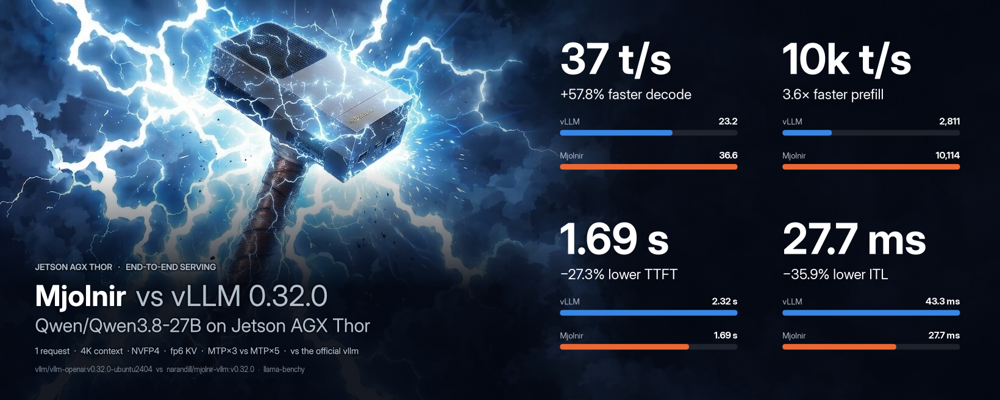
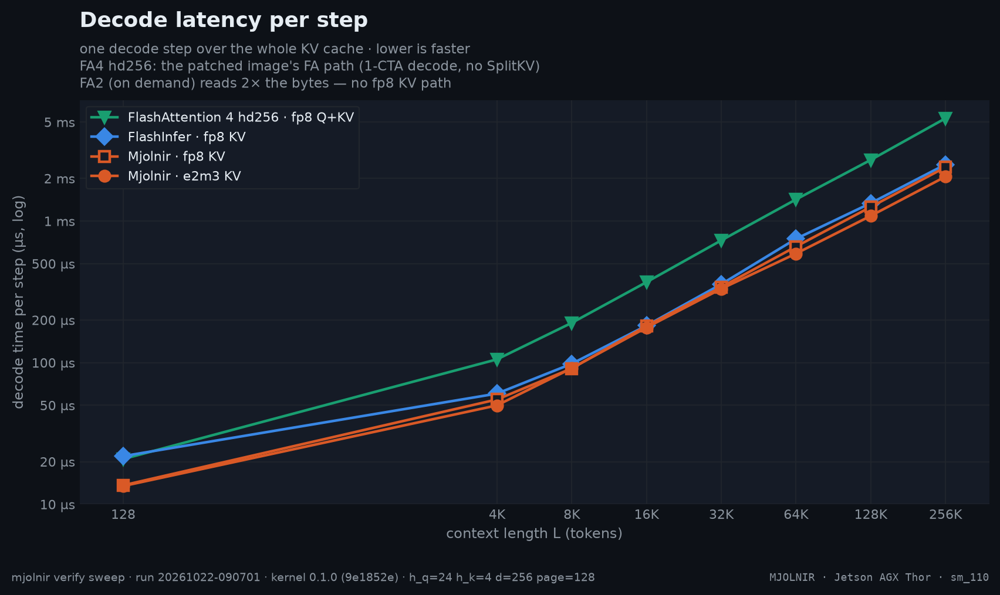
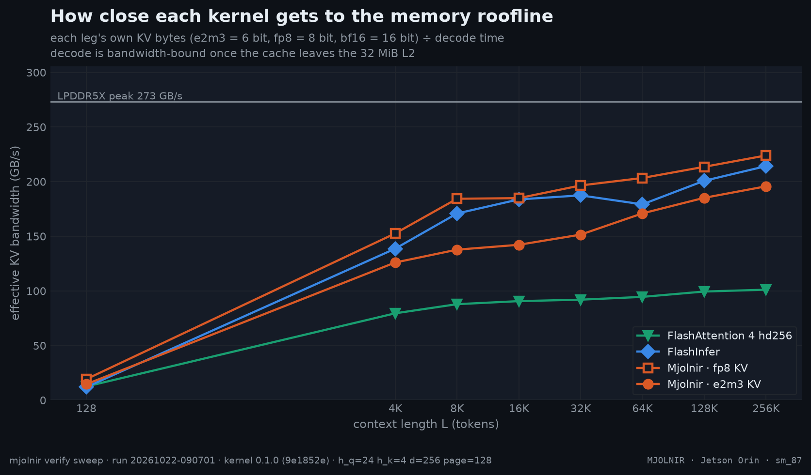
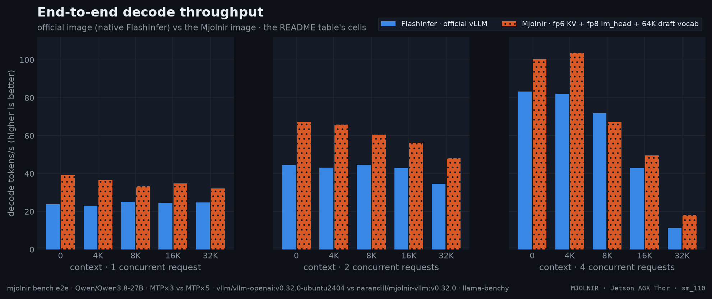
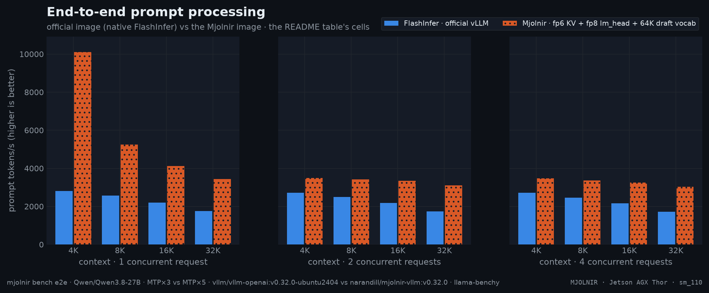

<p align="center">
  
</p>

<p align="center">
  <a href="https://pypi.org/project/mjolnir-kernel/"></a>
  <a href="https://pypi.org/project/mjolnir-cli/"></a>
  <a href="https://hub.docker.com/r/narandill/mjolnir-vllm"></a>
  
  
  <a href="https://github.com/thor-arena/mjolnir/actions/workflows/ci.yml"></a>
  
</p>

<p align="center">
  ⭐ Star us on GitHub — it motivates us a lot!
</p>

<p align="center">
  <b><em>Mjölnir</em></b> — <em>faster, bigger-context LLM serving on the <b>Jetson AGX Thor</b>: a dedicated decode kernel, a tuned vLLM image and a CLI that serves, benchmarks and documents it.</em>
</p>

<p align="center">
  <a href="#-key-features">Features</a> •
  <a href="#quickstart">Quickstart</a> •
  <a href="#jetson-thor-benchmarks">Benchmarks</a> •
  <a href="https://thor-arena.github.io/mjolnir/">Interactive charts</a> •
  <a href="#platforms">Platforms</a> •
  <a href="docs/platforms/thor/README.md#kernel">Case study</a> •
  <a href="#contributing">Contributing</a>
</p>

## What is ⚡ Mjolnir?

> *Mjölnir* is Old Norse for "Thor's hammer" — pronounced **"MYOL-nir"**.

**Mjolnir makes LLM serving on the NVIDIA Jetson AGX Thor faster and roomier**: a decode-attention kernel written for this one chip (`sm_110`, CuTe DSL on `tcgen05` tensor cores, `TMEM` and `TMA`), a 6-bit KV cache format for vLLM, a patched vLLM image that runs it, and a CLI that serves models from YAML configs and benchmarks every claim:

```bash
mjolnir serve up    # or: vllm serve <model> --attention-backend MJOLNIR
```

Every generated token re-reads the whole KV cache, so on a 273 GB/s edge GPU **decode speed is a memory problem**. Stock vLLM 0.32.0 runs FlashAttention&nbsp;2 on Thor, which has no fp8 KV path and reads twice the bytes; FlashInfer is the fastest stock option. Mjolnir is built for this exact chip: 20 SMs, 2 CTAs per SM, a 32 MiB L2, LPDDR5X.

## ⚡ Key Features

<p align="center">

</p>

<details>
<summary>How the % and × here are calculated</summary>

- **Throughput** (decode, prefill — tokens/s, higher is better): change = (Mjolnir − official) ÷ official × 100. `+57%` = 1.57× the tokens per second. On the infographic a change of +100% or more is written as the multiple Mjolnir ÷ official (`+200%` = `3×`).
- **Latency** (TTFT, ITL — milliseconds, lower is better): change = (Mjolnir − official) ÷ official × 100, so a negative value is a **latency reduction**: `−27%` = 27% fewer milliseconds. It is *not* the reciprocal speedup official ÷ Mjolnir − 1, which reads larger for the same pair.
- **Worked example** (4K context, 1 request): TTFT 2,319 → 1,686 ms: (1,686 − 2,319) ÷ 2,319 × 100 = **−27.3%** (a latency reduction of 27.3%). The reciprocal speedup would be 2,319 ÷ 1,686 = 1.38× (+37.6%) — the same measurement, a different convention.
- **Values**: the mean over the measured runs per cell (6 measured after 2 warm-ups, llama-benchy): decode = generated tokens ÷ generation time per request (summed over requests at higher concurrency), prefill = prompt tokens ÷ prompt-processing time, TTFT = time to the first content token, ITL = 1000 ÷ the per-request decode rate.
- **Colors**: green = better by at least 3%, grey = within ±3% (`E2E_NOISE_PCT`), red = worse by at least that. With speculative decoding a single decode cell moves more between runs (acceptance depends on the prompt), so repeat (`--repeat`) before reading a few-% difference.

</details><br />

<table width="100%">
  <tr>
    <td width="33%" valign="top" align="center">
      <br>
      <h3>🚀&nbsp;<a href="docs/platforms/thor/README.md#end-to-end">Faster decode</a></h3>
      <p><b>+58% tokens/s</b> vs the official vLLM image. MTP with <b>5 draft tokens</b>: an fp8 lm_head and a 64K draft vocabulary.</p>
      <br>
    </td>
    <td width="33%" valign="top" align="center">
      <br>
      <h3>⏱️&nbsp;<a href="docs/platforms/thor/README.md#end-to-end">Faster prompts</a></h3>
      <p><b>+260%</b> prefill throughput, <b>−27%</b> time to first token.</p>
      <br>
    </td>
    <td width="33%" valign="top" align="center">
      <br>
      <h3>🧠&nbsp;<a href="docs/platforms/thor/kernel/kv-cache-size.md">More context per GB</a></h3>
      <p>The 6-bit <code>e2m3</code> KV cache holds <b>+31% tokens</b> in the same memory.</p>
      <br>
    </td>
  </tr>
  <tr>
    <td width="33%" valign="top" align="center">
      <br>
      <h3>🎯&nbsp;<a href="docs/platforms/thor/kernel/accuracy.md">Same accuracy</a></h3>
      <p>Tool calling within <b>±3.6 points</b> of the stock FlashInfer fp8 baseline.</p>
      <br>
    </td>
    <td width="33%" valign="top" align="center">
      <br>
      <h3>🐳&nbsp;<a href="docker/vllm-thor/PATCHES.md">Dockerized</a></h3>
      <p>Official vLLM 0.32.0 + Mjolnir + Jetson Thor patches.</p>
      <br>
    </td>
    <td width="33%" valign="top" align="center">
      <br>
      <h3>📄&nbsp;<a href="configs/Qwen/Qwen3.8-27B/README.md">Models as Code</a></h3>
      <p>Each model is a YAML file of serve flags. <code>mjolnir serve up</code> does the rest.</p>
      <br>
    </td>
  </tr>
  <tr>
    <td width="33%" valign="top" align="center">
      <br>
      <h3>🧪&nbsp;<a href="docs/faq/fp6-kv.md">Calibrated per model</a></h3>
      <p>KV-cache scales and the draft vocabulary come from <code>mjolnir calibrate</code> and ship next to the config.</p>
      <br>
    </td>
    <td width="33%" valign="top" align="center">
      <br>
      <h3>📊&nbsp;<a href="docs/methodology/benchmarking.md">Benchmarks you can rerun</a></h3>
      <p>Kernel, serving and accuracy benches in one CLI, raw JSON for every table, chart and number on this page.</p>
      <br>
    </td>
    <td width="33%" valign="top" align="center">
      <br>
      <h3>🔬&nbsp;<a href="docs/faq/autoresearch.md">Autoresearch</a></h3>
      <p>An agent loop proposes, tests and logs kernel experiments; every try leaves data behind.</p>
      <br>
    </td>
  </tr>
</table>

## Quickstart

> [!IMPORTANT]
> Requirements: Jetson AGX Thor (JetPack 7.x, `sm_110a`), Docker + NVIDIA Container Toolkit, [`uv`](https://docs.astral.sh/uv/).

```bash
# the CLI (the package is mjolnir-cli; the command is `mjolnir`)
uv tool install mjolnir-cli

# one-time: Thor host setup for stable numbers (clocks, power mode, fans, swap)
mjolnir hw setup

# serve: Qwen3.8-27B NVFP4 on the Mjolnir image, --attention-backend MJOLNIR, port 6001
mjolnir serve up
```

```bash
curl -s http://localhost:6001/v1/chat/completions \
  -H 'content-type: application/json' \
  -d '{"model": "Qwen/Qwen3.8-27B", "messages": [{"role": "user", "content": "hi"}], "max_tokens": 64}'
```

**Use the image directly** (any model, any vLLM flags):

```bash
docker run --rm -it --gpus all --ipc host -p 8000:8000 -e VLLM_KV_CACHE_LAYOUT=HND \
  narandill/mjolnir-vllm:v0.32.0 <model> --kv-cache-dtype fp8 --attention-backend MJOLNIR
```

## Supported Hardware

Mjolnir is detection-first: the CLI resolves the host platform (never a silent
guess), every platform gets [its own page](docs/platforms/README.md) and — once
kernel results exist for its headline model — its own kernel case study.

| platform | status | kernel | host requirements |
|---|---|---|---|
| **[Jetson AGX Thor](docs/platforms/thor/README.md)** | ✅ supported | [case study](docs/platforms/thor/README.md#kernel) | JetPack 7.x |
| **[DGX Spark](docs/platforms/spark/README.md)** | ⏳ research | — | DGX OS + CUDA 13 |
| **[Jetson Orin](docs/platforms/orin/README.md)** | ⏳ research | — | JetPack 7.2.1+ (L4T 39.2.1, CUDA 13.2) |


## Supported Models

| model | [Jetson AGX Thor](docs/platforms/thor/README.md) | [DGX Spark](docs/platforms/spark/README.md) | [Jetson Orin](docs/platforms/orin/README.md) |
|---|---|---|---|
| [Qwen3.8-27B](configs/Qwen/Qwen3.8-27B/README.md) | <span title="NVFP4_MJOLNIR_E2M3_LMH8_VT64K">✅ 39.2 t/s</span> | ✅ | ✅ |
| [Qwen3.6-35B-A3B](configs/nvidia/Qwen3.6-35B-A3B/README.md) | <span title="NVFP4_MJOLNIR_E2M3">✅ 126.2 t/s</span> | — | — |


> <sub>✅ at least one of the model's configs serves natively on the platform · ❌ every config targeting it is explicitly unavailable there · — no config targets it. t/s (when shown): decode tokens/s at 1 request and 0 context — the fastest config's latest run, its name in the cell's hover title · from [benchmarks/history.jsonl](benchmarks/history.jsonl).</sub>

### Model Configs

A served model is a file, not a command line: each config is the `vllm serve` flags in YAML — model, quantization, KV-cache dtype, attention backend, speculative decoding, context length — in its own directory, `configs/<vendor>/<model>/<config>/config.yaml`; what YAML cannot carry (the fp8 lm_head, the draft vocabulary) goes into the config dir's optional `.env` sidecar of `KEY=VALUE` switches, the model's calibration files (`kv_scales/<format>.json`, `draft_vocab.json`) sit next to the config dirs, and your own configs drop into `~/.local/share/mjolnir/configs/` (same layout) to appear next to the repo's:

```bash
configs/Qwen/Qwen3.8-27B/
├── NVFP4_MJOLNIR_E2M3_LMH8_VT64K/          # attention-backend: MJOLNIR · kv-cache-dtype: fp6_e2m3 · MTP, 5 drafts
│   ├── config.yaml
│   └── .env                           # MJOLNIR_LM_HEAD=fp8 · MJOLNIR_DRAFT_VOCAB={configs}/draft_vocab.json
├── NVFP4/
│   └── config.yaml                    # the stock FlashInfer baseline, same model and limits
├── kv_scales/e2m3.json                # per-channel KV scales (mjolnir calibrate)
└── draft_vocab.json                   # the drafter's vocabulary (mjolnir calibrate --draft-vocab)
```

```bash
mjolnir model use                               # pick the model and config (interactive)
mjolnir serve up --config NVFP4_MJOLNIR_E2M3    # or serve one explicitly
```

- **One file per variant** — an A/B is two configs, not two shell histories: `mjolnir bench ab --backends NVFP4,NVFP4_MJOLNIR_E2M3_LMH8_VT64K`.
- **The same config everywhere** — `serve`, `bench`, `verify` and `calibrate` read the same YAML and `.env`, so a benchmark measures exactly what you serve.
- **Yours without forking** — drop configs into `~/.local/share/mjolnir/configs/` (same layout); they appear next to the repo's.

More: [adding a model config](docs/faq/new-model-config.md) · [the default model and config](docs/faq/default-model-quant.md) · [serving](docs/faq/serve-server.md) · [which setting wins](docs/faq/settings-precedence.md) · [fp6 KV and calibration](docs/faq/fp6-kv.md).

## Jetson Thor Benchmarks

Measured models and their per-platform serving cells: [Supported Models](#supported-models) — each model's page carries its configs, per-platform quickstart and A/B rows; each config a README with its Benchmarks section.

### Mjolnir Kernel

All kernel numbers are **ncu kernel time** (decode + split-KV merge), cold L2, base clocks, one sequence with 24 query / 4 KV heads, head dim 256, 128-token pages — the attention shape of Qwen3.8-27B — at **every context length from 128 to 256K tokens**.
Measured on a dedicated Thor: a same-run ratio repeats within ±3% between runs, see [`docs/methodology/benchmarking.md`](docs/methodology/benchmarking.md).

| leg | config | what runs | KV cache |
|---|---|---|---|
| **Mjolnir · e2m3 KV** | `NVFP4_MJOLNIR_E2M3_LMH8_VT64K` | Mjolnir kernel + fp8 lm_head + 64K MTP drafter | e2m3, HND pages |
| **Mjolnir · fp8 KV** | `NVFP4_MJOLNIR` | Mjolnir kernel | fp8 e4m3, HND pages |
| **FlashInfer · fp8 KV** | `NVFP4` | The fastest official vllm 0.32.0 FlashInfer for `sm_110` | fp8 e4m3, NHD pages |
| **FlashAttention&nbsp;2 · bf16 KV** | `NVFP4_FA2` | FA2 — stock vLLM 0.32.0's `sm_110` default | bf16 $\color{grey}\scriptstyle\text{(FA2 has no fp8 KV)}$ |



| L | FlashInfer | FA2 | Mjolnir fp8 | Mjolnir e2m3 | fp8 vs FI | e2m3 vs FI | fp8 vs FA2 | e2m3 vs FA2 |
|---|--:|--:|--:|--:|--:|--:|--:|--:|
| **128** | 22.8&nbsp;µs | 19.9&nbsp;µs | 13.6&nbsp;µs | **13.3&nbsp;µs** | $\color{#16a34a}{\mathbf{1.68\times}}$ | $\color{#16a34a}{\mathbf{1.72\times}}$ | $\color{#16a34a}{\mathbf{1.47\times}}$ | $\color{#16a34a}{\mathbf{1.50\times}}$ |
| **4K** | 61.2&nbsp;µs | 95.2&nbsp;µs | 56.5&nbsp;µs | **52.1&nbsp;µs** | $\color{#16a34a}{\mathbf{1.08\times}}$ | $\color{#16a34a}{\mathbf{1.17\times}}$ | $\color{#16a34a}{\mathbf{1.69\times}}$ | $\color{#16a34a}{\mathbf{1.83\times}}$ |
| **8K** | 96.7&nbsp;µs | 187.0&nbsp;µs | 90.1&nbsp;µs | **85.9&nbsp;µs** | $\color{#16a34a}{\mathbf{1.07\times}}$ | $\color{#16a34a}{\mathbf{1.13\times}}$ | $\color{#16a34a}{\mathbf{2.08\times}}$ | $\color{#16a34a}{\mathbf{2.18\times}}$ |
| **16K** | 180.5&nbsp;µs | 363.2&nbsp;µs | **170.4&nbsp;µs** | 174.4&nbsp;µs | $\color{#16a34a}{\mathbf{1.06\times}}$ | $\color{#16a34a}{\mathbf{1.03\times}}$ | $\color{#16a34a}{\mathbf{2.13\times}}$ | $\color{#16a34a}{\mathbf{2.08\times}}$ |
| **32K** | 379.9&nbsp;µs | 665.6&nbsp;µs | 340.8&nbsp;µs | **335.7&nbsp;µs** | $\color{#16a34a}{\mathbf{1.11\times}}$ | $\color{#16a34a}{\mathbf{1.13\times}}$ | $\color{#16a34a}{\mathbf{1.95\times}}$ | $\color{#16a34a}{\mathbf{1.98\times}}$ |
| **64K** | 785.2&nbsp;µs | 1.28&nbsp;ms | 671.0&nbsp;µs | **595.4&nbsp;µs** | $\color{#16a34a}{\mathbf{1.17\times}}$ | $\color{#16a34a}{\mathbf{1.32\times}}$ | $\color{#16a34a}{\mathbf{1.91\times}}$ | $\color{#16a34a}{\mathbf{2.15\times}}$ |
| **128K** | 1.44&nbsp;ms | 2.43&nbsp;ms | 1.28&nbsp;ms | **1.08&nbsp;ms** | $\color{#16a34a}{\mathbf{1.13\times}}$ | $\color{#16a34a}{\mathbf{1.33\times}}$ | $\color{#16a34a}{\mathbf{1.90\times}}$ | $\color{#16a34a}{\mathbf{2.26\times}}$ |
| **256K** | 2.73&nbsp;ms | 4.65&nbsp;ms | 2.40&nbsp;ms | **2.06&nbsp;ms** | $\color{#16a34a}{\mathbf{1.14\times}}$ | $\color{#16a34a}{\mathbf{1.33\times}}$ | $\color{#16a34a}{\mathbf{1.94\times}}$ | $\color{#16a34a}{\mathbf{2.26\times}}$ |
| geomean |  |  |  |  | $\color{#16a34a}{\mathbf{1.17\times}}$ | $\color{#16a34a}{\mathbf{1.26\times}}$ | $\color{#16a34a}{\mathbf{1.87\times}}$ | $\color{#16a34a}{\mathbf{2.01\times}}$ |

> <sub>Bold = fastest at that `L`. Ratio columns: baseline time ÷ this kernel's time (green = faster beyond noise).</sub>

<details>
<summary>How the % and × here are calculated</summary>

- **Time per decode step** = Nsight Compute kernel time (`gpu__time_duration`) of the decode kernel **plus** its split-KV merge kernel, at base clocks with a cold L2, median over the iterations. The reference (FlashInfer, FlashAttention 2) is measured the same way, at the same L, in the same run.
- **Speedup ×** = reference time ÷ Mjolnir time. `1.24×` means Mjolnir needs 1 ÷ 1.24 = 81% of the reference's time per step (19% less time); below 1 the reference is faster.
- **Geomean over L** = exp(mean of ln(speedup at each L)): every context length weighs the same, and one large ratio cannot dominate the way it would in an arithmetic mean.
- **Colors / "beyond the noise band"**: green = speedup ≥ 1.03, grey = within ±3%, red ≤ 0.97. ±3% (`NOISE_PCT`) is how far a same-run ratio moves between repeated runs on a dedicated Thor.

</details><br />



### E2E: Official vLLM image vs Mjolnir

Native vLLM 0.32.0 — FlashInfer, on the **official** `vllm/vllm-openai` image against the Mjolnir backend on the Mjolnir image: same model, same serving config — **speculative decoding on both sides: MTP, 3 speculative tokens vs MTP, 5 speculative tokens** — measured back to back by `mjolnir bench e2e`.





Each cell: official → **Mjolnir** and the relative change of the value — **throughput change** for decode and prefill, **latency change** for TTFT and ITL.

| context | requests | decode (t/s, ↑) $\color{grey}\scriptstyle\text{throughput change}$ | prefill (t/s, ↑) $\color{grey}\scriptstyle\text{throughput change}$ | TTFT (ms, ↓) $\color{grey}\scriptstyle\text{latency change}$ | ITL (ms, ↓) $\color{grey}\scriptstyle\text{latency change}$ |
|--:|--:|--:|--:|--:|--:|
| no ctx | 1 | 23.9 → **39.2** $\color{#16a34a}{\text{+63.9\\%}}$ | — | 820 → **604** $\color{#16a34a}{\text{−26.3\\%}}$ | 42.0 → **26.5** $\color{#16a34a}{\text{−36.8\\%}}$ |
| 4K | 1 | 23.2 → **36.6** $\color{#16a34a}{\text{+57.8\\%}}$ | 2,811 → **10,114** $\color{#16a34a}{\text{+259.8\\%}}$ | 2,319 → **1,686** $\color{#16a34a}{\text{−27.3\\%}}$ | 43.3 → **27.7** $\color{#16a34a}{\text{−35.9\\%}}$ |
| 8K | 1 | 25.3 → **33.4** $\color{#16a34a}{\text{+32.2\\%}}$ | 2,560 → **5,240** $\color{#16a34a}{\text{+104.7\\%}}$ | 4,134 → **3,034** $\color{#16a34a}{\text{−26.6\\%}}$ | 39.7 → **30.6** $\color{#16a34a}{\text{−23.1\\%}}$ |
| 16K | 1 | 24.7 → **34.8** $\color{#16a34a}{\text{+41.0\\%}}$ | 2,196 → **4,120** $\color{#16a34a}{\text{+87.6\\%}}$ | 8,526 → **5,553** $\color{#16a34a}{\text{−34.9\\%}}$ | 40.7 → **29.1** $\color{#16a34a}{\text{−28.6\\%}}$ |
| 32K | 1 | 24.8 → **32.2** $\color{#16a34a}{\text{+29.9\\%}}$ | 1,756 → **3,433** $\color{#16a34a}{\text{+95.5\\%}}$ | 19,964 → **11,222** $\color{#16a34a}{\text{−43.8\\%}}$ | 40.6 → **31.3** $\color{#16a34a}{\text{−23.1\\%}}$ |
| no ctx | 2 | 44.5 → **67.1** $\color{#16a34a}{\text{+50.6\\%}}$ | — | 1,443 → **1,065** $\color{#16a34a}{\text{−26.2\\%}}$ | 42.5 → **27.9** $\color{#16a34a}{\text{−34.4\\%}}$ |
| 4K | 2 | 43.2 → **65.9** $\color{#16a34a}{\text{+52.4\\%}}$ | 2,707 → **3,497** $\color{#16a34a}{\text{+29.2\\%}}$ | 4,478 → **3,453** $\color{#16a34a}{\text{−22.9\\%}}$ | 44.2 → **28.1** $\color{#16a34a}{\text{−36.4\\%}}$ |
| 8K | 2 | 44.6 → **60.7** $\color{#16a34a}{\text{+35.9\\%}}$ | 2,499 → **3,422** $\color{#16a34a}{\text{+37.0\\%}}$ | 8,135 → **5,803** $\color{#16a34a}{\text{−28.7\\%}}$ | 42.6 → **30.3** $\color{#16a34a}{\text{−29.0\\%}}$ |
| 16K | 2 | 43.1 → **56.2** $\color{#16a34a}{\text{+30.5\\%}}$ | 2,180 → **3,345** $\color{#16a34a}{\text{+53.4\\%}}$ | 16,847 → **10,896** $\color{#16a34a}{\text{−35.3\\%}}$ | 43.7 → **32.2** $\color{#16a34a}{\text{−26.3\\%}}$ |
| 32K | 2 | 34.6 → **48.1** $\color{#16a34a}{\text{+39.0\\%}}$ | 1,743 → **3,108** $\color{#16a34a}{\text{+78.3\\%}}$ | 39,253 → **21,777** $\color{#16a34a}{\text{−44.5\\%}}$ | 49.8 → **35.5** $\color{#16a34a}{\text{−28.7\\%}}$ |
| no ctx | 4 | 83.3 → **100.2** $\color{#16a34a}{\text{+20.3\\%}}$ | — | 2,789 → **2,302** $\color{#16a34a}{\text{−17.5\\%}}$ | 43.3 → **32.3** $\color{#16a34a}{\text{−25.5\\%}}$ |
| 4K | 4 | 82.0 → **103.6** $\color{#16a34a}{\text{+26.4\\%}}$ | 2,710 → **3,470** $\color{#16a34a}{\text{+28.0\\%}}$ | 9,035 → **6,895** $\color{#16a34a}{\text{−23.7\\%}}$ | 45.8 → **32.8** $\color{#16a34a}{\text{−28.3\\%}}$ |
| 8K | 4 | 71.9 → **67.1** $\color{#dc2626}{\text{−6.7\\%}}$ | 2,461 → **3,372** $\color{#16a34a}{\text{+37.0\\%}}$ | 16,323 → **11,213** $\color{#16a34a}{\text{−31.3\\%}}$ | 46.7 → **39.9** $\color{#16a34a}{\text{−14.6\\%}}$ |
| 16K | 4 | 42.9 → **49.7** $\color{#16a34a}{\text{+15.8\\%}}$ | 2,158 → **3,246** $\color{#16a34a}{\text{+50.4\\%}}$ | 32,532 → **20,887** $\color{#16a34a}{\text{−35.8\\%}}$ | 58.5 → **48.9** $\color{#16a34a}{\text{−16.4\\%}}$ |
| 32K | 4 | 11.4 → **18.2** $\color{#16a34a}{\text{+58.9\\%}}$ | 1,726 → **3,030** $\color{#16a34a}{\text{+75.5\\%}}$ | 66,221 → **36,571** $\color{#16a34a}{\text{−44.8\\%}}$ | 161.7 → **109.7** $\color{#16a34a}{\text{−32.1\\%}}$ |

> <sub>official: `vllm/vllm-openai:v0.32.0-ubuntu2404 · NVFP4 (FlashInfer)` · Mjolnir: `narandill/mjolnir-vllm:v0.32.0 · NVFP4_MJOLNIR_E2M3_LMH8_VT64K (Mjolnir fp6 KV + fp8 lm_head + 64K draft vocab)` · TTFT = time to first token; ITL = inter-token latency (1000 / per-request decode rate) · from [`benchmarks/history.jsonl`](benchmarks/history.jsonl).</sub>

<details>
<summary>How the % and × here are calculated</summary>

- **Throughput** (decode, prefill — tokens/s, higher is better): change = (Mjolnir − official) ÷ official × 100. `+57%` = 1.57× the tokens per second. On the infographic a change of +100% or more is written as the multiple Mjolnir ÷ official (`+200%` = `3×`).
- **Latency** (TTFT, ITL — milliseconds, lower is better): change = (Mjolnir − official) ÷ official × 100, so a negative value is a **latency reduction**: `−27%` = 27% fewer milliseconds. It is *not* the reciprocal speedup official ÷ Mjolnir − 1, which reads larger for the same pair.
- **Worked example** (4K context, 1 request): TTFT 2,319 → 1,686 ms: (1,686 − 2,319) ÷ 2,319 × 100 = **−27.3%** (a latency reduction of 27.3%). The reciprocal speedup would be 2,319 ÷ 1,686 = 1.38× (+37.6%) — the same measurement, a different convention.
- **Values**: the mean over the measured runs per cell (6 measured after 2 warm-ups, llama-benchy): decode = generated tokens ÷ generation time per request (summed over requests at higher concurrency), prefill = prompt tokens ÷ prompt-processing time, TTFT = time to the first content token, ITL = 1000 ÷ the per-request decode rate.
- **Colors**: green = better by at least 3%, grey = within ±3% (`E2E_NOISE_PCT`), red = worse by at least that. With speculative decoding a single decode cell moves more between runs (acceptance depends on the prompt), so repeat (`--repeat`) before reading a few-% difference.

</details><br />

## How the kernel works

A decode step is one query token per sequence against the whole KV cache: at 64K tokens that is 128 MiB of K and V per layer, read once. The design goal is to keep the LPDDR5X busy and everything else out of the way.

| | design choice | why on Thor |
|---|---|---|
| ⚙️ | **Warp-specialized `tcgen05` pipeline** — a TMA warp streams K/V pages through an SMEM ring, an MMA warp runs `S = QKᵀ` and `O += PV` on the tensor cores into TMEM, softmax warpgroups read S from TMEM and write P | the tensor cores and TMEM keep scores off the register file; the TMA engine walks the page table so the SMs never issue loads |
| 📐 | **Occupancy-pinned split-KV** — every step fills exactly 2 CTAs × 20 SMs; long sequences split into chunks, a small reduction kernel merges them | one full wave at every L; a fixed padded grid replays under full CUDA graphs |
| 🧊 | **fp8 everything** — Q quantized per (sequence, KV head) on the fly, fp8 KV, P stored as e4m3 | one MMA kind, no conversion warps, half the KV bytes of bf16 |
| 🗂️ | **Head-major (HND) pages** — each KV head's page is one contiguous block | longer DRAM bursts per TMA box: [hndsweep](docs/platforms/thor/kernel/hndsweep.md) |
| 🪶 | **6-bit KV (e2m3) read directly by the MMA** (`kind::f8f6f4`, TMA unpacks to byte containers) | 25% fewer bytes at near-fp8 accuracy: [kvfmt](docs/platforms/thor/kernel/kvfmt.md), [quant](docs/platforms/thor/kernel/quant.md), [capacity](docs/platforms/thor/kernel/kv-cache-size.md) |
| 🚿 | **L2 evict-first on K/V loads**, a 2-stage ring for fp6 | KV is streamed once; keep L2 for the rest of the model: [ring](docs/platforms/thor/kernel/ring.md), [ab](docs/platforms/thor/kernel/ab.md) |

The full walkthrough — one chapter per experiment, each with its chart, data table and the command that reproduces it — is the **[kernel case study](docs/platforms/thor/README.md#kernel)** (thor; every platform with raws carries the same index on its own page):

| chapter | question it answers |
|---|---|
| [Correctness matrix](docs/platforms/thor/kernel/correctness.md)  | kernel vs the bit-faithful emulator: every layout, format, page size, q_len, Q dtype |
| [Headline L-sweep](docs/platforms/thor/kernel/sweep.md)  | Mjolnir vs FlashInfer vs FlashAttention 2, ncu kernel time at every L |
| [Head-major pages](docs/platforms/thor/kernel/hndsweep.md)  | FlashInfer on NHD and HND vs Mjolnir on HND — is HND a kernel win or a layout win? |
| [KV layouts and formats](docs/platforms/thor/kernel/kvfmt.md)  | fp8 / fp6 / fp4 / nvfp4 KV on NHD / interleaved / HND pages (ncu + wall clock) |
| [KV format accuracy](docs/platforms/thor/kernel/quant.md)  | relative L2 error of each KV format vs unquantized KV, at every L |
| [KV cache capacity](docs/platforms/thor/kernel/kv-cache-size.md)  | tokens of KV each config fits (vLLM's startup sizing), and the concurrency that buys per context |
| [Speculative decoding](docs/platforms/thor/kernel/spec.md)  | MTP acceptance per draft position and decode t/s for 1-N draft tokens, per config — the best draft count |
| [Full profiles per KV format](docs/platforms/thor/kernel/fp6prof.md)  | full ncu profiles: L2 sectors vs requests vs time, warp stalls, per KV format |
| [KV ring depth](docs/platforms/thor/kernel/ring.md)  | TMA→MMA ring depth (--kv_stages) sweep at every L |
| [L2 prefetch](docs/platforms/thor/kernel/prefetch.md)  | TMA L2 prefetch distance (--l2_prefetch) sweep |
| [Programmatic dependent launch](docs/platforms/thor/kernel/pdl.md)  | PDL on/off wall clock (decode overlaps the previous kernel; merge launches early) |
| [Flag A/B](docs/platforms/thor/kernel/ab.md)  | any harness flag sets, ncu + wall clock (default: evict-first x PDL) |
| [Accuracy](docs/platforms/thor/kernel/accuracy.md)  | Does a serving config keep the model's answers? Tool calling (standard + Hard Mode), GSM8K / MMLU / IFEval on demand |

## What's in the Mjolnir image

[`narandill/mjolnir-vllm:v0.32.0`](https://hub.docker.com/r/narandill/mjolnir-vllm) = the official `vllm/vllm-openai:v0.32.0` image + the `mjolnir-kernel` package + a hand-adapted [patch stack for Thor](docker/vllm-thor/PATCHES.md). Tags follow the upstream vLLM version.

| patch | what it does |
|---|---|
| **`thor-mjolnir-attention-backend`** | adds `MJOLNIR` to vLLM's attention-backend enum → `--attention-backend MJOLNIR` |
| [#50885](https://github.com/vllm-project/vllm/pull/50885) | FULL cudagraph mode for speculative decode on the FlashInfer-native backend |
| [#49652](https://github.com/vllm-project/vllm/pull/49652) | draft-decode cudagraphs under dynamic speculative decoding |
| [#54165](https://github.com/vllm-project/vllm/pull/54165) | Mamba/GDN `copy_kv_cache` restore under speculative decode |
| [#55519](https://github.com/vllm-project/vllm/pull/55519) | no false-positive KV-reuse warning on the GDN hybrid |
| Thor `sm_110` patches | GDN prefill enablement, FA4 hd256 fp8-KV + 1-CTA decode, fused draft-decode plan advance, DSpark non-causal draft cudagraph, draft-cudagraph shape gate, the `MJOLNIR` backend name + FA4 fallback default, the `fp6_e2m3` KV cache dtype |

## The CLI

```bash
mjolnir                                      # help + next steps
mjolnir serve [up|down|status|logs]          # the vLLM container on the Mjolnir image
mjolnir model | image                        # pick the active model config / vLLM image
mjolnir calibrate [--draft-vocab]            # fp6 KV-cache scales (and the drafter's vocabulary) per model
mjolnir verify <stage>                       # kernel correctness + ncu benchmarks -> benchmarks/raw/verify
mjolnir verify bench | all                   # every benchmark stage (all = + correctness)
mjolnir verify show | list                   # re-print saved results
mjolnir bench e2e | compare                  # official vLLM image vs Mjolnir: decode, prefill, TTFT, ITL
mjolnir bench perf | ab | accuracy           # serving benchmarks, A/B legs, model quality
mjolnir plot --readme [--site DIR]           # charts + README + docs (+ the interactive site) from raw data
mjolnir autoresearch [init|run|ledger]       # the autonomous kernel-research loop
mjolnir gate | hw | litellm | perses         # clean-window gate, Thor host setup, side stacks
```

Every command, sub-command and option, with defaults: **[the CLI reference](docs/cli.md)** — generated from the commands themselves; `mjolnir <command> --help` prints the same.

## Contributing

**Mjolnir** is meant to be a **community case study**: every claim is reproducible with one command, and every experiment — kept or discarded — leaves raw data behind.

- **Run the benchmarks on your Thor** — `mjolnir verify bench` writes JSON you can open a PR with; the README, docs and charts re-render from it.
- **Try a kernel idea** — change `src/mjolnir/mjolnir/t5_decode.py`, prove it with `mjolnir verify correctness` and an `mjolnir verify ab --variants ...` run, and send the raw result with the PR.
- **Let the agents try** — `mjolnir autoresearch run` drives an OpenCode research loop (web + arXiv research, implementation, debugging) where every experiment is logged on [the ledger](research/README.md).
- Guidelines: [CONTRIBUTING.md](.github/CONTRIBUTING.md) · [docs index](docs/README.md).

## Repository layout

```
├── src/
│   ├── mjolnir/                the kernel package (PyPI: mjolnir-kernel, import `mjolnir`)
│   │   └── mjolnir/            t5_decode.py (kernel + harness) · runner.py · backend.py
│   └── mjolnir-cli/            the CLI package (PyPI: mjolnir-cli, command `mjolnir`)
│       └── mjolnir_cli/        verify/ · charts.py · readme.py · autoresearch.py · serve/bench/...
├── docker/vllm-thor/           the image: Dockerfile, patches/, apply/verify gates, PATCHES.md
├── configs/                    model configs (NVFP4_MJOLNIR_E2M3_LMH8_VT64K default, NVFP4 = FlashInfer, NVFP4_FA2)
├── benchmarks/raw/verify/      raw verify results (one JSON per stage run) — the charts' only input
├── assets/benchmarks/          generated charts (`*.png`)
├── docs/platforms/             per-platform pages + the kernel case studies (rendered)
├── research/                   the autoresearch program + ledger
└── .opencode/                  OpenCode agents (autoresearch, researchers, engineer, debugger)
```

## Security

The served API is unauthenticated; expose it deliberately. See [SECURITY.md](.github/SECURITY.md).

## License

Mjolnir is open source under the [Apache License 2.0](LICENSE) — the license of vLLM and FlashInfer, which it builds on — with one exception: the kernel, [`src/mjolnir/mjolnir/t5_decode.py`](src/mjolnir/mjolnir/t5_decode.py), is derived from an NVIDIA CUTLASS CuTe DSL example and stays under that example's **BSD-3-Clause** license, with NVIDIA's notice kept at the top of the file.

### Third-party
Third-party code, the vLLM / FlashInfer / FlashAttention files the image patches, and what the [`narandill/mjolnir-vllm`](https://hub.docker.com/r/narandill/mjolnir-vllm) image redistributes are listed in [NOTICE](NOTICE).

---

<br />

<p align="center"><sub>⚡ Mjölnir — built on and for the edge ❤️.</sub></p>
<p align="center"><sub>Generated from <code>README.md.j2</code> by <code>mjolnir plot --readme</code>.</sub></p>
