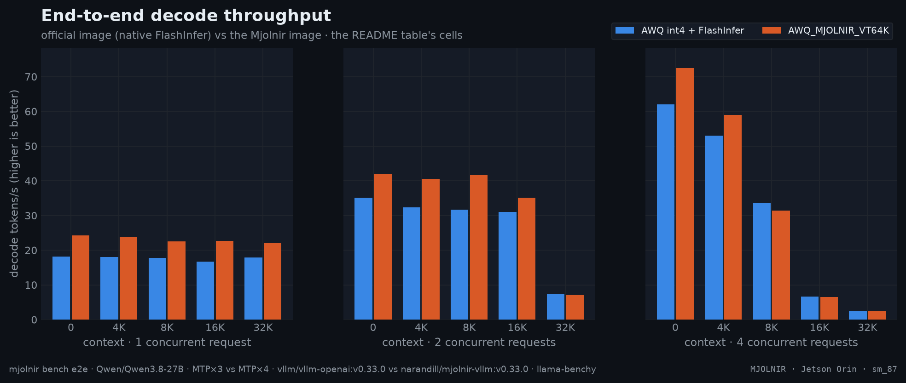

# Qwen/Qwen3.8-27B

`AWQ_MJOLNIR_VT64K` — compressed-tensors · serving profile. Flags live in
[config.yaml](config.yaml), platform deltas in [platforms/](platforms/), Mjolnir env switches in `.env`; every number on
this page derives from the committed raw data ([history](../../../../benchmarks/history.jsonl), [raw](../../../../benchmarks/raw/)). The model's [README](../README.md).

## Serving profile

| parameter | Orin |
|---|---|
| Checkpoint | `twolven/Qwen3.8-27B-abliterated-AWQ-MTP` |
| Format | compressed-tensors |
| Max context | 190K |
| Max concurrency | 5 |
| Prefill chunk | 8K |
| KV cache | fp8 · skip: sliding_window |
| Attention backend | MJOLNIR |
| Spec decode | MTP ×4 |
| GPU memory util | 0.72 |
| Parsing | qwen3_coder / qwen3 |

## Serve

**Jetson Orin**
```bash
mjolnir serve up --config AWQ_MJOLNIR_VT64K
```
Availability: ✅ Marlin serves W4A16 (GPTQ/AWQ) from compute capability 7.5 up — the bandwidth-optimized classic edge format.

Explore the numbers in [the interactive charts](https://GoBrrr-ai.github.io/mjolnir/#config=AWQ_MJOLNIR_VT64K).

## Benchmarks
### End to end (AWQ_FLASHINFER vs AWQ_MJOLNIR_VT64K, 1 request · 32K context)

| metric | official `AWQ_FLASHINFER` | Mjolnir `AWQ_MJOLNIR_VT64K` | change |
|---|--:|--:|--:|
| decode (t/s) | 17.9 | 21.9 | +22.4% |
| prefill (t/s) | 394 | 391 | −0.7% |
| TTFT (ms) | 88,466 | 89,204 | +0.8% |
| ITL (ms) | 56.1 | 45.7 | −18.5% |



<details>
<summary>How the % and × here are calculated</summary>

- **Throughput** (decode, prefill — tokens/s, higher is better): change = (Mjolnir − official) ÷ official × 100. `+57%` = 1.57× the tokens per second. On the infographic a change of +100% or more is written as the multiple Mjolnir ÷ official (`+200%` = `3×`).
- **Latency** (TTFT, ITL — milliseconds, lower is better): change = (Mjolnir − official) ÷ official × 100, so a negative value is a **latency reduction**: `−27%` = 27% fewer milliseconds. It is *not* the reciprocal speedup official ÷ Mjolnir − 1, which reads larger for the same pair.
- **Values**: the mean over the measured runs per cell (6 measured after 2 warm-ups, llama-benchy): decode = generated tokens ÷ generation time per request (summed over requests at higher concurrency), prefill = prompt tokens ÷ prompt-processing time, TTFT = time to the first content token, ITL = 1000 ÷ the per-request decode rate.
- **Colors**: green = better by at least 3%, grey = within ±3% (`E2E_NOISE_PCT`), red = worse by at least that. With speculative decoding a single decode cell moves more between runs (acceptance depends on the prompt), so repeat (`--repeat`) before reading a few-% difference.

</details><br />

<details>
<summary>Speculative decoding</summary>

AWQ_MJOLNIR_VT64K, 1 request: best with **6 drafts** — 26.3 t/s per request, 4.01 tokens per step. AWQ_MJOLNIR_VT64K, 4 requests: best with **4 drafts** — 23.4 t/s per request, 3.49 tokens per step.

<details>
<summary>How the % and × here are calculated</summary>

- **tokens/step** = 1 + accepted draft tokens ÷ verify steps, from vLLM's speculative-decoding counters read before and after the block; **accept @i** = the share of verify steps whose i-th draft was accepted.
- **decode t/s per request** = (generated tokens − 1) ÷ (time of the last token − time of the first token); **aggregate t/s** = all generated tokens ÷ the block's wall time.
- ★ = the draft count with the highest decode t/s for that config and concurrency.

</details><br />
</details>

<details>
<summary>KV capacity</summary>

**Mjolnir · fp8 KV + 64K draft vocab**: **570,343 tokens**, 2.9 requests at the full 190K context (vLLM's own estimate).

<details>
<summary>How the % and × here are calculated</summary>

- **KV tokens** and KV memory come from vLLM's own startup log ("GPU KV cache size", "Available KV cache memory") for the same model and memory budget.
- **vs first** = this row's KV tokens ÷ the first row's (`1.33×` = 33% more tokens).
- **fits @ L** = ⌊KV tokens ÷ (L + 2,048 prompt + 128 generated)⌋ — whole requests of the e2e bench's shape that fit at once (`max-num-seqs` ignored).

</details><br />
</details>

The per-stage kernel numbers — findings, charts and raw provenance — live in the [Jetson Orin kernel case study](../../../../docs/platforms/orin/README.md#-kernel), one chapter per verify stage.
