# NVFP4_MJOLNIR — benchmarks

`Qwen/Qwen3.8-27B` — every number on this page is computed from the committed
raw data ([`benchmarks/history.jsonl`](../../../../benchmarks/history.jsonl) and
[`benchmarks/raw/`](../../../../benchmarks/raw/)); regenerate with
`mjolnir plot --readme`. One section per platform the overlays put this
config on; the kernel stages are the platform's headline-model runs
(Qwen/Qwen3.8-27B).

## Jetson AGX Thor

### Speculative decoding

Mjolnir · fp8 KV, 1 request: best with **3 drafts** — 25.9 t/s per request, 3.02 tokens per step. Mjolnir · fp8 KV, 4 requests: best with **4 drafts** — 24.3 t/s per request, 3.41 tokens per step.

How the % and × here are calculated

- **tokens/step** = 1 + accepted draft tokens ÷ verify steps, from vLLM's speculative-decoding counters read before and after the block; **accept @i** = the share of verify steps whose i-th draft was accepted.
- **decode t/s per request** = (generated tokens − 1) ÷ (time of the last token − time of the first token); **aggregate t/s** = all generated tokens ÷ the block's wall time.
- ★ = the draft count with the highest decode t/s for that config and concurrency.

 

### KV capacity

**Mjolnir · fp8 KV**: **1,998,478 tokens**, 9.8 requests at the full 200K context (vLLM's own estimate).

How the % and × here are calculated

- **KV tokens** and KV memory come from vLLM's own startup log ("GPU KV cache size", "Available KV cache memory") for the same model and memory budget.
- **vs first** = this row's KV tokens ÷ the first row's (`1.33×` = 33% more tokens).
- **fits @ L** = ⌊KV tokens ÷ (L + 2,048 prompt + 128 generated)⌋ — whole requests of the e2e bench's shape that fit at once (`max-num-seqs` ignored).

 

### Model quality (per suite)

| suite | score |
|---|--:|
| Tool calls | 95.7 |
| Hard Mode | 78.6 |

How the % and × here are calculated

- **Score** = points ÷ maximum points × 100, each scenario 2 (pass), 1 (partial) or 0 (fail); GSM8K / MMLU = accuracy in %; IFEval = prompt-level accuracy in %.
- **(±)** = this row's score − the baseline row's score, in percentage **points**, not a relative change: 86.5 vs 88.0 is −1.5 points (a relative change would be −1.7%).
- **n** = runs averaged (`--trials`); **completion** = the share of scenarios the endpoint answered — compare rows only at equal completion.

 

### Kernel stages (Qwen/Qwen3.8-27B — the platform's case-study scope)

**Headline L-sweep**

- **Mjolnir (e2m3 KV, HND)** vs FlashInfer (fp8 KV, NHD): geomean **1.26×**, from 1.03× (L=16K) to 1.72× (L=128); faster beyond the ±3% noise band at 8 of 8 context lengths.
- **Mjolnir (fp8 KV, HND)** vs FlashInfer (fp8 KV, NHD): geomean **1.17×**, from 1.06× (L=16K) to 1.68× (L=128); faster beyond the ±3% noise band at 8 of 8 context lengths.
- **FlashAttention 2 (bf16 KV)** vs FlashInfer (fp8 KV, NHD): geomean **0.62×**, from 0.50× (L=16K) to 1.15× (L=128); faster beyond the ±3% noise band at 1 of 8 context lengths.

How the % and × here are calculated

- **Time per decode step** = Nsight Compute kernel time (`gpu__time_duration`) of the decode kernel **plus** its split-KV merge kernel, at base clocks with a cold L2, median over the iterations. The reference (FlashInfer, FlashAttention 2) is measured the same way, at the same L, in the same run.
- **Speedup ×** = reference time ÷ Mjolnir time. `1.24×` means Mjolnir needs 1 ÷ 1.24 = 81% of the reference's time per step (19% less time); below 1 the reference is faster.
- **Geomean over L** = exp(mean of ln(speedup at each L)): every context length weighs the same, and one large ratio cannot dominate the way it would in an arithmetic mean.
- **Colors / "beyond the noise band"**: green = speedup ≥ 1.03, grey = within ±3%, red ≤ 0.97. ±3% (`NOISE_PCT`) is how far a same-run ratio moves between repeated runs on a dedicated Thor.

 

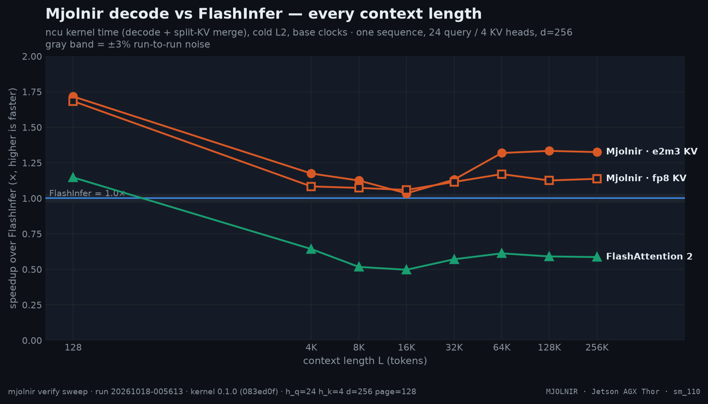
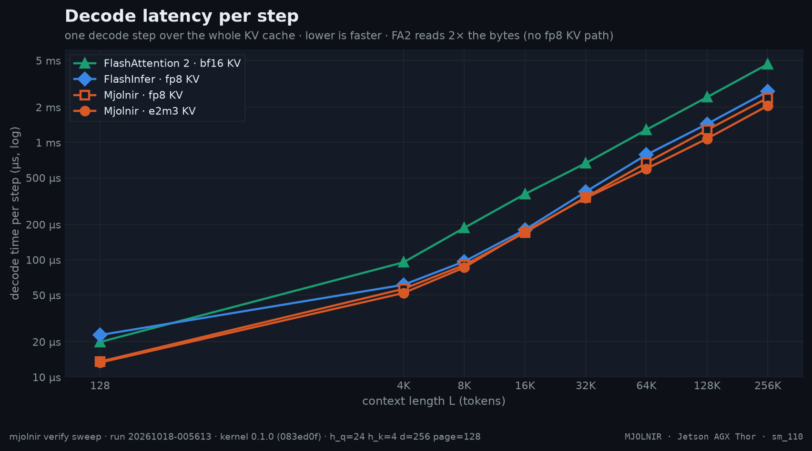
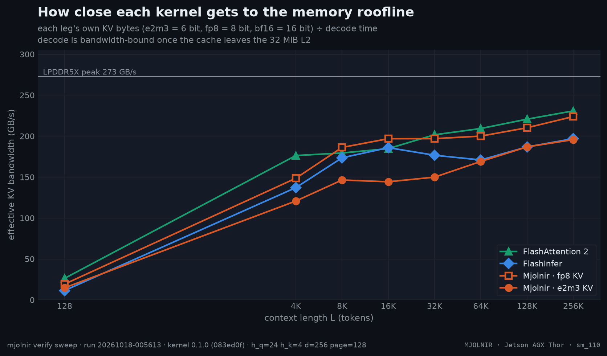

**Head-major pages**

- **Mjolnir (fp8 KV, HND)** vs FlashInfer (fp8 KV, NHD): geomean **1.15×**, from 1.00× (L=16K) to 1.65× (L=128); faster beyond the ±3% noise band at 7 of 8 context lengths.
- **FlashInfer (fp8 KV, HND)** vs FlashInfer (fp8 KV, NHD): geomean **1.04×**, from 0.99× (L=128) to 1.08× (L=64K); faster beyond the ±3% noise band at 4 of 8 context lengths.

How the % and × here are calculated

- **Time per decode step** = Nsight Compute kernel time (`gpu__time_duration`) of the decode kernel **plus** its split-KV merge kernel, at base clocks with a cold L2, median over the iterations. The reference (FlashInfer, FlashAttention 2) is measured the same way, at the same L, in the same run.
- **Speedup ×** = reference time ÷ Mjolnir time. `1.24×` means Mjolnir needs 1 ÷ 1.24 = 81% of the reference's time per step (19% less time); below 1 the reference is faster.
- **Geomean over L** = exp(mean of ln(speedup at each L)): every context length weighs the same, and one large ratio cannot dominate the way it would in an arithmetic mean.
- **Colors / "beyond the noise band"**: green = speedup ≥ 1.03, grey = within ±3%, red ≤ 0.97. ±3% (`NOISE_PCT`) is how far a same-run ratio moves between repeated runs on a dedicated Thor.

 

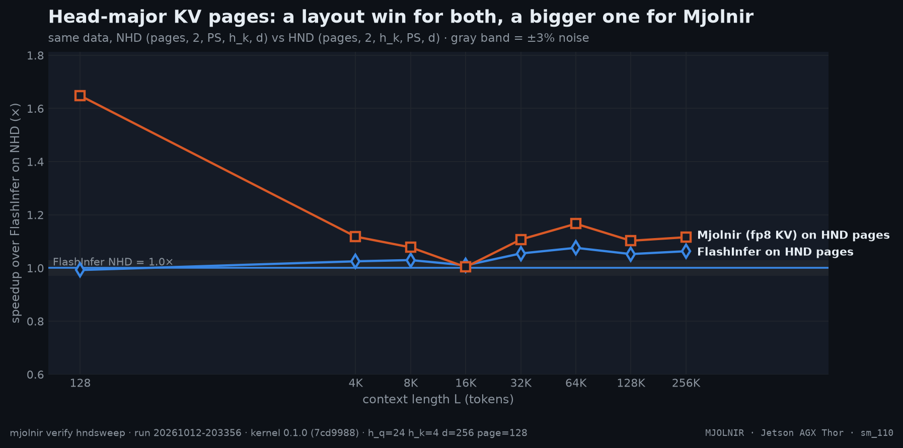

**KV layouts and formats**

- Fastest variant at the most context lengths: **`e2m1-hnd`** (7 of 8).
- Best geomean vs FlashInfer: **`e2m1-hnd`** (1.92×); worst: `nvfp4-hnd` (0.57×).

How the % and × here are calculated

- Each cell = **reference time ÷ variant time** (Nsight Compute kernel time, decode + merge, base clocks, cold L2, same run, same L). `1.10×` = the variant needs 1 ÷ 1.10 = 91% of the reference's time; below 1 it is slower.
- **geomean** = exp(mean of ln(ratio)) over the context lengths; **bold** = the fastest variant at that L.
- Green ≥ 1.03, grey within ±3% (`NOISE_PCT`, the run-to-run spread of a same-run ratio), red ≤ 0.97.

 

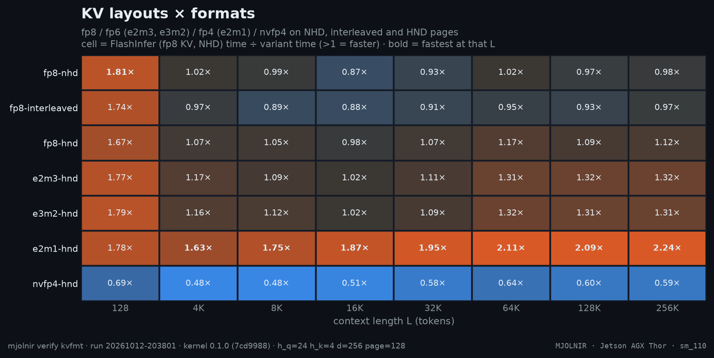
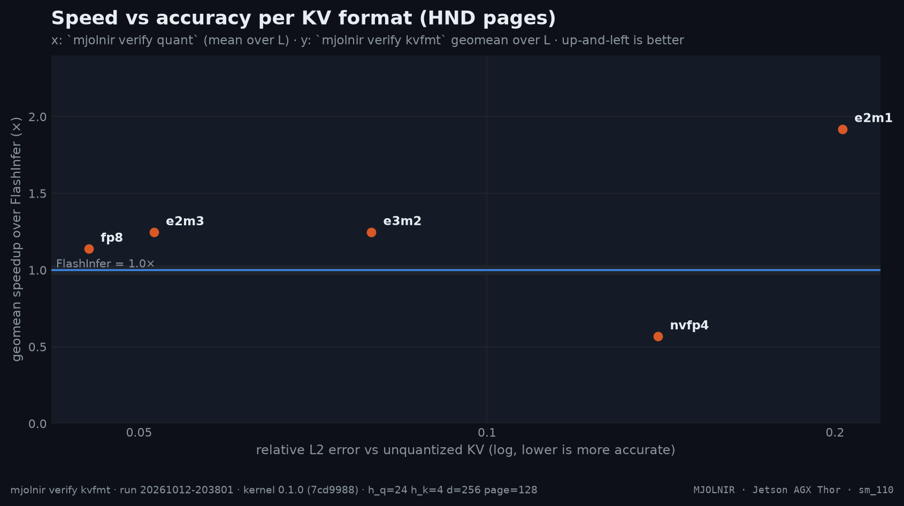

**KV format accuracy**

- `fp8`: mean relative L2 error **0.045** (1.0× fp8's 0.045).
- `e2m3`: mean relative L2 error **0.052** (1.1× fp8's 0.045).
- `e3m2`: mean relative L2 error **0.079** (1.8× fp8's 0.045).
- `nvfp4`: mean relative L2 error **0.141** (3.1× fp8's 0.045).
- `e2m1`: mean relative L2 error **0.203** (4.5× fp8's 0.045).

How the % and × here are calculated

- **Time per decode step** = Nsight Compute kernel time (`gpu__time_duration`) of the decode kernel **plus** its split-KV merge kernel, at base clocks with a cold L2, median over the iterations. The reference (FlashInfer, FlashAttention 2) is measured the same way, at the same L, in the same run.
- **Speedup ×** = reference time ÷ Mjolnir time. `1.24×` means Mjolnir needs 1 ÷ 1.24 = 81% of the reference's time per step (19% less time); below 1 the reference is faster.
- **Geomean over L** = exp(mean of ln(speedup at each L)): every context length weighs the same, and one large ratio cannot dominate the way it would in an arithmetic mean.
- **Colors / "beyond the noise band"**: green = speedup ≥ 1.03, grey = within ±3%, red ≤ 0.97. ±3% (`NOISE_PCT`) is how far a same-run ratio moves between repeated runs on a dedicated Thor.

 

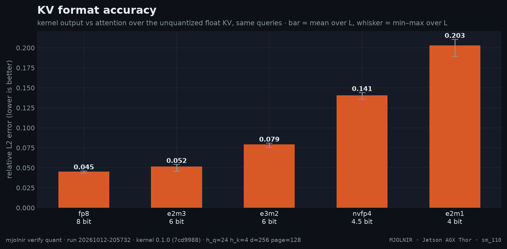

**KV ring depth**

- Fastest variant at the most context lengths: **`stages=5`** (2 of 8).
- Best geomean vs FlashInfer: **`stages=2`** (1.25×); worst: `stages=6` (1.16×).

How the % and × here are calculated

- Each cell = **reference time ÷ variant time** (Nsight Compute kernel time, decode + merge, base clocks, cold L2, same run, same L). `1.10×` = the variant needs 1 ÷ 1.10 = 91% of the reference's time; below 1 it is slower.
- **geomean** = exp(mean of ln(ratio)) over the context lengths; **bold** = the fastest variant at that L.
- Green ≥ 1.03, grey within ±3% (`NOISE_PCT`, the run-to-run spread of a same-run ratio), red ≤ 0.97.

 

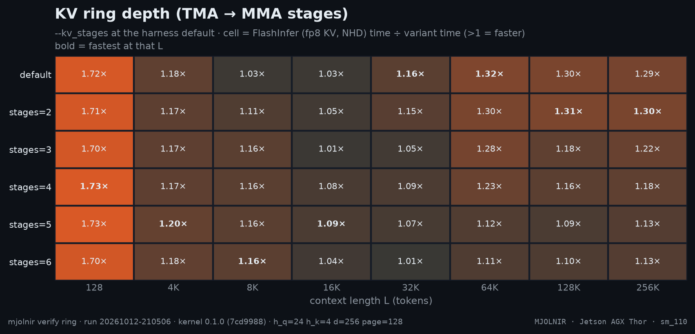

**L2 prefetch**

- Fastest variant at the most context lengths: **`prefetch=0`** (7 of 8).
- Best geomean vs FlashInfer: **`prefetch=0`** (1.14×); worst: `prefetch=4` (1.02×).

How the % and × here are calculated

- Each cell = **reference time ÷ variant time** (Nsight Compute kernel time, decode + merge, base clocks, cold L2, same run, same L). `1.10×` = the variant needs 1 ÷ 1.10 = 91% of the reference's time; below 1 it is slower.
- **geomean** = exp(mean of ln(ratio)) over the context lengths; **bold** = the fastest variant at that L.
- Green ≥ 1.03, grey within ±3% (`NOISE_PCT`, the run-to-run spread of a same-run ratio), red ≤ 0.97.

 

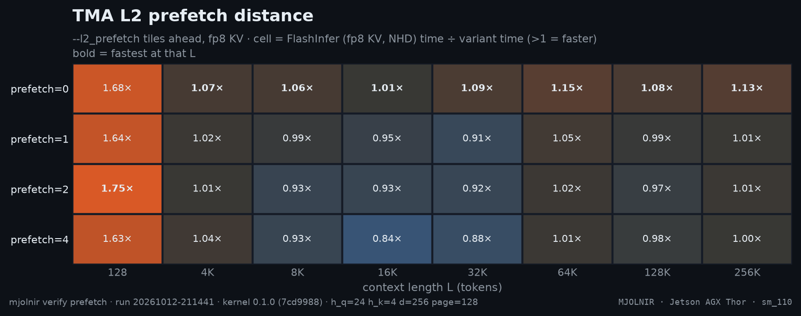

**Flag A/B**

- Fastest variant at the most context lengths: **`pdl`** (3 of 8).
- Best geomean vs FlashInfer: **`evict`** (1.28×); worst: `base` (1.26×).
- All variants sit within 2% of each other — inside the noise band.

How the % and × here are calculated

- Each cell = **reference time ÷ variant time** (Nsight Compute kernel time, decode + merge, base clocks, cold L2, same run, same L). `1.10×` = the variant needs 1 ÷ 1.10 = 91% of the reference's time; below 1 it is slower.
- **geomean** = exp(mean of ln(ratio)) over the context lengths; **bold** = the fastest variant at that L.
- Green ≥ 1.03, grey within ±3% (`NOISE_PCT`, the run-to-run spread of a same-run ratio), red ≤ 0.97.

 

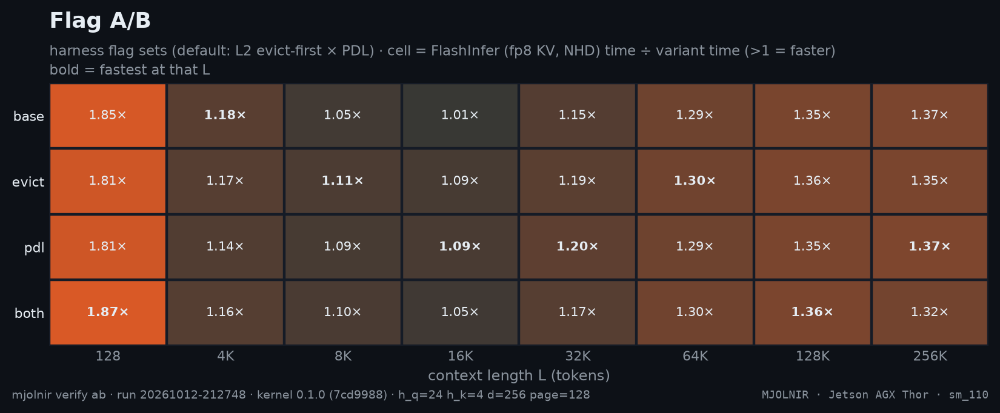

**Programmatic dependent launch**

- 12 of 16 measurements move by less than the ±3% noise band (range -3.4% … +5.7%).

How the % and × here are calculated

- **%** = (time with PDL − time without PDL) ÷ time without PDL × 100, harness median per L, both measured back to back in the same run. Negative = PDL saves time.
- Green ≤ −3%, red ≥ +3%, grey within ±3% (`NOISE_PCT`).

 

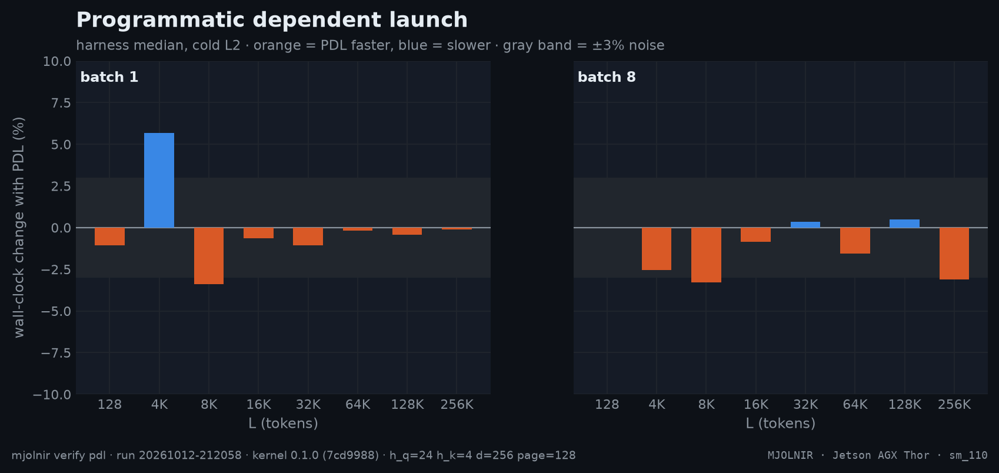

**Full profiles per KV format**

- `e2m3-hnd`: kernel time **0.90×** the baseline for 0.75× the bytes — 40% of the byte saving becomes speed (mean over L).
- `e2m1-hnd`: kernel time **0.61×** the baseline for 0.50× the bytes — 78% of the byte saving becomes speed (mean over L).

How the % and × here are calculated

- **time ratio** = this row's Nsight Compute kernel time ÷ the first row's at the same L; **L2 bytes ratio** = L2 read sectors ÷ the first row's; **ideal** = this row's KV bits ÷ the first row's — the ratio a purely bandwidth-bound kernel would show.
- **bytes / L2 request** = 32 B × L2 read sectors ÷ L2 read requests.

 

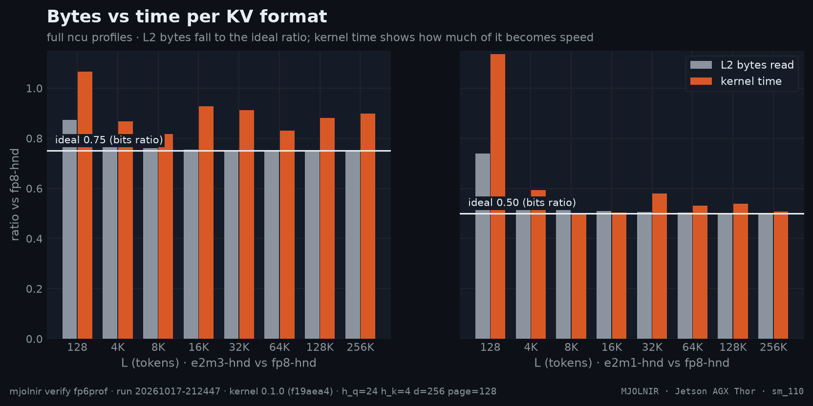

**KV cache capacity**

- **Mjolnir · fp6 e2m3 KV** holds **2,645,421 tokens**, +31% vs official vLLM · FlashInfer · fp8 KV (2,022,204).
- **Mjolnir · fp6 e2m3 KV** holds **2,645,421 tokens**, +32% vs Mjolnir · fp8 KV (1,998,478).
- **Mjolnir · fp6 e2m3 KV** holds **2,645,421 tokens**, +1% vs Mjolnir · fp6 e2m3 KV + fp8 lm_head + 64K draft vocab (2,608,065).
- official vLLM · FlashInfer · fp8 KV: 9.9 requests at the full 200K context (vLLM's own estimate).
- Mjolnir · fp8 KV: 9.8 requests at the full 200K context (vLLM's own estimate).
- Mjolnir · fp6 e2m3 KV: 12.9 requests at the full 200K context (vLLM's own estimate).
- Mjolnir · fp6 e2m3 KV + fp8 lm_head + 64K draft vocab: 12.7 requests at the full 200K context (vLLM's own estimate).

How the % and × here are calculated

- **KV tokens** and KV memory come from vLLM's own startup log ("GPU KV cache size", "Available KV cache memory") for the same model and memory budget.
- **vs first** = this row's KV tokens ÷ the first row's (`1.33×` = 33% more tokens).
- **fits @ L** = ⌊KV tokens ÷ (L + 2,048 prompt + 128 generated)⌋ — whole requests of the e2e bench's shape that fit at once (`max-num-seqs` ignored).

 

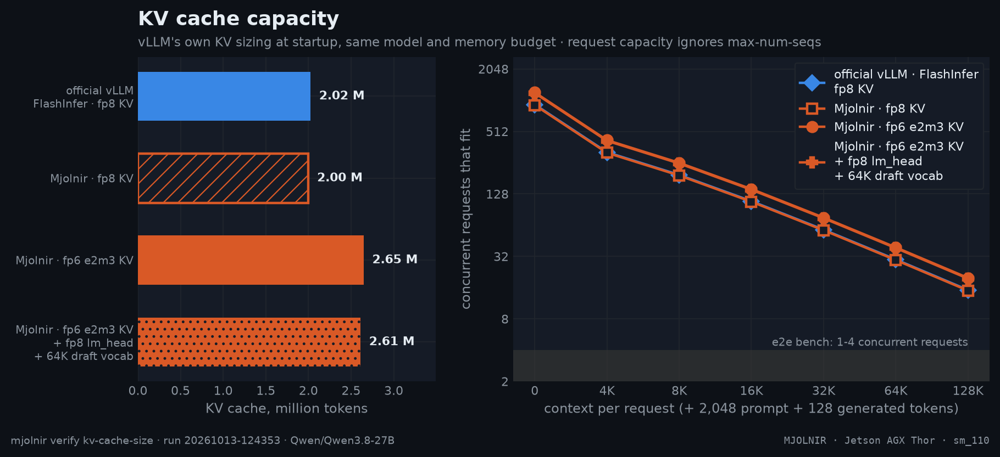

**Speculative decoding**

- official vLLM · FlashInfer fp8, 1 request: best with **4 drafts** — 25.8 t/s per request, 3.46 tokens per step, +4.9% vs 3 drafts.
- official vLLM · FlashInfer fp8, 4 requests: best with **4 drafts** — 24.8 t/s per request, 3.50 tokens per step, +0.9% vs 3 drafts.
- Mjolnir · fp8 KV, 1 request: best with **3 drafts** — 25.9 t/s per request, 3.02 tokens per step.
- Mjolnir · fp8 KV, 4 requests: best with **4 drafts** — 24.3 t/s per request, 3.41 tokens per step, +4.5% vs 3 drafts.
- Mjolnir · fp6 KV, 1 request: best with **3 drafts** — 25.7 t/s per request, 3.04 tokens per step.
- Mjolnir · fp6 KV, 4 requests: best with **4 drafts** — 24.5 t/s per request, 3.47 tokens per step, +5.8% vs 3 drafts.
- Mjolnir · fp6 KV + fp8 lm_head + 64K draft vocab, 1 request: best with **6 drafts** — 39.8 t/s per request, 3.94 tokens per step, +6.4% vs 3 drafts.
- Mjolnir · fp6 KV + fp8 lm_head + 64K draft vocab, 4 requests: best with **5 drafts** — 34.0 t/s per request, 3.70 tokens per step, +7.1% vs 3 drafts.
- Acceptance, 3 drafts, 1 request: Mjolnir · fp8 KV 3.02 vs official 3.08 tokens/step (-2.0%) — same prompts, temperature 0.
- Acceptance, 3 drafts, 1 request: Mjolnir · fp6 KV 3.04 vs official 3.08 tokens/step (-1.3%) — same prompts, temperature 0.
- Acceptance, 3 drafts, 1 request: Mjolnir · fp6 KV + fp8 lm_head + 64K draft vocab 3.06 vs official 3.08 tokens/step (-0.7%) — same prompts, temperature 0.

How the % and × here are calculated

- **tokens/step** = 1 + accepted draft tokens ÷ verify steps, from vLLM's speculative-decoding counters read before and after the block; **accept @i** = the share of verify steps whose i-th draft was accepted.
- **decode t/s per request** = (generated tokens − 1) ÷ (time of the last token − time of the first token); **aggregate t/s** = all generated tokens ÷ the block's wall time.
- ★ = the draft count with the highest decode t/s for that config and concurrency.

 

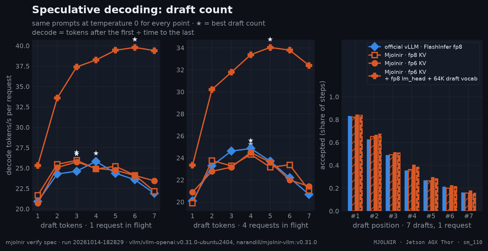

Raw provenance: [`benchmarks/raw/verify/sweep/20261018-005613.json`](../../../../benchmarks/raw/verify/sweep/20261018-005613.json) · [`benchmarks/raw/verify/hndsweep/20261012-203356.json`](../../../../benchmarks/raw/verify/hndsweep/20261012-203356.json) · [`benchmarks/raw/verify/kvfmt/20261012-203801.json`](../../../../benchmarks/raw/verify/kvfmt/20261012-203801.json) · [`benchmarks/raw/verify/quant/20261012-205732.json`](../../../../benchmarks/raw/verify/quant/20261012-205732.json) · [`benchmarks/raw/verify/ring/20261012-210506.json`](../../../../benchmarks/raw/verify/ring/20261012-210506.json) · [`benchmarks/raw/verify/prefetch/20261012-211441.json`](../../../../benchmarks/raw/verify/prefetch/20261012-211441.json) · [`benchmarks/raw/verify/ab/20261012-212748.json`](../../../../benchmarks/raw/verify/ab/20261012-212748.json) · [`benchmarks/raw/verify/pdl/20261012-212058.json`](../../../../benchmarks/raw/verify/pdl/20261012-212058.json) · [`benchmarks/raw/verify/fp6prof/20261017-212447.json`](../../../../benchmarks/raw/verify/fp6prof/20261017-212447.json) · [`benchmarks/raw/verify/kv-cache-size/20261013-124353.json`](../../../../benchmarks/raw/verify/kv-cache-size/20261013-124353.json) · [`benchmarks/raw/verify/spec/20261014-182829.json`](../../../../benchmarks/raw/verify/spec/20261014-182829.json)

[The model's README](../README.md) · [the platform pages](../../../../docs/platforms/README.md) · [the interactive charts](https://thor-arena.github.io/mjolnir/#config=NVFP4_MJOLNIR)
