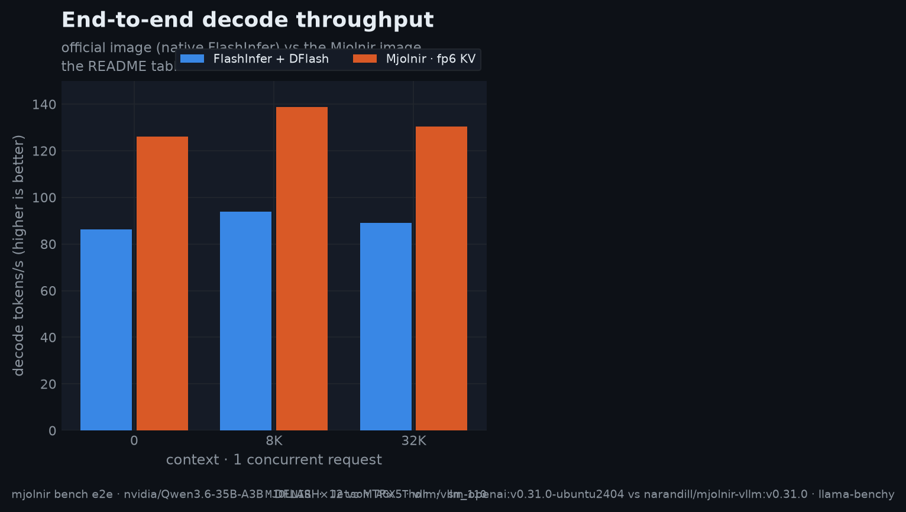

# nvidia/Qwen3.6-35B-A3B

`NVFP4_DFLASH` — FlashInfer + DFlash · serving profile. Flags live in
[config.yaml](config.yaml), Mjolnir env switches in `.env`; every number on
this page derives from the committed raw data ([history](../../../../benchmarks/history.jsonl), [raw](../../../../benchmarks/raw/)). The model's [README](../README.md).

## Serving profile

| parameter | Thor |
|---|---|
| Checkpoint | `nvidia/Qwen3.6-35B-A3B-NVFP4` |
| Served as | `nvidia/Qwen3.6-35B-A3B-NVFP4` |
| Format | FlashInfer + DFlash |
| Max context | 256K |
| Max concurrency | 1 |
| KV cache | fp8 |
| Attention backend | FLASHINFER |
| Spec decode | DFLASH ×12 |
| GPU memory util | 0.45 |
| Parsing | qwen3_coder / qwen3 |

## Serve

**Jetson AGX Thor**
```bash
mjolnir serve up --config NVFP4_DFLASH
```
Availability: ✅ The FlashInfer backend serves fp8 KV across its whole sm_80 to sm_121 support window.

Explore the numbers in [the interactive charts](https://GoBrrr-ai.github.io/mjolnir/#config=NVFP4_DFLASH).

## Benchmarks
### End to end (NVFP4_DFLASH vs NVFP4_MJOLNIR_E2M3, 1 request · 128K context)

| metric | official `NVFP4_DFLASH` | Mjolnir `NVFP4_MJOLNIR_E2M3` | change |
|---|--:|--:|--:|
| decode (t/s) | 70.4 | 104.2 | +48.0% |
| prefill (t/s) | 1,665 | 3,908 | +134.8% |
| TTFT (ms) | 80,052 | 34,676 | −56.7% |
| ITL (ms) | 14.3 | 9.8 | −31.8% |



<details>
<summary>How the % and × here are calculated</summary>

- **Throughput** (decode, prefill — tokens/s, higher is better): change = (Mjolnir − official) ÷ official × 100. `+57%` = 1.57× the tokens per second. On the infographic a change of +100% or more is written as the multiple Mjolnir ÷ official (`+200%` = `3×`).
- **Latency** (TTFT, ITL — milliseconds, lower is better): change = (Mjolnir − official) ÷ official × 100, so a negative value is a **latency reduction**: `−27%` = 27% fewer milliseconds. It is *not* the reciprocal speedup official ÷ Mjolnir − 1, which reads larger for the same pair.
- **Values**: the mean over the measured runs per cell (6 measured after 2 warm-ups, llama-benchy): decode = generated tokens ÷ generation time per request (summed over requests at higher concurrency), prefill = prompt tokens ÷ prompt-processing time, TTFT = time to the first content token, ITL = 1000 ÷ the per-request decode rate.
- **Colors**: green = better by at least 3%, grey = within ±3% (`E2E_NOISE_PCT`), red = worse by at least that. With speculative decoding a single decode cell moves more between runs (acceptance depends on the prompt), so repeat (`--repeat`) before reading a few-% difference.

</details><br />

<details>
<summary>Model quality (per suite)</summary>

| suite | score |
|---|--:|
| Tool calls | 90.6 |
| Hard Mode | 76.8 |

<details>
<summary>How the % and × here are calculated</summary>

- **Score** = points ÷ maximum points × 100, each scenario 2 (pass), 1 (partial) or 0 (fail); GSM8K / MMLU = accuracy in %; IFEval = prompt-level accuracy in %.
- **(±)** = this row's score − the baseline row's score, in percentage **points**, not a relative change: 86.5 vs 88.0 is −1.5 points (a relative change would be −1.7%).
- **n** = runs averaged (`--trials`); **completion** = the share of scenarios the endpoint answered — compare rows only at equal completion.

</details><br />
</details>

The per-stage kernel numbers — findings, charts and raw provenance — live in the [Jetson AGX Thor kernel case study](../../../../docs/platforms/thor/README.md#kernel), one chapter per verify stage.
