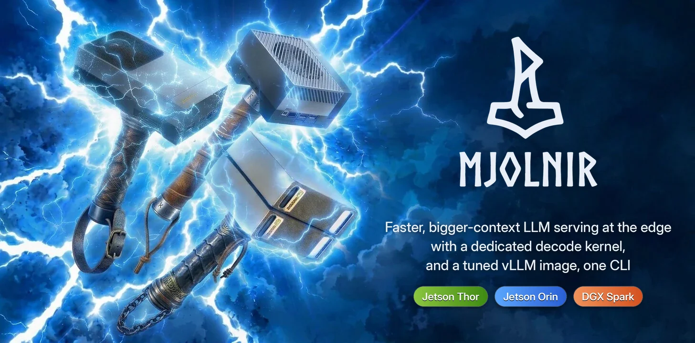
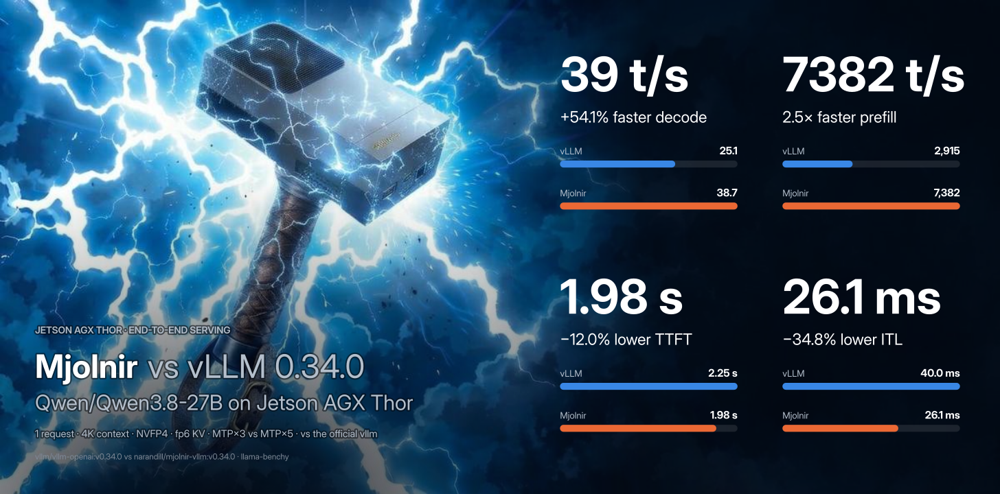

[](https://pypi.org/project/mjolnir-kernel/)
[](https://pypi.org/project/mjolnir-cli/)
[](https://hub.docker.com/r/narandill/mjolnir-vllm)
[](https://github.com/GoBrrr-ai/mjolnir)
[](https://github.com/GoBrrr-ai/mjolnir#supported-hardware)
[](https://github.com/GoBrrr-ai/mjolnir/blob/main/LICENSE)

**Mjolnir** — faster, bigger-context LLM serving on **Jetson Tegra**: one image, a decode kernel per platform — Thor (`sm_110`) and Orin (`sm_87`) — and a CLI that serves, benchmarks and documents every claim.

[GitHub](https://github.com/GoBrrr-ai/mjolnir) · [Platforms](https://github.com/GoBrrr-ai/mjolnir/blob/main/docs/platforms/README.md) · [Case study](https://github.com/GoBrrr-ai/mjolnir/blob/main/docs/platforms/thor/README.md) · [Interactive charts](https://GoBrrr-ai.github.io/mjolnir/) · [mjolnir-cli on PyPI](https://pypi.org/project/mjolnir-cli/) · [mjolnir-kernel on PyPI](https://pypi.org/project/mjolnir-kernel/)



## ⚡ What's inside this image

`narandill/mjolnir-vllm` is the official **vLLM ** aarch64 image (CUDA 13.0, Ubuntu 24.04) with a small overlay on top — everything else is upstream vLLM:

- **A decode-attention kernel per platform** — the CuTe DSL `tcgen05` kernel for Jetson Thor (`sm_110`) and the `mma.sync` kernel for Jetson Orin (`sm_87`), each with a 6-bit `e2m3` KV-cache format and multi-token (MTP) verify; the family resolves at runtime from the device. Registered as the `MJOLNIR` attention backend; the `vllm.general_plugins` entry point also makes `--attention-backend CUSTOM` work.
- **A hand-adapted stack of vLLM and FlashInfer patches** — the fixes hybrid GDN/Mamba spec-decode needs on these boards; applied and verified at build time, the build fails when a patch stops applying — the list is below. The Thor-only hunks are probe-gated and inert on other devices.
- **The per-platform environment** — the arch flags and the per-arch JIT environment for Triton / FlashInfer (`mjolnir serve` exports them), so the prebuilt wheels run on JetPack 7.x as-is.

The Mjolnir kernel takes over single-token and speculative-verify steps; prefill and mixed steps run on the platform's attention fallback (FlashAttention 4 on Thor, FlashInfer on Orin).


## ⚡ Patches

`1` hand-adapted vLLM PR fixes and `8` Thor-/FlashInfer-authored patches, applied to the installed vLLM `` and FlashInfer at build time (the sm_110-only ones probe-gate themselves inert on other devices):

| File | PR | What it fixes |
|------|----|---------------|
| `50885-flashinfer-full-cudagraph.patch` | [#50885](https://github.com/vllm-project/vllm/pull/50885) (closed unmerged) | Capture **FULL** decode cudagraphs for spec-decode on the FlashInfer **native** (non-trtllm) path — uniform multi-token verify batches. **0.33.0 slim-down:** the base now carries the wrapper plumbing itself (`_get_decode_wrapper(batch_size, use_cudagraph, q_len_per_req)`, the tuple-keyed `_decode_wrappers_cudagraph`, `fast_plan_decode` threading `q_len_per_req` into FlashInfer's `fast_decode_plan` — which since 0.7.2 plans uniform multi-token queries on the fa2 tensor-core backend). What remains Thor-side is the *policy*: the `flashinfer_supports_uniform_multi_token_decode()` probe (does the installed FI accept `q_len_per_req`), the `supports_spec_as_decode` OR-term and the `get_cudagraph_support` UNIFORM_BATCH grant (both gated on the probe + non-trtllm + causal) and the `build()` per-request `num_input_tokens`/`q_len_per_req` computation (previously fa2-native-only, pre-SM90). Without it sm_110 spec decode still falls to PIECEWISE graphs. Unchanged on 0.34 (`get_cudagraph_support` is byte-identical 0.33→0.34). |
| `thor-fused-draft-decode-fi-native-update.patch` | — (Thor-authored) | **Implement `update_draft_decode_metadata` for the FlashInfer backend** so the spec-decode loop can use the **fused multi-step draft decode** instead of the "rebuild attention metadata between draft steps" fallback. The upstream contract is a `pass` stub for trtllm-gen (0.33.0: one trtllm-gen decode build serves every step); the patch ORs `supports_draft_decode_metadata_update` with the FI-native full-cudagraph, single-rank, non-DCP, non-trtllm case and replaces the stub with `_advance_fi_decode_plan_kernel`, which re-derives the FI decode plan (`paged_kv_indptr`/`last_page_len`/`page_indices`) **on the GPU** from the advancing `seq_lens` + block table — the same formula as `build()`, but capture-safe (no host sync, no D2D index copy) so it replays correctly inside the draft CUDA graph. Pays off only at **K ≥ 3** (MTP3 / DSpark K≥2); a deliberate no-op at K=2. |
| `thor-fused-draft-t5-plan-refresh.patch` | — (Thor-authored) | **Rebuild the draft attention metadata on the fused FULL-graph replay path** so host-side per-cycle plan state survives graph replay. `_fused_multi_step_decode` returns before `_build_uniform_attn_metadata` when `cg_mode == FULL`, so any builder that computes per-cycle host state in `build()` — Mjolnir's T5 split-KV **work plan** (`work_buf`/`nsplit_buf`, host-computed from seq_lens) — stays **baked at capture-time seq_lens**: every replayed draft step attends a truncated context and MTP acceptance collapses beyond position 0 (measured 2026-10-18: K=5 acceptance 4.1→**2.04**; eager or `MJOLNIR_ATTN_FUSED_DRAFT=0` healthy). The fix re-runs the build before `run_fullgraph` — the returned metadata is unused (the graph replays baked launches), but the side effect refreshes the persistent plan buffers the graph reads. |
| `thor-dspark-draft-fi-noncausal-cudagraph.patch` | — (Thor-authored) | **Capture the DSpark non-causal multi-token draft under a FULL CUDA graph** instead of running the draft eagerly. A non-causal drafter (DSpark) routes its draft through the FI *prefill* wrapper — the FI *decode* wrapper cannot express non-causal multi-token (its fa2 kernel is block-causal only for `q_len_per_req > 1`). In cuda-graph mode that prefill wrapper freezes its batch size at creation and reads its KV plan from **persistent** buffers, so one wrapper per captured batch size is needed (`_noncausal_prefill_wrappers_cudagraph`, mirroring `_decode_wrappers_cudagraph`); the draft plans eagerly outside the captured graph and the captured `run()` replays safely across ragged re-plans. Adds the `_get_noncausal_prefill_wrapper_cudagraph` factory, grants a non-causal `UNIFORM_BATCH` in `get_cudagraph_support` (gated on a multi-token drafter, non-SM12x, single-rank DCP), and dispatches the prefill batch to the cudagraph wrapper in `build()`. Lands **after** 50885 (its `get_cudagraph_support` hunk is diffed against 50885's grant). Most bump-fragile patch — see below. |
| `thor-draft-cg-gate-sm110.patch` | — (Thor-authored) | **Shape-gate the DSpark draft's FULL cudagraph replay on sm_110 (the c1 fix).** The forensics showed the graphed draft is 7–16% *slower* than the eager draft at N=1 (replay overhead eats the launch savings on a tiny 5-layer draft). The gate routes per-step draft batches below `VLLM_THOR_DRAFT_CG_MIN_BATCH` requests (default **2**; min 1, where 1 = today's behavior) through the **existing eager fallback** via the dispatch's `need_eager` channel — no new eager path, no capture-logic changes. sm_110 only: off sm_110 the decision helper is a structural no-op (always CG). One-shot `THOR draft-CG gate: …` log lines; any gate evaluation error degrades to the CG behavior (logged once). Probe-gated, inert on non-sm_110, default N=1→eager. |
| `thor-fa4-hd256-1cta-decode-sm110.patch` | — (Thor-authored) | **RETIRED at the 0.35.0rc0.dev nightly (see above).** The 1CTA decode carve-out for the FA4 hd256 kernel (the v11 "N-2 decode" workstream).** Decode-shaped hd256 calls — `max_seqlen_q <= 8` (decode M 1..8, incl. MTP verify; prefill is 1024+), non-local, dense or paged-128 TMA (the kernel's only legal paged mode) — now OR into the `hd256_use_2cta` carve-out in `vllm_flash_attn/cute/interface.py` (one hunk), so the kernel drops its 2CTA cluster to a single CTA (`cluster (1,1)`, `CtaGroup.ONE`): a **1.56× decode win** at L=8192 M=1 (clean micro-bench 2CTA 323 µs → 1CTA 207 µs), with 1CTA == 2CTA == fp32-ref within fp8 tolerance; the kernel file is untouched and the 2CTA prefill path is unchanged (separate compile keys coexist in one process). |
| `thor-inkling2-sm110-conv-mix.patch` | — (Thor-authored) | **Inkling 2 Mini on sm_110.** The nightly wheel's prebuilt inkling2 kernels (`csrc/inkling2`: `conv_mix`, `allreduce_conv_mix`, `seq_parallel`) carry no sm_110 cubins — CMake's `INKLING2_KERNEL_ARCHS` is `9.0a;10.0f;10.3f` only (upstream #69167 open) — so the first `torch.ops._C.inkling2_conv_mix` launch dies with "no kernel image … for the device" at the memory-profiling run. The patch routes the TP1 conv/mix through the stock SM12x torch-compose fallback (`short_conv` + `attn_res`, both Triton → sm_110 JIT) on Thor, env-reversible: `MJOLNIR_INKLING2_CONV_MIX_NATIVE=1` forces the native kernels once the base carries sm_110 cubins. The TP>1 all-reduce/seq-conv kernels stay native-only — TP1 configs until #69167 lands in a pin. Everything else in the model is Triton/gluon or FlashInfer-JIT and compiles for sm_110 at runtime. |
| `thor-inkling2-fa4-rel-sm110.patch` | — (Thor-authored) | **Inkling 2's own attention + ViT on sm_110 FA4.** The model owns attention (`Inkling2AttentionBackend`; per-token sinks, sheared rel-bias) and gates its FA4 path on `use_sm100_kernels()` — the else-branch is the Triton-sm90 pair, fine on sm90, dead-slow assumption on Thor. Patched to run the tml-FA4 sheared-bias kernel on sm_110 too (runtime-compiled `sm_110a`, probed OK dense+paged), env-off `MJOLNIR_INKLING2_FA4_REL=0`. The **vision encoder** (`vision.py`) hardcoded `fa_version = 2 if family(120) else 3` — and the wheel's `_vllm_fa2_C`/`_vllm_fa3_C` carry **sm_80/sm_90a cubins only** (FA2's PTX also needs a newer driver JIT than the 580/CUDA-13.0 stack accepts), so the encoder-cache profiling run died with `no kernel image` (`hopper/flash_fwd_launch_template.h:172`) right after weight load — the crash that looked like a target/draft backend bug. Routed to the same tml gate. The **plain `FLASH_ATTN` legs** (DSpark draft, pass-cache attn) get a stock `get_flash_attn_version` sm_110 branch in the backend patch's fa_utils hunk (`major == 11 → FA4`, env-off `MJOLNIR_FA2_ON_SM110=1`; stock majors 9/10 only → FA2). The `_vllm_fa*` sm_110 rebuild was probed and parked (scratch `.fa110/`, not shipped): the fork pins FA2 gencode `8.0+PTX` / FA3 `9.0a` per-file, so an ext rebuild is a fork-level change — the cutedsl/tml runtime paths need no ext. |
| `thor-inkling2-fp8kv-sm110.patch` | — (Thor-authored) | **Unit-scale fp8 (E4M3) KV on sm_110.** The model's fp8 path is complete and arch-generic — the storage view (`_split_kv_cache`), the triton decode's `cvt.rn.f16x2.e4m3x2` PTX arm — but the dtype gate accepts `auto/bfloat16` off SM12x. Patch adds the family(110) arm, env-off `MJOLNIR_INKLING2_FP8KV=0`; config `NVFP4_FP8KV`. Motivation: the M0 profile — the decode window is attention-bound at depth (23.5% of the step at 128K, `_rel_attention` the top kernel) and fp8 halves the KV read. The tml FA4 path is same-dtype-asserted: the wrapper converts the fp8 cache on entry (no-op bf16). |

The full inventory with the deep-dive sections: [PATCHES.md](https://github.com/GoBrrr-ai/mjolnir/blob/main/docker/vllm-thor/PATCHES.md)


## ⚡ Quickstart

> Runs on Jetson AGX Thor (JetPack 7.x, `sm_110`) and Jetson Orin (JetPack 7.2.1+, `sm_87`) with Docker + the NVIDIA Container Toolkit — the kernel family resolves from the device at runtime.

```bash
docker pull narandill/mjolnir-vllm

# any model, any vLLM flags — Mjolnir serves the decode:
docker run --rm -it --gpus all --ipc host -p 8000:8000 -e VLLM_KV_CACHE_LAYOUT=HND \
  narandill/mjolnir-vllm <model> --kv-cache-dtype fp8 --attention-backend MJOLNIR
```

The recommended path is the **mjolnir CLI** ([`mjolnir-cli`](https://pypi.org/project/mjolnir-cli/) on PyPI) on the host: `uv tool install mjolnir-cli && mjolnir serve up` manages this image and serves the model from a YAML config — and `mjolnir bench` / `mjolnir verify` reproduce every number in the [case study](https://github.com/GoBrrr-ai/mjolnir/blob/main/docs/platforms/thor/README.md).

## ⚡ Tags

Tags follow the **upstream vLLM version** of the base image, not the kernel's:

- `v` — the current image (re-pushed on every rebuild)
- `v-<sha>` — the same build, immutable per commit
- `latest` — moved by each release

A kernel release is rebuilt into the same `v` tag; the kernel version rides along as the `io.github.thor-arena.mjolnir.kernel-version` image label.

## ⚡ More

- [Repo README](https://github.com/GoBrrr-ai/mjolnir) — benchmarks and docs
- [Kernel case study](https://github.com/GoBrrr-ai/mjolnir/blob/main/docs/platforms/thor/README.md) — how the kernel works
- [Interactive charts](https://GoBrrr-ai.github.io/mjolnir/) — every chart, live data
- [Patch inventory](https://github.com/GoBrrr-ai/mjolnir/blob/main/docker/vllm-thor/PATCHES.md) — what is patched, and why
