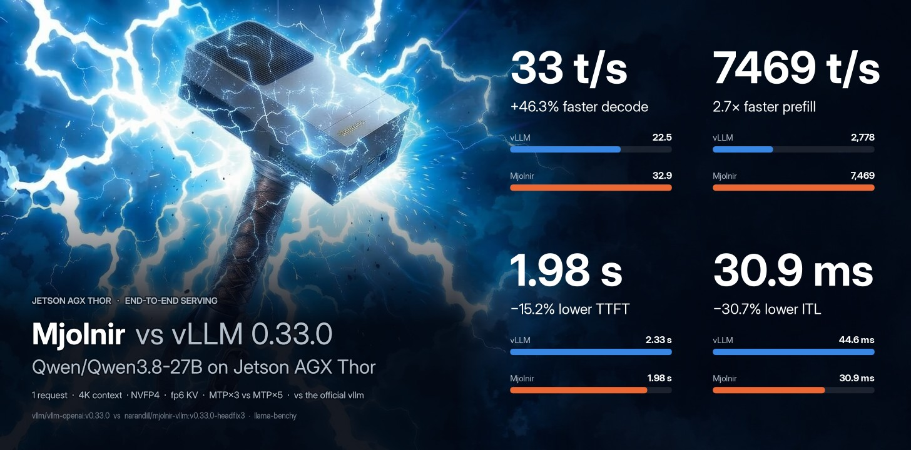

[](https://pypi.org/project/mjolnir-kernel/)
[](https://pypi.org/project/mjolnir-cli/)
[](https://hub.docker.com/r/narandill/mjolnir-vllm)
[](https://github.com/GoBrrr-ai/mjolnir)
[](https://github.com/GoBrrr-ai/mjolnir#supported-hardware)
[](https://github.com/GoBrrr-ai/mjolnir/blob/main/LICENSE)

**Mjolnir** — faster, bigger-context LLM serving on **Jetson Tegra**: one image, a decode kernel per platform — Thor (`sm_110`) and Orin (`sm_87`) — and a CLI that serves, benchmarks and documents every claim.

[GitHub](https://github.com/GoBrrr-ai/mjolnir) · [Platforms](https://github.com/GoBrrr-ai/mjolnir/blob/main/docs/platforms/README.md) · [Case study](https://github.com/GoBrrr-ai/mjolnir/blob/main/docs/platforms/thor/README.md) · [Interactive charts](https://GoBrrr-ai.github.io/mjolnir/) · [mjolnir-cli on PyPI](https://pypi.org/project/mjolnir-cli/) · [mjolnir-kernel on PyPI](https://pypi.org/project/mjolnir-kernel/)



## ⚡ What's inside this image

`narandill/mjolnir-vllm:v0.33.0` is the official **vLLM 0.33.0** aarch64 image (CUDA 13.0, Ubuntu 24.04) with a small overlay on top — everything else is upstream vLLM:

- **A decode-attention kernel per platform** — the CuTe DSL `tcgen05` kernel for Jetson Thor (`sm_110`) and the `mma.sync` kernel for Jetson Orin (`sm_87`), each with a 6-bit `e2m3` KV-cache format and multi-token (MTP) verify; the family resolves at runtime from the device. Registered as the `MJOLNIR` attention backend; the `vllm.general_plugins` entry point also makes `--attention-backend CUSTOM` work.
- **A hand-adapted stack of vLLM and FlashInfer patches** — the fixes hybrid GDN/Mamba spec-decode needs on these boards; applied and verified at build time, the build fails when a patch stops applying — the list is below. The Thor-only hunks are probe-gated and inert on other devices.
- **The per-platform environment** — the arch flags and the per-arch JIT environment for Triton / FlashInfer (`mjolnir serve` exports them), so the prebuilt wheels run on JetPack 7.x as-is.

The Mjolnir kernel takes over single-token and speculative-verify steps; prefill and mixed steps run on the platform's attention fallback (FlashAttention 4 on Thor, FlashInfer on Orin).


## ⚡ Patches

`4` hand-adapted vLLM PR fixes and `11` Thor-/FlashInfer-authored patches, applied to the installed vLLM `0.33.0` and FlashInfer at build time (the sm_110-only ones probe-gate themselves inert on other devices):

| File | PR | What it fixes |
|------|----|---------------|
| `50885-flashinfer-full-cudagraph.patch` | [#50885](https://github.com/vllm-project/vllm/pull/50885) (closed unmerged) | Capture **FULL** decode cudagraphs for spec-decode on the FlashInfer **native** (non-trtllm) path — uniform multi-token verify batches. **0.33.0 slim-down:** the base now carries the wrapper plumbing itself (`_get_decode_wrapper(batch_size, use_cudagraph, q_len_per_req)`, the tuple-keyed `_decode_wrappers_cudagraph`, `fast_plan_decode` threading `q_len_per_req` into FlashInfer's `fast_decode_plan` — which since 0.7.2 plans uniform multi-token queries on the fa2 tensor-core backend). What remains Thor-side is the *policy*: the `flashinfer_supports_uniform_multi_token_decode()` probe (does the installed FI accept `q_len_per_req`), the `supports_spec_as_decode` OR-term and the `get_cudagraph_support` UNIFORM_BATCH grant (both gated on the probe + non-trtllm + causal) and the `build()` per-request `num_input_tokens`/`q_len_per_req` computation (previously fa2-native-only, pre-SM90). Without it sm_110 spec decode still falls to PIECEWISE graphs. |
| `49652-draft-decode-capture.patch` | [#49652](https://github.com/vllm-project/vllm/pull/49652) (closed unmerged) | Autoregressive (MTP) **draft-decode** cudagraph capture under **Dynamic SD**. The draft decoder always processes 1 token/request, so its graphs must stay at fixed query length 1 instead of following the target's dynamic-SD verify schedule. |
| `thor-fused-draft-decode-fi-native-update.patch` | — (Thor-authored) | **Implement `update_draft_decode_metadata` for the FlashInfer backend** so the spec-decode loop can use the **fused multi-step draft decode** instead of the "rebuild attention metadata between draft steps" fallback. The upstream contract is a `pass` stub for trtllm-gen (0.33.0: one trtllm-gen decode build serves every step); the patch ORs `supports_draft_decode_metadata_update` with the FI-native full-cudagraph, single-rank, non-DCP, non-trtllm case and replaces the stub with `_advance_fi_decode_plan_kernel`, which re-derives the FI decode plan (`paged_kv_indptr`/`last_page_len`/`page_indices`) **on the GPU** from the advancing `seq_lens` + block table — the same formula as `build()`, but capture-safe (no host sync, no D2D index copy) so it replays correctly inside the draft CUDA graph. Pays off only at **K ≥ 3** (MTP3 / DSpark K≥2); a deliberate no-op at K=2. |
| `thor-fused-draft-t5-plan-refresh.patch` | — (Thor-authored) | **Rebuild the draft attention metadata on the fused FULL-graph replay path** so host-side per-cycle plan state survives graph replay. `_fused_multi_step_decode` returns before `_build_uniform_attn_metadata` when `cg_mode == FULL`, so any builder that computes per-cycle host state in `build()` — Mjolnir's T5 split-KV **work plan** (`work_buf`/`nsplit_buf`, host-computed from seq_lens) — stays **baked at capture-time seq_lens**: every replayed draft step attends a truncated context and MTP acceptance collapses beyond position 0 (measured 2026-10-18: K=5 acceptance 4.1→**2.04**; eager or `MJOLNIR_ATTN_FUSED_DRAFT=0` healthy). The fix re-runs the build before `run_fullgraph` — the returned metadata is unused (the graph replays baked launches), but the side effect refreshes the persistent plan buffers the graph reads. |
| `thor-dspark-draft-fi-noncausal-cudagraph.patch` | — (Thor-authored) | **Capture the DSpark non-causal multi-token draft under a FULL CUDA graph** instead of running the draft eagerly. A non-causal drafter (DSpark) routes its draft through the FI *prefill* wrapper — the FI *decode* wrapper cannot express non-causal multi-token (its fa2 kernel is block-causal only for `q_len_per_req > 1`). In cuda-graph mode that prefill wrapper freezes its batch size at creation and reads its KV plan from **persistent** buffers, so one wrapper per captured batch size is needed (`_noncausal_prefill_wrappers_cudagraph`, mirroring `_decode_wrappers_cudagraph`); the draft plans eagerly outside the captured graph and the captured `run()` replays safely across ragged re-plans. Adds the `_get_noncausal_prefill_wrapper_cudagraph` factory, grants a non-causal `UNIFORM_BATCH` in `get_cudagraph_support` (gated on a multi-token drafter, non-SM12x, single-rank DCP), and dispatches the prefill batch to the cudagraph wrapper in `build()`. Lands **after** 50885 (its `get_cudagraph_support` hunk is diffed against 50885's grant). Most bump-fragile patch — see below. |
| `thor-draft-cg-gate-sm110.patch` | — (Thor-authored) | **Shape-gate the DSpark draft's FULL cudagraph replay on sm_110 (the c1 fix).** The forensics showed the graphed draft is 7–16% *slower* than the eager draft at N=1 (replay overhead eats the launch savings on a tiny 5-layer draft). The gate routes per-step draft batches below `VLLM_THOR_DRAFT_CG_MIN_BATCH` requests (default **2**; min 1, where 1 = today's behavior) through the **existing eager fallback** via the dispatch's `need_eager` channel — no new eager path, no capture-logic changes. sm_110 only: off sm_110 the decision helper is a structural no-op (always CG). One-shot `THOR draft-CG gate: …` log lines; any gate evaluation error degrades to the CG behavior (logged once). Probe-gated, inert on non-sm_110, default N=1→eager. |
| `thor-fa4-hd256-1cta-decode-sm110.patch` | — (Thor-authored) | **The 1CTA decode carve-out for the FA4 hd256 kernel (the v11 "N-2 decode" workstream).** Decode-shaped hd256 calls — `max_seqlen_q <= 8` (decode M 1..8, incl. MTP verify; prefill is 1024+), non-local, dense or paged-128 TMA (the kernel's only legal paged mode) — now OR into the `hd256_use_2cta` carve-out in `vllm_flash_attn/cute/interface.py` (one hunk), so the kernel drops its 2CTA cluster to a single CTA (`cluster (1,1)`, `CtaGroup.ONE`): a **1.56× decode win** at L=8192 M=1 (clean micro-bench 2CTA 323 µs → 1CTA 207 µs), with 1CTA == 2CTA == fp32-ref within fp8 tolerance; the kernel file is untouched and the 2CTA prefill path is unchanged (separate compile keys coexist in one process). |
| `thor-mjolnir-attention-backend.patch` | — (Thor-authored) | **The `MJOLNIR` attention-backend name.** Adds `MJOLNIR = "mjolnir.backend.MjolnirAttentionBackend"` to `AttentionBackendEnum` (`v1/attention/backends/registry.py`), so `vllm serve <model> --attention-backend MJOLNIR` parses (the CLI resolves the name through the enum *before* plugins could add one — an `Enum` cannot grow at runtime) and `Attention.__init__`'s `AttentionBackendEnum[backend.get_name()]` round-trip works. The class itself comes from the `mjolnir-kernel` package, installed by the `Dockerfile`; its `vllm.general_plugins` entry point also maps `CUSTOM` to the same class, so a stock vLLM can use `--attention-backend CUSTOM`. Also makes **FlashAttention 4 the Mjolnir backend's default fallback** (its prefill/mixed-step backend) on sm_110 — see "The Mjolnir attention backend" below. |
| `thor-gdn-prefill-sm110.patch` | — (Thor-authored) | **RETIRED on 0.33.0 (2026-11-04, the c4 aggregate stagger — a Thor patch bisect isolated this pair; the spec-graph family and the kernel package were exonerated):** GDN **prefill** grant in `_resolve_gdn_prefill_backend()` (the fast FlashInfer kernel for the model's GDN layers) — probe-gated at import; see "Thor sm_110 gate probes". **Carried the 0.33 c4 stagger**: with the pair installed, requests 2–4's prefills slide ~5–7 s behind request 1 in mixed steps (benchy aggregate −30% at c4/8K); removing just this pair restores the 0.32 ordering (headfix3: aggregate 64.5–68.5 vs 0.32's 66.5, TTFT spread ~3.6 s = healthy). Stock GDN prefill serves correctly on 0.33 (kernelonly A/B: acc 3.59–3.63). Re-visit when the underlying mixed-step interaction is understood. |
| `thor-fa4-fp8kv-sm110.patch` | — (Thor-authored) | **FA4 + FP8-KV** eligibility gate (probe-gated fam(110) OR-term in `flash_attn_supports_kv_cache_dtype`) + the FA4 arch assert widened to `(10, 11)` — **inert until a config selects FA4** (default stays FlashInfer); see "Thor sm_110 gate probes". |
| `thor-fa4-hd256-fp8-sm110.patch` | — (Thor-authored) | hd256 **FP8-KV kernel + policy** patch (the "N-1" workstream — enable the FA4 hd256 kernel on sm_110, probe-gated, T11 canary in `kernel_test_sm110_gates.py`); the decode path is the 1CTA carve-out above. |
| `thor-gdn-prefill-fi-sm110.patch` | — (FlashInfer) | **RETIRED on 0.33.0 together with `thor-gdn-prefill-sm110`** (the c4 aggregate stagger — the pair is the carrier; see that row). **FlashInfer-side** GDN prefill non-CP dispatch allowlist widened major 10 → (10, 11) so the SM100 CuTe-DSL kernel is reachable on sm_110 (behavior unchanged on other devices); see "Thor sm_110 GDN prefill enablement (flashinfer side)". |
| `fi-fp6-kv-ampere-prefill.patch` | — (Mjolnir-authored, **FlashInfer-side**) | **Packed-fp6 (e2m3) KV direct-read for FlashInfer's Ampere (sm_80-family) FA2 prefill** — the scratchpad-free fp6 fallback: the produce stage stages 16 codes (12 bytes, partial-src cp.async) per smem slot and an in-place pass rewrites each slot to e4m3 (`code · s_channel`, per-(kv-head, channel) float scales via two new optional `maybe_{k,v}_fp6_scales` params), after which the tile is byte-identical to fp8 and **every** downstream path (per-fragment `vec_cast`, both tile shapes) runs unchanged. Inert unless the fp6 dtype string is requested; see "fp6 prefill direct-read (flashinfer side, sm_80/87)" below. **0.33.0 bump:** applies to FlashInfer 0.7.2.post1 (22/23 hunks verbatim; the one dropped hunk was a pure line-collapse in `jit/attention/modules.py`). |
| `thor-sm110-mxfp4-moe-gate.patch` | [#62133](https://github.com/vllm-project/vllm/pull/62133) | **Fix OAI Triton MXFP4 MoE on SM110** (supersedes closed #61387). #58877 (in 0.32.0) widened the OAI-Triton device gate to `< (13, 0)`, admitting SM110 → `matmul_ogs` compile failure at engine init (upstream issue #61374). The final state keeps the device gate (TRITON opt-in) but: the GPT-OSS MXFP4 **selector** keeps **MARLIN** the default on SM110 (TRITON opt-in) and `_swizzle_mxfp4` applies the persistent + `epilogue_subtile=1` constraints on SM110 too. **#62133 merged 2026-10-27 (f03b704) but is NOT in the 0.33.0 release branch** (the device gate still admits SM110; the selector has no SM110 clause) — the patch applies and stays. Re-check at every bump; drop once a tracked release carries it. |
| `thor-sm110-cutlass-fp4-moe-guard.patch` | [#62275](https://github.com/vllm-project/vllm/pull/62275) (open) | **Disable CUTLASS FP4 MoE backend on sm_110.** NVFP4 MoE auto-select picks `VLLM_CUTLASS` on Thor and faults in `profile_run` (TMA descriptor init); sm_110 is removed from `_supports_current_device`'s family allowlist so the fallback backend is chosen. Drop when upstream merges #62275 (still open as of the 0.33.0 bump). |

The full inventory with the deep-dive sections: [PATCHES.md](https://github.com/GoBrrr-ai/mjolnir/blob/main/docker/vllm-thor/PATCHES.md)


## ⚡ Quickstart

> Runs on Jetson AGX Thor (JetPack 7.x, `sm_110`) and Jetson Orin (JetPack 7.2.1+, `sm_87`) with Docker + the NVIDIA Container Toolkit — the kernel family resolves from the device at runtime.

```bash
docker pull narandill/mjolnir-vllm:v0.33.0

# any model, any vLLM flags — Mjolnir serves the decode:
docker run --rm -it --gpus all --ipc host -p 8000:8000 -e VLLM_KV_CACHE_LAYOUT=HND \
  narandill/mjolnir-vllm:v0.33.0 <model> --kv-cache-dtype fp8 --attention-backend MJOLNIR
```

The recommended path is the **mjolnir CLI** ([`mjolnir-cli`](https://pypi.org/project/mjolnir-cli/) on PyPI) on the host: `uv tool install mjolnir-cli && mjolnir serve up` manages this image and serves the model from a YAML config — and `mjolnir bench` / `mjolnir verify` reproduce every number in the [case study](https://github.com/GoBrrr-ai/mjolnir/blob/main/docs/platforms/thor/README.md).

## ⚡ Tags

Tags follow the **upstream vLLM version** of the base image, not the kernel's:

- `v0.33.0` — the current image (re-pushed on every rebuild)
- `v0.33.0-<sha>` — the same build, immutable per commit
- `latest` — moved by each release

A kernel release is rebuilt into the same `v0.33.0` tag; the kernel version rides along as the `io.github.thor-arena.mjolnir.kernel-version` image label.

## ⚡ More

- [Repo README](https://github.com/GoBrrr-ai/mjolnir) — benchmarks and docs
- [Kernel case study](https://github.com/GoBrrr-ai/mjolnir/blob/main/docs/platforms/thor/README.md) — how the kernel works
- [Interactive charts](https://GoBrrr-ai.github.io/mjolnir/) — every chart, live data
- [Patch inventory](https://github.com/GoBrrr-ai/mjolnir/blob/main/docker/vllm-thor/PATCHES.md) — what is patched, and why
