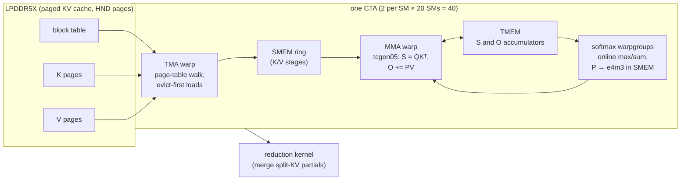

# The Mjolnir kernel — a case study

> How a paged fp8 decode-attention kernel was built for one GPU — the Jetson AGX Thor (`sm_110`, 20 SMs, 32 MiB L2, ~273 GB/s LPDDR5X) — and measured step by step against FlashInfer and FlashAttention 2. Every chart and table on these pages is rendered from raw results in [`benchmarks/raw/verify/`](../../benchmarks/raw/verify/) by `mjolnir plot --readme`; every chapter ends with the command that reproduces it.

**Where it stands:** 1.28× FlashInfer (geomean over L = 128 4K 8K 16K 32K 64K 128K 256K), 2.01× FlashAttention 2, 89 / 89 correctness checks — run `20261011-113515`.

<picture>
  <source media="(prefers-color-scheme: dark)" srcset="../../assets/benchmarks/kernel-speedup-dark.png">
  
</picture>

## The problem: decode is a memory stream

One decode step multiplies **one** query vector per head with **every** cached key, then mixes **every** cached value. For a 24-query / 4-KV-head layer with head dim 256, the KV cache is `L × 4 × 256 × 2` elements: at L = 64K that is 128 MiB in fp8 — read once, used once. Arithmetic intensity is tiny (~6 FLOP/byte for the GQA group of 6), so the step is bound by how fast LPDDR5X delivers bytes. Three things decide the time:

1. **how many bytes** are read (KV format: bf16 → fp8 → fp6 → fp4);
2. **how efficiently** they stream (TMA box shape, page layout, L2 policy, ring depth);
3. **how much of the GPU is busy** while they stream (split-KV plan, occupancy, launch gaps).

## The design



- **Warp specialization.** A TMA warp walks the block table and streams K/V boxes into a shared-memory ring; an MMA warp issues `tcgen05` UMMAs whose accumulators live in **TMEM**, not registers; softmax warpgroups read scores from TMEM, keep the running max and sum, and write P back as e4m3 for the PV product. Producers and consumers synchronize with mbarrier pipelines, so loads, matrix math and softmax overlap.
- **Occupancy-pinned split-KV.** The planner always launches exactly one wave — 2 CTAs on each of the 20 SMs — and cuts long sequences into chunks so every CTA streams about the same number of KV tiles. A separate reduction kernel merges the partial outputs with their log-sum-exp. The grid is padded to a fixed size, so the whole step replays under full CUDA graphs.
- **fp8 end to end.** Q is quantized per (sequence, KV head) when the step starts, KV is e4m3, P is e4m3: one MMA kind, no conversion warps. The KV format can drop further to fp6/fp4, which `tcgen05 kind::f8f6f4` multiplies directly (TMA unpacks sub-byte data into byte containers).
- **The vLLM backend** subclasses a stock backend — FlashAttention 4 on the image (FlashInfer on a stock vLLM): prefill, KV writes and mixed batches run there unchanged; decode-only steps (including speculative-decode verify, q_len ≤ 1 + num_speculative_tokens) run Mjolnir.

## The chapters

| # | chapter | question | status |
|---|---|---|---|
| 1 | [Correctness matrix](correctness.md) | kernel vs the bit-faithful emulator: every layout, format, page size, q_len, Q dtype | ✅ run `20261011-105337` |
| 2 | [Headline L-sweep](sweep.md) | Mjolnir vs FlashInfer vs FlashAttention 2, ncu kernel time at every L | ✅ run `20261011-113515` |
| 3 | [Head-major pages](hndsweep.md) | FlashInfer on NHD and HND vs Mjolnir on HND — is HND a kernel win or a layout win? | ✅ run `20261011-114842` |
| 4 | [KV layouts and formats](kvfmt.md) | fp8 / fp6 / fp4 / nvfp4 KV on NHD / interleaved / HND pages (ncu + wall clock) | ✅ run `20261011-115251` |
| 5 | [KV format accuracy](quant.md) | relative L2 error of each KV format vs unquantized KV, at every L | ✅ run `20261011-121120` |
| 6 | [KV cache capacity](kv-cache-size.md) | tokens of KV each config fits (vLLM's startup sizing), and the concurrency that buys per context | ✅ run `20261011-213435` |
| 7 | [Full profiles per KV format](fp6prof.md) | full ncu profiles: L2 sectors vs requests vs time, warp stalls, per KV format | ✅ run `20261011-125212` |
| 8 | [KV ring depth](ring.md) | TMA→MMA ring depth (--kv_stages) sweep at every L | ✅ run `20261011-121857` |
| 9 | [L2 prefetch](prefetch.md) | TMA L2 prefetch distance (--l2_prefetch) sweep | ✅ run `20261011-122836` |
| 10 | [Programmatic dependent launch](pdl.md) | PDL on/off wall clock (decode overlaps the previous kernel; merge launches early) | ✅ run `20261011-123457` |
| 11 | [Flag A/B](ab.md) | any harness flag sets, ncu + wall clock (default: evict-first x PDL) | ✅ run `20261011-124125` |


## Reproducing everything

```bash
uv tool install mjolnir-cli
mjolnir hw setup                     # locked clocks, MAXN, fans — stable numbers
mjolnir verify all                   # correctness + every benchmark stage (≈ hours; gated)
mjolnir plot --readme                # charts + README + these pages, from the raw results
```

Each stage writes one JSON file per run. A run with non-default parameters (`--ls`, `--variants`, …) is saved too but never replaces the headline chart, so exploratory A/Bs are safe to commit. Methodology and the noise floor: [`docs/methodology/benchmarking.md`](../../docs/methodology/benchmarking.md).
