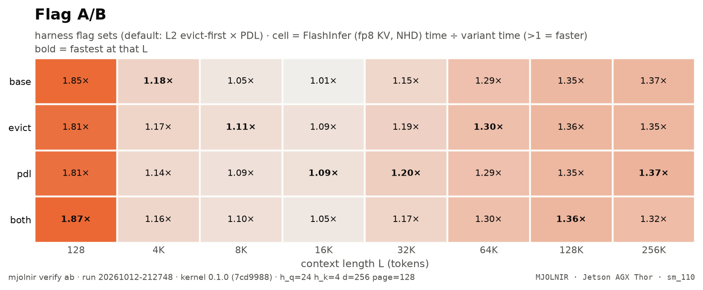

# Flag A/B

> any harness flag sets, ncu + wall clock (default: evict-first x PDL) · `mjolnir verify ab` · run `20261012-212748`

## The question

A general-purpose A/B for harness flags. The default run compares the L2 **evict-first** cache policy on K/V loads and PDL, alone and together.

## How it is measured

Any `name:flags|name:flags` list (`--variants`), ncu at every L plus a wall-clock row. Evict-first marks K/V lines as streaming so they do not displace the rest of the model's working set in the 32 MiB L2.

## Result

<picture>
  <source media="(prefers-color-scheme: dark)" srcset="../../assets/benchmarks/ab-heatmap-dark.png">
  
</picture>

- Fastest variant at the most context lengths: **`pdl`** (3 of 8).
- Best geomean vs FlashInfer: **`evict`** (1.28×); worst: `base` (1.26×).
- All variants sit within 2% of each other — inside the noise band.

| variant | flags | 128 | 4K | 8K | 16K | 32K | 64K | 128K | 256K | geomean |
|---|---|--:|--:|--:|--:|--:|--:|--:|--:|--:|
| `base` | `--kv_evict_first 0` | $\color{#16a34a}{1.85\times}$ | **$\color{#16a34a}{1.18\times}$** | $\color{#16a34a}{1.05\times}$ | $\color{grey}{1.01\times}$ | $\color{#16a34a}{1.15\times}$ | $\color{#16a34a}{1.29\times}$ | $\color{#16a34a}{1.35\times}$ | $\color{#16a34a}{1.37\times}$ | $\color{#16a34a}{\mathbf{1.26\times}}$ |
| `evict` | `--kv_evict_first 1` | $\color{#16a34a}{1.81\times}$ | $\color{#16a34a}{1.17\times}$ | **$\color{#16a34a}{1.11\times}$** | $\color{#16a34a}{1.09\times}$ | $\color{#16a34a}{1.19\times}$ | **$\color{#16a34a}{1.30\times}$** | $\color{#16a34a}{1.36\times}$ | $\color{#16a34a}{1.35\times}$ | $\color{#16a34a}{\mathbf{1.28\times}}$ |
| `pdl` | `--kv_evict_first 0 --pdl` | $\color{#16a34a}{1.81\times}$ | $\color{#16a34a}{1.14\times}$ | $\color{#16a34a}{1.09\times}$ | **$\color{#16a34a}{1.09\times}$** | **$\color{#16a34a}{1.20\times}$** | $\color{#16a34a}{1.29\times}$ | $\color{#16a34a}{1.35\times}$ | **$\color{#16a34a}{1.37\times}$** | $\color{#16a34a}{\mathbf{1.28\times}}$ |
| `both` | `--kv_evict_first 1 --pdl` | **$\color{#16a34a}{1.87\times}$** | $\color{#16a34a}{1.16\times}$ | $\color{#16a34a}{1.10\times}$ | $\color{#16a34a}{1.05\times}$ | $\color{#16a34a}{1.17\times}$ | $\color{#16a34a}{1.30\times}$ | **$\color{#16a34a}{1.36\times}$** | $\color{#16a34a}{1.32\times}$ | $\color{#16a34a}{\mathbf{1.27\times}}$ |

<details>
<summary>How the % and × here are calculated</summary>

- Each cell = **reference time ÷ variant time** (Nsight Compute kernel time, decode + merge, base clocks, cold L2, same run, same L). `1.10×` = the variant needs 1 ÷ 1.10 = 91% of the reference's time; below 1 it is slower.
- **geomean** = exp(mean of ln(ratio)) over the context lengths; **bold** = the fastest variant at that L.
- Green ≥ 1.03, grey within ±3% (`NOISE_PCT`, the run-to-run spread of a same-run ratio), red ≤ 0.97.

</details>


**Wall clock** (harness median, cold L2, b=1; Δ vs the first variant):

| L | base | evict | pdl | both |
|---|--:|--:|--:|--:|
| **128** | 14.1&nbsp;µs | 13.9&nbsp;µs $\color{grey}{\text{−1.8\\%}}$ | 12.2&nbsp;µs $\color{#16a34a}{\text{−14.0\\%}}$ | 12.3&nbsp;µs $\color{#16a34a}{\text{−12.7\\%}}$ |
| **4K** | 74.6&nbsp;µs | 90.1&nbsp;µs $\color{#dc2626}{\text{+20.9\\%}}$ | 73.6&nbsp;µs $\color{grey}{\text{−1.3\\%}}$ | 77.5&nbsp;µs $\color{#dc2626}{\text{+4.0\\%}}$ |
| **8K** | 115.5&nbsp;µs | 110.3&nbsp;µs $\color{#16a34a}{\text{−4.5\\%}}$ | 116.1&nbsp;µs $\color{grey}{\text{+0.5\\%}}$ | 106.4&nbsp;µs $\color{#16a34a}{\text{−7.9\\%}}$ |
| **16K** | 173.0&nbsp;µs | 172.6&nbsp;µs $\color{grey}{\text{−0.2\\%}}$ | 171.8&nbsp;µs $\color{grey}{\text{−0.6\\%}}$ | 175.1&nbsp;µs $\color{grey}{\text{+1.2\\%}}$ |
| **32K** | 288.3&nbsp;µs | 284.5&nbsp;µs $\color{grey}{\text{−1.3\\%}}$ | 290.5&nbsp;µs $\color{grey}{\text{+0.8\\%}}$ | 282.5&nbsp;µs $\color{grey}{\text{−2.0\\%}}$ |
| **64K** | 528.3&nbsp;µs | 535.9&nbsp;µs $\color{grey}{\text{+1.4\\%}}$ | 522.1&nbsp;µs $\color{grey}{\text{−1.2\\%}}$ | 523.1&nbsp;µs $\color{grey}{\text{−1.0\\%}}$ |
| **128K** | 1.01&nbsp;ms | 999.1&nbsp;µs $\color{grey}{\text{−1.0\\%}}$ | 991.1&nbsp;µs $\color{grey}{\text{−1.8\\%}}$ | 984.9&nbsp;µs $\color{grey}{\text{−2.4\\%}}$ |
| **256K** | 1.97&nbsp;ms | 1.99&nbsp;ms $\color{grey}{\text{+1.1\\%}}$ | 1.96&nbsp;ms $\color{grey}{\text{−0.8\\%}}$ | 1.95&nbsp;ms $\color{grey}{\text{−1.1\\%}}$ |

<details>
<summary>How the % and × here are calculated</summary>

- Wall-clock median per launch over the stage's iterations (CUDA events), every variant in the same run.
- **%** = (variant − first column) ÷ first column × 100 — the change in **time**: negative = faster. `−6.0%` = 6% less time than the first column.
- Green = at least 3% less time, red = at least 3% more, grey = within ±3% (`NOISE_PCT`).

</details>


<sub>Rendered from [`benchmarks/raw/verify/ab/20261012-212748.json`](../../benchmarks/raw/verify/ab/20261012-212748.json). Ratios: FlashInfer time ÷ variant time; green = faster beyond the ±3% noise band, red = slower, gray = within noise.</sub>

## How to read it

Use it for any idea: change a flag in the harness, run `mjolnir verify ab --variants ...`, and the heatmap shows where it wins. Custom runs are saved but never replace this page's default chart.

## Reproduce

```bash
mjolnir verify ab
mjolnir verify ab --variants "base:|mine:--my_flag 1" --ls "8192 65536 262144"
```

## Ideas to try

- anything — this is the experiment slot. `mjolnir autoresearch` uses it to test agent-proposed changes.

Found something? Open a PR with the raw JSON from `benchmarks/raw/verify/` — see [CONTRIBUTING](../../.github/CONTRIBUTING.md).

---

[← Programmatic dependent launch](pdl.md) · [case study](README.md)
