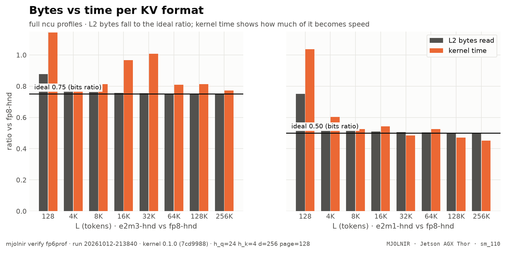

# Full profiles per KV format

> full ncu profiles: L2 sectors vs requests vs time, warp stalls, per KV format · `mjolnir verify fp6prof` · run `20261012-213840`

## The question

fp6 reads 25% fewer bytes than fp8 — so why is it not 25% faster? A full Nsight Compute profile per KV format answers where the time goes.

## How it is measured

`ncu --set full` on 3 launches of the decode kernel per format and L (cold L2, base clocks). Recorded: kernel time, L2 sectors and requests read, throughput %, achieved occupancy, warp-stall reasons. The `.ncu-rep` files stay in the run's log directory for Nsight Compute's *Add Baseline* view.

## Result

<picture>
  <source media="(prefers-color-scheme: dark)" srcset="../../assets/benchmarks/fp6prof-bytes-vs-time-dark.png">
  
</picture>

- `e2m3-hnd`: kernel time **0.89×** the baseline for 0.75× the bytes — 43% of the byte saving becomes speed (mean over L).
- `e2m1-hnd`: kernel time **0.58×** the baseline for 0.50× the bytes — 84% of the byte saving becomes speed (mean over L).

| L | variant | bits | kernel time | time ratio | L2 bytes ratio | ideal | bytes / L2 request | top stall (cycles/instr) |
|---|---|--:|--:|--:|--:|--:|--:|---|
| **128** | `fp8-hnd` | 8 | 14.1&nbsp;µs | 1.00 | 1.00 | 1.00 | 238 B | long_scoreboard 3.7 |
| **128** | `e2m3-hnd` | 6 | 16.1&nbsp;µs | 1.14 | 0.88 | 0.75 | 143 B | long_scoreboard 3.4 |
| **128** | `e2m1-hnd` | 4 | 14.6&nbsp;µs | 1.04 | 0.75 | 0.50 | 178 B | long_scoreboard 3.1 |
| **4K** | `fp8-hnd` | 8 | 53.4&nbsp;µs | 1.00 | 1.00 | 1.00 | 135 B | long_scoreboard 14.9 |
| **4K** | `e2m3-hnd` | 6 | 43.3&nbsp;µs | 0.81 | 0.77 | 0.75 | 69 B | long_scoreboard 14.2 |
| **4K** | `e2m1-hnd` | 4 | 32.2&nbsp;µs | 0.60 | 0.53 | 0.50 | 72 B | long_scoreboard 7.3 |
| **8K** | `fp8-hnd` | 8 | 93.1&nbsp;µs | 1.00 | 1.00 | 1.00 | 132 B | long_scoreboard 21.6 |
| **8K** | `e2m3-hnd` | 6 | 75.6&nbsp;µs | 0.81 | 0.76 | 0.75 | 67 B | long_scoreboard 19.7 |
| **8K** | `e2m1-hnd` | 4 | 48.9&nbsp;µs | 0.52 | 0.52 | 0.50 | 68 B | long_scoreboard 10.2 |
| **16K** | `fp8-hnd` | 8 | 180.4&nbsp;µs | 1.00 | 1.00 | 1.00 | 130 B | long_scoreboard 30.3 |
| **16K** | `e2m3-hnd` | 6 | 174.5&nbsp;µs | 0.97 | 0.76 | 0.75 | 66 B | long_scoreboard 30.8 |
| **16K** | `e2m1-hnd` | 4 | 97.9&nbsp;µs | 0.54 | 0.51 | 0.50 | 66 B | long_scoreboard 13.4 |
| **32K** | `fp8-hnd` | 8 | 389.3&nbsp;µs | 1.00 | 1.00 | 1.00 | 129 B | long_scoreboard 37.8 |
| **32K** | `e2m3-hnd` | 6 | 391.9&nbsp;µs | 1.01 | 0.75 | 0.75 | 65 B | long_scoreboard 43.1 |
| **32K** | `e2m1-hnd` | 4 | 188.6&nbsp;µs | 0.48 | 0.51 | 0.50 | 65 B | long_scoreboard 18.3 |
| **64K** | `fp8-hnd` | 8 | 779.4&nbsp;µs | 1.00 | 1.00 | 1.00 | 129 B | long_scoreboard 43.2 |
| **64K** | `e2m3-hnd` | 6 | 630.0&nbsp;µs | 0.81 | 0.75 | 0.75 | 64 B | long_scoreboard 41.0 |
| **64K** | `e2m1-hnd` | 4 | 409.7&nbsp;µs | 0.53 | 0.50 | 0.50 | 65 B | long_scoreboard 21.4 |
| **128K** | `fp8-hnd` | 8 | 1.48&nbsp;ms | 1.00 | 1.00 | 1.00 | 128 B | long_scoreboard 43.3 |
| **128K** | `e2m3-hnd` | 6 | 1.21&nbsp;ms | 0.81 | 0.75 | 0.75 | 64 B | long_scoreboard 41.9 |
| **128K** | `e2m1-hnd` | 4 | 697.7&nbsp;µs | 0.47 | 0.50 | 0.50 | 64 B | long_scoreboard 21.3 |
| **256K** | `fp8-hnd` | 8 | 2.80&nbsp;ms | 1.00 | 1.00 | 1.00 | 128 B | long_scoreboard 46.3 |
| **256K** | `e2m3-hnd` | 6 | 2.16&nbsp;ms | 0.77 | 0.75 | 0.75 | 64 B | long_scoreboard 38.4 |
| **256K** | `e2m1-hnd` | 4 | 1.27&nbsp;ms | 0.45 | 0.50 | 0.50 | 64 B | long_scoreboard 21.4 |

<details>
<summary>How the % and × here are calculated</summary>

- **time ratio** = this row's Nsight Compute kernel time ÷ the first row's at the same L; **L2 bytes ratio** = L2 read sectors ÷ the first row's; **ideal** = this row's KV bits ÷ the first row's — the ratio a purely bandwidth-bound kernel would show.
- **bytes / L2 request** = 32 B × L2 read sectors ÷ L2 read requests.

</details><br />

<sub>Rendered from [`benchmarks/raw/verify/fp6prof/20261012-213840.json`](../../benchmarks/raw/verify/fp6prof/20261012-213840.json). Ratios: FlashInfer time ÷ variant time; green = faster beyond the ±3% noise band, red = slower, gray = within noise.</sub>

## How to read it

- **L2 bytes ratio ≈ the ideal (bits) ratio** → no padding or over-fetch: the TMA reads exactly the packed bytes;
- **kernel time well above the bytes ratio** → the limit is not bandwidth. The *bytes per L2 request* column shows fp6 rows arriving as more, smaller requests (the TMA's sub-byte unpack path);
- the stall column shows what warps wait on — long scoreboard = waiting for memory.

## Reproduce

```bash
mjolnir verify fp6prof
mjolnir verify fp6prof --variants "fp8-hnd:--kv_format fp8 --kv_layout hnd|e2m3-hnd:--kv_format e2m3 --kv_layout hnd" --ls 65536
```

## Ideas to try

- **Tried:** a TMA box that keeps fp6 requests at 128 B (SW128 smem atoms, autoresearch run 1) — ~5% faster at 64K–256K, slower at short L; gated at ≥ 64K it is +1.7% overall. At long L e2m3 is already close to its byte ratio, so request size is not the main limit there.
- **Open:** the 16K–32K range, where e2m3 is as slow as fp8 and its L2 throughput drops; the latency side of the whole kernel (L2 at 16–24% of peak, `long_scoreboard` the top stall — the TMA warp reads the block table on its critical path); ring depth chosen per L at runtime. The ranked list with commands is [`research/program.md`](../../research/program.md).
- **Not worth it:** unpacking fp6 in registers instead of the TMA — the nvfp4 convert warpgroup shows what a conversion pass costs (0.48–0.69× FlashInfer).

Found something? Open a PR with the raw JSON from `benchmarks/raw/verify/` — see [CONTRIBUTING](../../.github/CONTRIBUTING.md).

---

[← Speculative decoding](spec.md) · [case study](README.md) · [KV ring depth →](ring.md)
