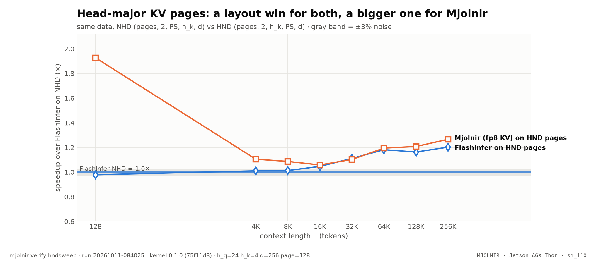

# Head-major pages

> FlashInfer on NHD and HND vs Mjolnir on HND — is HND a kernel win or a layout win? · `mjolnir verify hndsweep` · run `20261011-084025`

## The question

Mjolnir reads K/V from **head-major (HND)** pages, where each KV head's page is one contiguous block, instead of vLLM's default token-major layout. Is that a kernel advantage, or a layout that would make FlashInfer just as fast?

## How it is measured

Same data in both layouts: the FlashInfer driver generates the cache once in NHD order `(pages, 2, PS, h_k, d)` and transposes it to HND `(pages, 2, h_k, PS, d)`; Mjolnir (fp8 KV) runs on HND. All legs are relative to FlashInfer on NHD.

## Result

<picture>
  <source media="(prefers-color-scheme: dark)" srcset="../../assets/benchmarks/hnd-layout-dark.png">
  
</picture>

- **Mjolnir (fp8 KV, HND)** vs FlashInfer (fp8 KV, NHD): geomean **1.22×**, from 1.06× (L=16K) to 1.93× (L=128); faster beyond the ±3% noise band at 8 of 8 context lengths.
- **FlashInfer (fp8 KV, HND)** vs FlashInfer (fp8 KV, NHD): geomean **1.09×**, from 0.98× (L=128) to 1.20× (L=256K); faster beyond the ±3% noise band at 5 of 8 context lengths.

| L | FlashInfer | FlashInfer HND | Mjolnir fp8 | fp8 vs FI | fp8 vs FI-HND |
|---|--:|--:|--:|--:|--:|
| **128** | 25.6 µs | 26.2 µs | **13.3 µs** | $\color{#16a34a}{\mathbf{1.93\times}}$ | $\color{#16a34a}{\mathbf{1.97\times}}$ |
| **4K** | 60.1 µs | 59.5 µs | **54.4 µs** | $\color{#16a34a}{\mathbf{1.10\times}}$ | $\color{#16a34a}{\mathbf{1.09\times}}$ |
| **8K** | 94.0 µs | 92.8 µs | **86.5 µs** | $\color{#16a34a}{\mathbf{1.09\times}}$ | $\color{#16a34a}{\mathbf{1.07\times}}$ |
| **16K** | 181.2 µs | 173.1 µs | **171.2 µs** | $\color{#16a34a}{\mathbf{1.06\times}}$ | $\color{grey}{1.01\times}$ |
| **32K** | 402.0 µs | **361.8 µs** | 364.5 µs | $\color{#16a34a}{\mathbf{1.10\times}}$ | $\color{grey}{0.99\times}$ |
| **64K** | 859.7 µs | 727.4 µs | **719.5 µs** | $\color{#16a34a}{\mathbf{1.19\times}}$ | $\color{grey}{1.01\times}$ |
| **128K** | 1.57 ms | 1.35 ms | **1.30 ms** | $\color{#16a34a}{\mathbf{1.21\times}}$ | $\color{#16a34a}{\mathbf{1.04\times}}$ |
| **256K** | 3.09 ms | 2.57 ms | **2.44 ms** | $\color{#16a34a}{\mathbf{1.27\times}}$ | $\color{#16a34a}{\mathbf{1.05\times}}$ |
| geomean |  |  |  | $\color{#16a34a}{\mathbf{1.22\times}}$ | $\color{#16a34a}{\mathbf{1.12\times}}$ |

<sub>Rendered from [`benchmarks/raw/verify/hndsweep/20261011-084025.json`](../../benchmarks/raw/verify/hndsweep/20261011-084025.json). Ratios: FlashInfer time ÷ variant time; green = faster beyond the ±3% noise band, red = slower, gray = within noise.</sub>

## How to read it

If FlashInfer-HND climbed to Mjolnir's line, HND would be a layout win only. The gap between the two HND lines is what the kernel itself adds: TMA boxes of one head's contiguous page stream in longer DRAM bursts, which Mjolnir's pipeline converts into speed more fully than FlashInfer's.

In vLLM, `VLLM_KV_CACHE_LAYOUT=HND` allocates this layout (`mjolnir serve` sets it for MJOLNIR configs). vLLM's interleaved `(B, H, N, 2D)` layout is head-major too, but K and V alternate per row, so each stream reads every other block — see [kvfmt](kvfmt.md).

## Reproduce

```bash
mjolnir verify hndsweep
```

## Ideas to try

- FlashInfer at page size 16 and 64 (`--page-size`), where its native vLLM path runs.

Found something? Open a PR with the raw JSON from `benchmarks/raw/verify/` — see [CONTRIBUTING](../../.github/CONTRIBUTING.md).

---

[← Headline L-sweep](sweep.md) · [case study](README.md) · [KV layouts and formats →](kvfmt.md)
