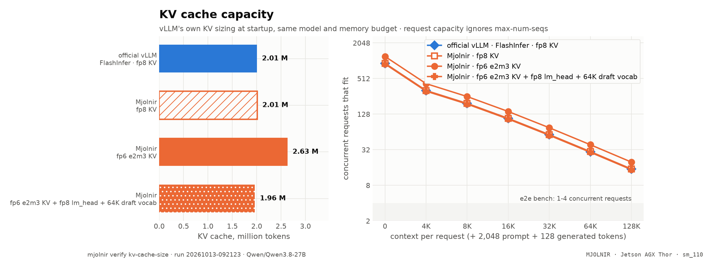

# KV cache capacity

> tokens of KV each config fits (vLLM's startup sizing), and the concurrency that buys per context · `mjolnir verify kv-cache-size` · run `20261013-092123`

## The question

A 6-bit KV cache stores 25% fewer bytes per token than fp8. On a real serving setup, how many more tokens does that buy — and how many more concurrent requests at the context lengths the end-to-end bench runs?

## How it is measured

Every leg is a real `vllm serve` of the same model with the same config except the attention backend and the KV dtype: the official vLLM image with its stock backend (FlashInfer, fp8 KV), and the Mjolnir image on fp8 and on fp6 (e2m3) KV. vLLM sizes the KV cache itself at startup — weights loaded, activations profiled, CUDA-graph memory estimated — and logs the result:

```
Available KV cache memory: 38.12 GiB
GPU KV cache size: 2,656,033 tokens
Maximum concurrency for 204,800 tokens per request: 12.97x
```

The stage reads those lines and stops the leg's server right after (no graph capture or warm-up needed). The request capacity divides the token count by an e2e bench request: the context depth + 2,048 prompt + 128 generated tokens. Qwen3.8's linear-attention (GDN) layers keep a fixed-size state per request, which vLLM accounts for in the same pool, so the token count is what the 16 full-attention layers can hold.

## Result

<picture>
  <source media="(prefers-color-scheme: dark)" srcset="../../assets/benchmarks/kv-cache-capacity-dark.png">
  
</picture>

- **Mjolnir · fp6 e2m3 KV** holds **2,632,688 tokens**, +31% vs official vLLM · FlashInfer · fp8 KV (2,005,007).
- **Mjolnir · fp6 e2m3 KV** holds **2,632,688 tokens**, +31% vs Mjolnir · fp8 KV (2,012,747).
- **Mjolnir · fp6 e2m3 KV** holds **2,632,688 tokens**, +34% vs Mjolnir · fp6 e2m3 KV + fp8 lm_head + 64K draft vocab (1,962,318).
- official vLLM · FlashInfer · fp8 KV: 9.8 requests at the full 200K context (vLLM's own estimate).
- Mjolnir · fp8 KV: 9.8 requests at the full 200K context (vLLM's own estimate).
- Mjolnir · fp6 e2m3 KV: 12.8 requests at the full 200K context (vLLM's own estimate).
- Mjolnir · fp6 e2m3 KV + fp8 lm_head + 64K draft vocab: 9.6 requests at the full 200K context (vLLM's own estimate).

| config | serving | KV memory | KV tokens | vs first | max concurrency | fits @ 4K | fits @ 8K | fits @ 16K | fits @ 32K | fits @ 64K | fits @ 128K |
|---|---|--:|--:|--:|--:|--:|--:|--:|--:|--:|--:|
| `NVFP4` | official vLLM · FlashInfer · fp8 KV | 69.2 GiB | 2,005,007 | 1.00× | 9.8× @ 200K | 319 | 193 | 108 | 57 | 29 | 15 |
| `NVFP4_MJOLNIR` | Mjolnir · fp8 KV | 69.7 GiB | 2,012,747 | 1.00× | 9.8× @ 200K | 320 | 194 | 108 | 57 | 29 | 15 |
| `NVFP4_MJOLNIR_E2M3` | Mjolnir · fp6 e2m3 KV | 69.5 GiB | 2,632,688 | 1.31× | 12.8× @ 200K | 419 | 253 | 141 | 75 | 38 | 19 |
| `NVFP4_MJOLNIR_E2M3_LMH8_VT64K` | Mjolnir · fp6 e2m3 KV + fp8 lm_head + 64K draft vocab | 52.6 GiB | 1,962,318 | 0.98× | 9.6× @ 200K | 312 | 189 | 105 | 56 | 28 | 14 |

<details>
<summary>How the % and × here are calculated</summary>

- **KV tokens** and KV memory come from vLLM's own startup log ("GPU KV cache size", "Available KV cache memory") for the same model and memory budget.
- **vs first** = this row's KV tokens ÷ the first row's (`1.33×` = 33% more tokens).
- **fits @ L** = ⌊KV tokens ÷ (L + 2,048 prompt + 128 generated)⌋ — whole requests of the e2e bench's shape that fit at once (`max-num-seqs` ignored).

</details>

<sub>Rendered from [`benchmarks/raw/verify/kv-cache-size/20261013-092123.json`](../../benchmarks/raw/verify/kv-cache-size/20261013-092123.json). "fits @ L": whole requests of L + 2,176 tokens in the KV cache; the server still caps running requests at `max-num-seqs`.</sub>

## How to read it

Capacity is not speed. At the bench's 1–4 concurrent requests every config fits with room to spare, so the end-to-end table cannot show this gain; it shows when many long requests share the server — agents, RAG over long documents, several users at 100K+ context — where fp8 KV would preempt or queue requests that fp6 still holds. The decode kernel reads fewer bytes too, but at ≤32K context attention is a small part of a decode step on this model (see the e2e notes in the README).

## Reproduce

```bash
mjolnir serve down                      # the stage restarts the server per leg — the GPU must be yours
mjolnir verify kv-cache-size            # official FlashInfer fp8 · Mjolnir fp8 · Mjolnir fp6
mjolnir verify kv-cache-size --legs mjolnir:NVFP4_MJOLNIR_E2M3   # one config
```

## Ideas to try

- an e2e sweep at 8–16 concurrent requests and 64K+ context, where capacity turns into throughput;
- fp4 (e2m1 / nvfp4) KV once its accuracy holds up on a real model (see [KV format accuracy](quant.md)).

Found something? Open a PR with the raw JSON from `benchmarks/raw/verify/` — see [CONTRIBUTING](../../.github/CONTRIBUTING.md).

---

[← KV format accuracy](quant.md) · [case study](README.md) · [Speculative decoding →](spec.md)
