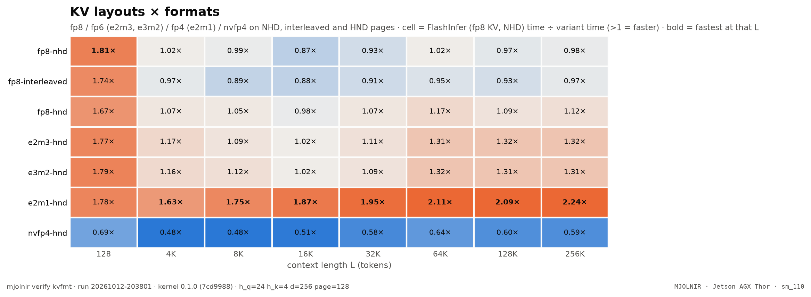
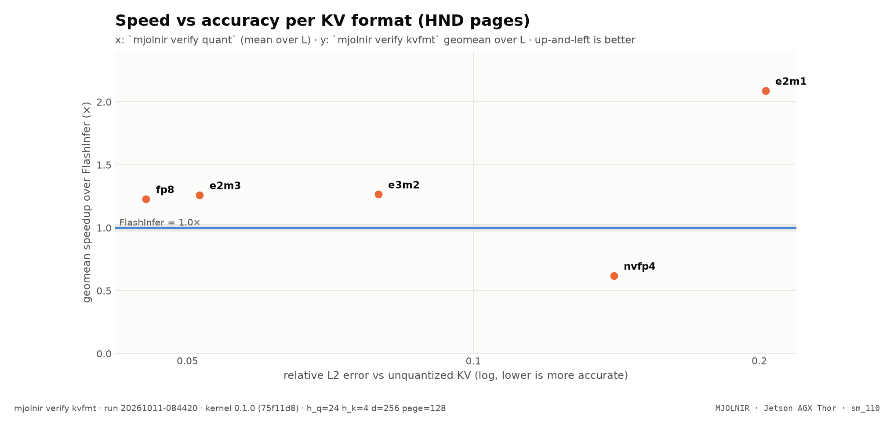

# KV layouts and formats

> fp8 / fp6 / fp4 / nvfp4 KV on NHD / interleaved / HND pages (ncu + wall clock) · `mjolnir verify kvfmt` · run `20261011-084420`

## The question

How many bits does a KV element need, and which page layout streams them best? Mjolnir can read fp8 (e4m3), fp6 (e2m3, e3m2) and fp4 (e2m1) KV **directly** in the tensor-core MMA (`tcgen05 kind::f8f6f4`, TMA unpacks sub-byte data to byte containers), and NVFP4 (e2m1 + one e4m3 scale per 16 elements) through a conversion warpgroup.

## How it is measured

Every variant runs at every L with the harness default otherwise; FlashInfer on NHD and HND are the references. A wall-clock row (harness median, cold L2) adds what ncu cannot see — launch gaps. The tradeoff chart pairs each format's speed with its accuracy from [quant](quant.md).

## Result

<picture>
  <source media="(prefers-color-scheme: dark)" srcset="../../assets/benchmarks/kvfmt-heatmap-dark.png">
  
</picture>

<picture>
  <source media="(prefers-color-scheme: dark)" srcset="../../assets/benchmarks/kvfmt-tradeoff-dark.png">
  
</picture>

- Fastest variant at the most context lengths: **`e2m1-hnd`** (8 of 8).
- Best geomean vs FlashInfer: **`e2m1-hnd`** (2.09×); worst: `nvfp4-hnd` (0.62×).

| variant | flags | 128 | 4K | 8K | 16K | 32K | 64K | 128K | 256K | geomean |
|---|---|--:|--:|--:|--:|--:|--:|--:|--:|--:|
| `fp8-nhd` | `--kv_format fp8 --kv_layout nhd` | $\color{#16a34a}{1.93\times}$ | $\color{grey}{1.00\times}$ | $\color{grey}{0.99\times}$ | $\color{#dc2626}{0.92\times}$ | $\color{#dc2626}{0.85\times}$ | $\color{#dc2626}{0.90\times}$ | $\color{#dc2626}{0.92\times}$ | $\color{#dc2626}{0.87\times}$ | $\color{grey}{1.01\times}$ |
| `fp8-interleaved` | `--kv_format fp8 --kv_layout interleaved` | $\color{#16a34a}{1.87\times}$ | $\color{#dc2626}{0.94\times}$ | $\color{#dc2626}{0.83\times}$ | $\color{#dc2626}{0.90\times}$ | $\color{#dc2626}{0.89\times}$ | $\color{#dc2626}{0.91\times}$ | $\color{#dc2626}{0.86\times}$ | $\color{#dc2626}{0.85\times}$ | $\color{grey}{0.97\times}$ |
| `fp8-hnd` | `--kv_format fp8 --kv_layout hnd` | $\color{#16a34a}{1.94\times}$ | $\color{#16a34a}{1.07\times}$ | $\color{#16a34a}{1.07\times}$ | $\color{#16a34a}{1.17\times}$ | $\color{#16a34a}{1.11\times}$ | $\color{#16a34a}{1.18\times}$ | $\color{#16a34a}{1.22\times}$ | $\color{#16a34a}{1.25\times}$ | $\color{#16a34a}{\mathbf{1.23\times}}$ |
| `e2m3-hnd` | `--kv_format e2m3 --kv_layout hnd` | $\color{#16a34a}{1.97\times}$ | $\color{#16a34a}{1.17\times}$ | $\color{#16a34a}{1.15\times}$ | $\color{#16a34a}{1.14\times}$ | $\color{#16a34a}{1.12\times}$ | $\color{#16a34a}{1.23\times}$ | $\color{#16a34a}{1.20\times}$ | $\color{#16a34a}{1.27\times}$ | $\color{#16a34a}{\mathbf{1.26\times}}$ |
| `e3m2-hnd` | `--kv_format e3m2 --kv_layout hnd` | $\color{#16a34a}{1.90\times}$ | $\color{#16a34a}{1.23\times}$ | $\color{#16a34a}{1.16\times}$ | $\color{#16a34a}{1.12\times}$ | $\color{#16a34a}{1.12\times}$ | $\color{#16a34a}{1.27\times}$ | $\color{#16a34a}{1.20\times}$ | $\color{#16a34a}{1.27\times}$ | $\color{#16a34a}{\mathbf{1.27\times}}$ |
| `e2m1-hnd` | `--kv_format e2m1 --kv_layout hnd` | **$\color{#16a34a}{2.01\times}$** | **$\color{#16a34a}{1.55\times}$** | **$\color{#16a34a}{1.71\times}$** | **$\color{#16a34a}{2.15\times}$** | **$\color{#16a34a}{2.20\times}$** | **$\color{#16a34a}{2.30\times}$** | **$\color{#16a34a}{2.49\times}$** | **$\color{#16a34a}{2.54\times}$** | $\color{#16a34a}{\mathbf{2.09\times}}$ |
| `nvfp4-hnd` | `--kv_format nvfp4 --kv_layout hnd` | $\color{#dc2626}{0.74\times}$ | $\color{#dc2626}{0.48\times}$ | $\color{#dc2626}{0.47\times}$ | $\color{#dc2626}{0.60\times}$ | $\color{#dc2626}{0.66\times}$ | $\color{#dc2626}{0.71\times}$ | $\color{#dc2626}{0.68\times}$ | $\color{#dc2626}{0.68\times}$ | $\color{#dc2626}{0.62\times}$ |


**Wall clock** (harness median, cold L2, b=1; Δ vs the first variant):

| L | fp8-nhd | fp8-interleaved | fp8-hnd | e2m3-hnd | e3m2-hnd | e2m1-hnd | nvfp4-hnd |
|---|--:|--:|--:|--:|--:|--:|--:|
| **128** | 14.2 µs | 14.1 µs $\color{grey}{\text{−0.3\%}}$ | 14.1 µs $\color{grey}{\text{−0.3\%}}$ | 14.1 µs $\color{grey}{\text{−0.3\%}}$ | 14.2 µs $\color{grey}{\text{0.0\%}}$ | 12.3 µs $\color{#16a34a}{\text{−13.5\%}}$ | 22.4 µs $\color{#dc2626}{\text{+58.0\%}}$ |
| **4K** | 138.1 µs | 145.1 µs $\color{#dc2626}{\text{+5.1\%}}$ | 129.9 µs $\color{#16a34a}{\text{−5.9\%}}$ | 117.5 µs $\color{#16a34a}{\text{−14.9\%}}$ | 117.6 µs $\color{#16a34a}{\text{−14.9\%}}$ | 93.0 µs $\color{#16a34a}{\text{−32.7\%}}$ | 134.8 µs $\color{grey}{\text{−2.3\%}}$ |
| **8K** | 196.7 µs | 207.6 µs $\color{#dc2626}{\text{+5.6\%}}$ | 185.1 µs $\color{#16a34a}{\text{−5.9\%}}$ | 163.6 µs $\color{#16a34a}{\text{−16.8\%}}$ | 161.4 µs $\color{#16a34a}{\text{−17.9\%}}$ | 122.7 µs $\color{#16a34a}{\text{−37.6\%}}$ | 207.7 µs $\color{#dc2626}{\text{+5.6\%}}$ |
| **16K** | 304.1 µs | 320.4 µs $\color{#dc2626}{\text{+5.4\%}}$ | 275.5 µs $\color{#16a34a}{\text{−9.4\%}}$ | 236.2 µs $\color{#16a34a}{\text{−22.3\%}}$ | 238.1 µs $\color{#16a34a}{\text{−21.7\%}}$ | 168.8 µs $\color{#16a34a}{\text{−44.5\%}}$ | 343.9 µs $\color{#dc2626}{\text{+13.1\%}}$ |
| **32K** | 502.5 µs | 532.3 µs $\color{#dc2626}{\text{+5.9\%}}$ | 420.7 µs $\color{#16a34a}{\text{−16.3\%}}$ | 362.1 µs $\color{#16a34a}{\text{−27.9\%}}$ | 361.1 µs $\color{#16a34a}{\text{−28.1\%}}$ | 235.4 µs $\color{#16a34a}{\text{−53.2\%}}$ | 631.6 µs $\color{#dc2626}{\text{+25.7\%}}$ |
| **64K** | 901.6 µs | 965.9 µs $\color{#dc2626}{\text{+7.1\%}}$ | 748.3 µs $\color{#16a34a}{\text{−17.0\%}}$ | 609.1 µs $\color{#16a34a}{\text{−32.4\%}}$ | 615.3 µs $\color{#16a34a}{\text{−31.8\%}}$ | 373.6 µs $\color{#16a34a}{\text{−58.6\%}}$ | 1.20 ms $\color{#dc2626}{\text{+33.4\%}}$ |
| **128K** | 1.82 ms | 1.91 ms $\color{#dc2626}{\text{+4.7\%}}$ | 1.34 ms $\color{#16a34a}{\text{−26.6\%}}$ | 1.15 ms $\color{#16a34a}{\text{−36.9\%}}$ | 1.10 ms $\color{#16a34a}{\text{−39.6\%}}$ | 634.7 µs $\color{#16a34a}{\text{−65.2\%}}$ | 2.32 ms $\color{#dc2626}{\text{+27.5\%}}$ |
| **256K** | 3.71 ms | 3.65 ms $\color{grey}{\text{−1.6\%}}$ | 2.62 ms $\color{#16a34a}{\text{−29.2\%}}$ | 2.32 ms $\color{#16a34a}{\text{−37.4\%}}$ | 2.27 ms $\color{#16a34a}{\text{−38.8\%}}$ | 1.15 ms $\color{#16a34a}{\text{−68.9\%}}$ | 4.58 ms $\color{#dc2626}{\text{+23.6\%}}$ |


<sub>Rendered from [`benchmarks/raw/verify/kvfmt/20261011-084420.json`](../../benchmarks/raw/verify/kvfmt/20261011-084420.json). Ratios: FlashInfer time ÷ variant time; green = faster beyond the ±3% noise band, red = slower, gray = within noise.</sub>

## How to read it

- **layout**: fp8 on NHD vs interleaved vs HND isolates the page layout;
- **format**: on HND, fp6 reads 25% fewer bytes and fp4 50% fewer — compare the measured speedup with that ideal (and see [fp6prof](fp6prof.md) for why fp6 realizes less of it);
- **nvfp4** is limited by its conversion warpgroup, not by bytes;
- the tradeoff chart is the decision: up-and-left wins; e2m3 is the harness default because it sits next to fp8 on accuracy.

## Reproduce

```bash
mjolnir verify kvfmt
mjolnir verify kvfmt --variants "e2m3:--kv_format e2m3|e2m3-s3:--kv_format e2m3 --kv_stages 3"
```

## Ideas to try

- fp4 with per-channel K scales folded into Q and per-token V scales folded into P (KIVI-style), to bring e2m1's accuracy toward fp6;
- a vLLM cache-write path for e2m3, so serving can use the 6-bit cache.

Found something? Open a PR with the raw JSON from `benchmarks/raw/verify/` — see [CONTRIBUTING](../../.github/CONTRIBUTING.md).

---

[← Head-major pages](hndsweep.md) · [case study](README.md) · [KV format accuracy →](quant.md)
