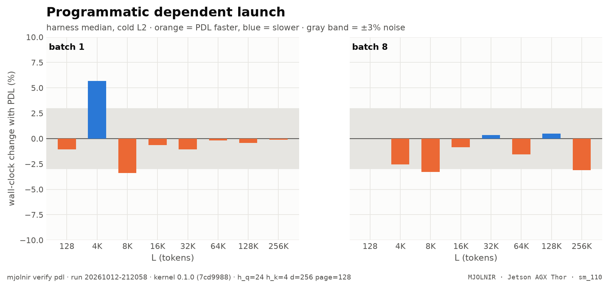

# Programmatic dependent launch

> PDL on/off wall clock (decode overlaps the previous kernel; merge launches early) · `mjolnir verify pdl` · run `20261012-212058`

## The question

Programmatic dependent launch lets the decode kernel start while the previous kernel drains, and the split-KV merge launch before decode finishes. Does it shorten a step?

## How it is measured

Wall clock (harness median of 200 iterations, cold L2) with and without `--pdl`, batch 1 and batch 8 (varlen), every L. ncu serializes kernels and cannot see PDL, so this is a wall-clock stage.

## Result

<picture>
  <source media="(prefers-color-scheme: dark)" srcset="../../assets/benchmarks/pdl-delta-dark.png">
  
</picture>

- 12 of 16 measurements move by less than the ±3% noise band (range -3.4% … +5.7%).

| Q | batch | 128 | 4K | 8K | 16K | 32K | 64K | 128K | 256K |
|---|--:|--:|--:|--:|--:|--:|--:|--:|--:|
| fp8 | 1 | $\color{grey}{\text{−1.1\\%}}$ | $\color{#dc2626}{\text{+5.7\\%}}$ | $\color{#16a34a}{\text{−3.4\\%}}$ | $\color{grey}{\text{−0.6\\%}}$ | $\color{grey}{\text{−1.1\\%}}$ | $\color{grey}{\text{−0.2\\%}}$ | $\color{grey}{\text{−0.4\\%}}$ | $\color{grey}{\text{−0.1\\%}}$ |
| fp8 | 8 | $\color{grey}{\text{0.0\\%}}$ | $\color{grey}{\text{−2.5\\%}}$ | $\color{#16a34a}{\text{−3.3\\%}}$ | $\color{grey}{\text{−0.9\\%}}$ | $\color{grey}{\text{+0.3\\%}}$ | $\color{grey}{\text{−1.5\\%}}$ | $\color{grey}{\text{+0.5\\%}}$ | $\color{#16a34a}{\text{−3.1\\%}}$ |

<details>
<summary>How the % and × here are calculated</summary>

- **%** = (time with PDL − time without PDL) ÷ time without PDL × 100, harness median per L, both measured back to back in the same run. Negative = PDL saves time.
- Green ≤ −3%, red ≥ +3%, grey within ±3% (`NOISE_PCT`).

</details><br />

<sub>Rendered from [`benchmarks/raw/verify/pdl/20261012-212058.json`](../../benchmarks/raw/verify/pdl/20261012-212058.json). Ratios: FlashInfer time ÷ variant time; green = faster beyond the ±3% noise band, red = slower, gray = within noise.</sub>

## How to read it

PDL removes launch gaps, so any win is largest where the step is short (small L). Bars inside the gray ±3% band are noise; PDL stays opt-in (`MJOLNIR_ATTN_PDL=1`) unless it wins consistently.

## Reproduce

```bash
mjolnir verify pdl
```

## Ideas to try

- measure inside a full vLLM CUDA graph, where the neighbors are real model kernels: `mjolnir verify profile` with and without `MJOLNIR_ATTN_PDL=1`.

Found something? Open a PR with the raw JSON from `benchmarks/raw/verify/` — see [CONTRIBUTING](../../.github/CONTRIBUTING.md).

---

[← L2 prefetch](prefetch.md) · [case study](README.md) · [Flag A/B →](ab.md)
