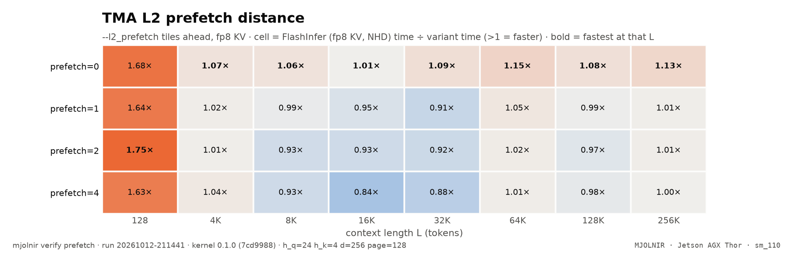

# L2 prefetch

> TMA L2 prefetch distance (--l2_prefetch) sweep · `mjolnir verify prefetch` · run `20261012-211441`

## The question

Does prefetching K/V into L2 ahead of the TMA loads help? `--l2_prefetch k` issues `cute.prefetch` for the tile k tiles ahead.

## How it is measured

Distances 0 (off), 1, 2, 4 on fp8 KV (the prefetch path is not wired for NVFP4) at every L.

## Result

<picture>
  <source media="(prefers-color-scheme: dark)" srcset="../../assets/benchmarks/prefetch-heatmap-dark.png">
  
</picture>

- Fastest variant at the most context lengths: **`prefetch=0`** (7 of 8).
- Best geomean vs FlashInfer: **`prefetch=0`** (1.14×); worst: `prefetch=4` (1.02×).

| variant | flags | 128 | 4K | 8K | 16K | 32K | 64K | 128K | 256K | geomean |
|---|---|--:|--:|--:|--:|--:|--:|--:|--:|--:|
| `prefetch=0` | `--kv_format fp8 --l2_prefetch 0` | $\color{#16a34a}{1.68\times}$ | **$\color{#16a34a}{1.07\times}$** | **$\color{#16a34a}{1.06\times}$** | **$\color{grey}{1.01\times}$** | **$\color{#16a34a}{1.09\times}$** | **$\color{#16a34a}{1.15\times}$** | **$\color{#16a34a}{1.08\times}$** | **$\color{#16a34a}{1.13\times}$** | $\color{#16a34a}{\mathbf{1.14\times}}$ |
| `prefetch=1` | `--kv_format fp8 --l2_prefetch 1` | $\color{#16a34a}{1.64\times}$ | $\color{grey}{1.02\times}$ | $\color{grey}{0.99\times}$ | $\color{#dc2626}{0.95\times}$ | $\color{#dc2626}{0.91\times}$ | $\color{#16a34a}{1.05\times}$ | $\color{grey}{0.99\times}$ | $\color{grey}{1.01\times}$ | $\color{#16a34a}{\mathbf{1.05\times}}$ |
| `prefetch=2` | `--kv_format fp8 --l2_prefetch 2` | **$\color{#16a34a}{1.75\times}$** | $\color{grey}{1.01\times}$ | $\color{#dc2626}{0.93\times}$ | $\color{#dc2626}{0.93\times}$ | $\color{#dc2626}{0.92\times}$ | $\color{grey}{1.02\times}$ | $\color{#dc2626}{0.97\times}$ | $\color{grey}{1.01\times}$ | $\color{#16a34a}{\mathbf{1.04\times}}$ |
| `prefetch=4` | `--kv_format fp8 --l2_prefetch 4` | $\color{#16a34a}{1.63\times}$ | $\color{#16a34a}{1.04\times}$ | $\color{#dc2626}{0.93\times}$ | $\color{#dc2626}{0.84\times}$ | $\color{#dc2626}{0.88\times}$ | $\color{grey}{1.01\times}$ | $\color{grey}{0.98\times}$ | $\color{grey}{1.00\times}$ | $\color{grey}{1.02\times}$ |

<sub>Rendered from [`benchmarks/raw/verify/prefetch/20261012-211441.json`](../../benchmarks/raw/verify/prefetch/20261012-211441.json). Ratios: FlashInfer time ÷ variant time; green = faster beyond the ±3% noise band, red = slower, gray = within noise.</sub>

## How to read it

Prefetch helps only when DRAM is idle between bursts. With an occupancy-pinned grid that keeps the memory system saturated, a prefetch mostly duplicates traffic; a distance that is slower than 0 beyond the noise band is a regression.

## Reproduce

```bash
mjolnir verify prefetch
```

## Ideas to try

- prefetch only the first tiles of each split (warm-up), not the steady state.

Found something? Open a PR with the raw JSON from `benchmarks/raw/verify/` — see [CONTRIBUTING](../../.github/CONTRIBUTING.md).

---

[← KV ring depth](ring.md) · [case study](README.md) · [Programmatic dependent launch →](pdl.md)
