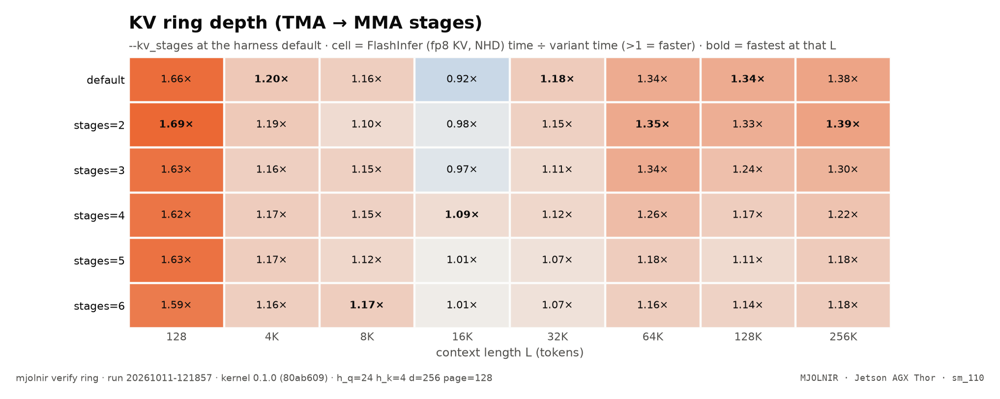

# KV ring depth

> TMA→MMA ring depth (--kv_stages) sweep at every L · `mjolnir verify ring` · run `20261011-121857`

## The question

How deep should the TMA → MMA ring be? A stage is freed only when the MMA that read it completes, so deeper rings let the loader run further ahead — but they cost shared memory, and with 2 CTAs per SM each CTA has ~113 KB.

## How it is measured

`--kv_stages 2…6` against the default (one whole KV tile at 2 CTAs/SM — 4 stages — for fp8; 2 stages for fp6, see the kernel's `_default_kv_stages`), on the harness default config, every L.

## Result

<picture>
  <source media="(prefers-color-scheme: dark)" srcset="../../assets/benchmarks/ring-heatmap-dark.png">
  
</picture>

- Fastest variant at the most context lengths: **`stages=2`** (3 of 8).
- Best geomean vs FlashInfer: **`default`** (1.26×); worst: `stages=5` (1.17×).

| variant | flags | 128 | 4K | 8K | 16K | 32K | 64K | 128K | 256K | geomean |
|---|---|--:|--:|--:|--:|--:|--:|--:|--:|--:|
| `default` | (default) | $\color{#16a34a}{1.66\times}$ | **$\color{#16a34a}{1.20\times}$** | $\color{#16a34a}{1.16\times}$ | $\color{#dc2626}{0.92\times}$ | **$\color{#16a34a}{1.18\times}$** | $\color{#16a34a}{1.34\times}$ | **$\color{#16a34a}{1.34\times}$** | $\color{#16a34a}{1.38\times}$ | $\color{#16a34a}{\mathbf{1.26\times}}$ |
| `stages=2` | `--kv_stages 2` | **$\color{#16a34a}{1.69\times}$** | $\color{#16a34a}{1.19\times}$ | $\color{#16a34a}{1.10\times}$ | $\color{grey}{0.98\times}$ | $\color{#16a34a}{1.15\times}$ | **$\color{#16a34a}{1.35\times}$** | $\color{#16a34a}{1.33\times}$ | **$\color{#16a34a}{1.39\times}$** | $\color{#16a34a}{\mathbf{1.26\times}}$ |
| `stages=3` | `--kv_stages 3` | $\color{#16a34a}{1.63\times}$ | $\color{#16a34a}{1.16\times}$ | $\color{#16a34a}{1.15\times}$ | $\color{#dc2626}{0.97\times}$ | $\color{#16a34a}{1.11\times}$ | $\color{#16a34a}{1.34\times}$ | $\color{#16a34a}{1.24\times}$ | $\color{#16a34a}{1.30\times}$ | $\color{#16a34a}{\mathbf{1.22\times}}$ |
| `stages=4` | `--kv_stages 4` | $\color{#16a34a}{1.62\times}$ | $\color{#16a34a}{1.17\times}$ | $\color{#16a34a}{1.15\times}$ | **$\color{#16a34a}{1.09\times}$** | $\color{#16a34a}{1.12\times}$ | $\color{#16a34a}{1.26\times}$ | $\color{#16a34a}{1.17\times}$ | $\color{#16a34a}{1.22\times}$ | $\color{#16a34a}{\mathbf{1.22\times}}$ |
| `stages=5` | `--kv_stages 5` | $\color{#16a34a}{1.63\times}$ | $\color{#16a34a}{1.17\times}$ | $\color{#16a34a}{1.12\times}$ | $\color{grey}{1.01\times}$ | $\color{#16a34a}{1.07\times}$ | $\color{#16a34a}{1.18\times}$ | $\color{#16a34a}{1.11\times}$ | $\color{#16a34a}{1.18\times}$ | $\color{#16a34a}{\mathbf{1.17\times}}$ |
| `stages=6` | `--kv_stages 6` | $\color{#16a34a}{1.59\times}$ | $\color{#16a34a}{1.16\times}$ | **$\color{#16a34a}{1.17\times}$** | $\color{grey}{1.01\times}$ | $\color{#16a34a}{1.07\times}$ | $\color{#16a34a}{1.16\times}$ | $\color{#16a34a}{1.14\times}$ | $\color{#16a34a}{1.18\times}$ | $\color{#16a34a}{\mathbf{1.18\times}}$ |

<sub>Rendered from [`benchmarks/raw/verify/ring/20261011-121857.json`](../../benchmarks/raw/verify/ring/20261011-121857.json). Ratios: FlashInfer time ÷ variant time; green = faster beyond the ±3% noise band, red = slower, gray = within noise.</sub>

## How to read it

Depths that are not a multiple of a tile (K + V stages) rotate a tile's K/V across slots. Look for the depth that wins at most L by more than the noise band; a depth that only wins inside ±3% does not justify a change of default.

## Reproduce

```bash
mjolnir verify ring
mjolnir verify ring --base "--kv_format fp8" --stages "3 4 6"
```

## Ideas to try

- 1 CTA per SM with a deeper ring (`--base "--ctas_per_sm 1"`).

Found something? Open a PR with the raw JSON from `benchmarks/raw/verify/` — see [CONTRIBUTING](../../.github/CONTRIBUTING.md).

---

[← Full profiles per KV format](fp6prof.md) · [case study](README.md) · [L2 prefetch →](prefetch.md)
