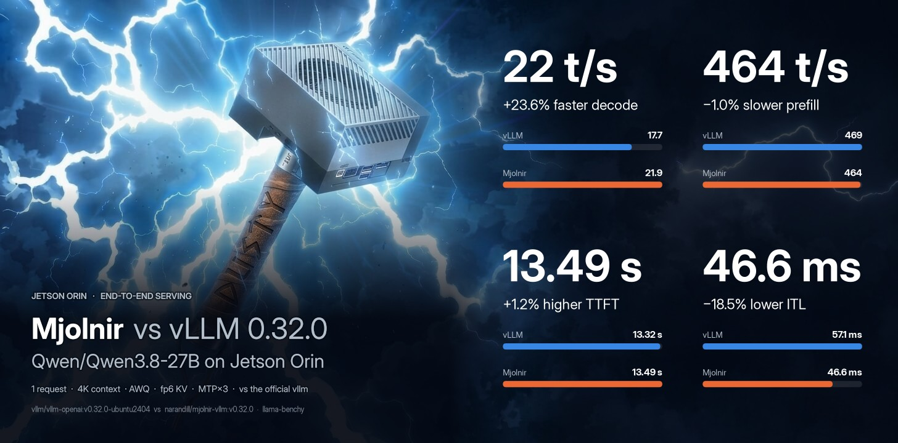
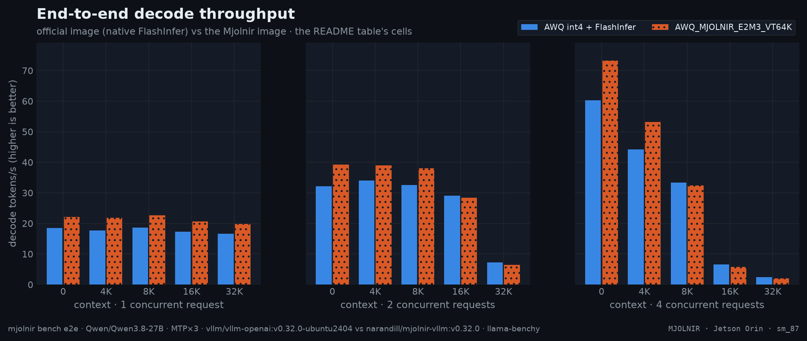
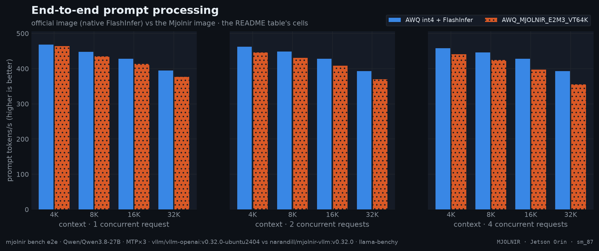

  

# Jetson Orin

> **research** platform · `sm_87` · host requirements: JetPack 7.2.1+ (L4T 39.2.1, CUDA 13.2) · [all platforms](../README.md)

## Serving on Jetson Orin

One row per model in `configs/` — the config the platform's overlays serve
by default (the model page's quickstart rule) and whether the
(platform, model) pair has end-to-end data. Per-config availability lives
on each [model page](../../../configs/).

| model | default config | measured |
|---|---|---|
| [`Qwen/Qwen3.8-27B`](../../../configs/Qwen/Qwen3.8-27B/README.md) | [`AWQ_FLASHINFER`](../../../configs/Qwen/Qwen3.8-27B/AWQ_FLASHINFER/README.md) | ✅ |
| [`nvidia/Qwen3.6-35B-A3B`](../../../configs/nvidia/Qwen3.6-35B-A3B/README.md) | — | — |

## Kernel

Mjolnir on Jetson Orin, measured chapter by chapter and pinned to the
headline model (Qwen/Qwen3.8-27B) — every chart and table rendered
from raw results in [`benchmarks/raw/verify/`](../../../benchmarks/raw/verify/)
by `mjolnir plot --readme`; every chapter ends with the command that
reproduces it.

**Where it stands:** 1.14× FlashInfer (geomean over L = 128 4K 8K 16K 32K 64K 128K 256K), 48 / 48 correctness checks — run `20261028-001502`.

How the % and × here are calculated

- **Time per decode step** = Nsight Compute kernel time (`gpu__time_duration`) of the decode kernel **plus** its split-KV merge kernel, at base clocks with a cold L2, median over the iterations. The reference (FlashInfer, FlashAttention 4 hd256) is measured the same way, at the same L, in the same run.
- **Speedup ×** = reference time ÷ Mjolnir time. `1.24×` means Mjolnir needs 1 ÷ 1.24 = 81% of the reference's time per step (19% less time); below 1 the reference is faster.
- **Geomean over L** = exp(mean of ln(speedup at each L)): every context length weighs the same, and one large ratio cannot dominate the way it would in an arithmetic mean.
- **Colors / "beyond the noise band"**: green = speedup ≥ 1.03, grey = within ±3%, red ≤ 0.97. ±3% (`NOISE_PCT`) is how far a same-run ratio moves between repeated runs on a dedicated Thor.

 

| # | chapter | question | status |
|---|---|---|---|
| 1 | [Correctness matrix](kernel/correctness.md) | kernel vs the bit-faithful emulator: every layout, format, page size, q_len, Q dtype | ✅ run `20261028-092639` |
| 2 | [Headline L-sweep](kernel/sweep.md) | Mjolnir vs FlashInfer (FA4 hd256 on Thor, FA2-TC on Orin), fp8 KV — ncu kernel time on Thor, events-timed where there is no ncu | ✅ run `20261028-001502` |
| 3 | [Head-major pages](kernel/hndsweep.md) | FlashInfer on NHD and HND vs Mjolnir on HND — is HND a kernel win or a layout win? | ✅ run `20261023-131353` |
| 4 | [KV layouts and formats](kernel/kvfmt.md) | fp8 / fp6 / fp4 / nvfp4 KV on NHD / interleaved / HND pages (ncu + wall clock) | ✅ run `20261023-135008` |
| 5 | [KV format accuracy](kernel/quant.md) | relative L2 error of each KV format vs unquantized KV, at every L | ✅ run `20261023-134300` |
| 6 | [KV cache capacity](kernel/kv-cache-size.md) | tokens of KV each config fits (vLLM's startup sizing), and the concurrency that buys per context | ✅ run `20261026-203434` |
| 7 | [Speculative decoding](kernel/spec.md) | MTP acceptance per draft position and decode t/s for 1-N draft tokens, per config — the best draft count | ✅ run `20261026-175121` |
| 8 | [Full profiles per KV format](kernel/fp6prof.md) | full ncu profiles: L2 sectors vs requests vs time, warp stalls, per KV format | ✅ run `20261023-135335` |
| 9 | [KV ring depth](kernel/ring.md) | TMA→MMA ring depth (--kv_stages) sweep at every L | ✅ run `20261023-135446` |
| 10 | [L2 prefetch](kernel/prefetch.md) | TMA L2 prefetch distance (--l2_prefetch) sweep | ✅ run `20261023-135447` |
| 11 | [Programmatic dependent launch](kernel/pdl.md) | PDL on/off wall clock (decode overlaps the previous kernel; merge launches early) | ⏳ pending |
| 12 | [Flag A/B](kernel/ab.md) | any harness flag sets, ncu + wall clock (default: evict-first x PDL) | ✅ run `20261023-135215` |
| 13 | [Accuracy](kernel/accuracy.md) | Does a serving config keep the model's answers? Tool calling (standard + Hard Mode), GSM8K / MMLU / IFEval on demand — `mjolnir bench accuracy` | ✅ run `20261017-210613` |

### Mjolnir Kernel

All kernel numbers are **cuda-event timed kernel time**, one sequence with 24 query / 4 KV heads, head dim 256, 128-token pages — the attention shape of Qwen3.8-27B — at **every context length from 128 to 256K tokens**.
Measured on the Orin: **research stage** — the restored `sm_87` kernel is slower than FlashInfer at every L; the chapters quantify the gap and where it comes from. Noise and methodology: [`docs/methodology/benchmarking.md`](../../../docs/methodology/benchmarking.md).

| leg | what runs | KV cache |
|---|---|---|
| **Mjolnir GEMV** | the restored `sm_87` GEMV kernel, standalone | fp8 e4m3, HND pages |
| **Mjolnir · serving path** | the kernel as the backend launches it (plan + buffers included) | fp8 e4m3, HND pages |
| **FlashInfer FA2-TC** | the official vLLM 0.32.0 FlashInfer decode path for `sm_87` | fp8 e4m3, NHD pages |

| L | Mjolnir fp8 | FlashInfer | fp8 vs FI |
|---|--:|--:|--:|
| **128** | **72.4&nbsp;µs** | 114.5&nbsp;µs | $\color{#16a34a}{\mathbf{1.58\times}}$ |
| **4K** | **86.4&nbsp;µs** | 129.6&nbsp;µs | $\color{#16a34a}{\mathbf{1.50\times}}$ |
| **8K** | 135.6&nbsp;µs | **135.0&nbsp;µs** | $\color{grey}{1.00\times}$ |
| **16K** | **230.1&nbsp;µs** | 230.2&nbsp;µs | $\color{grey}{1.00\times}$ |
| **32K** | **418.2&nbsp;µs** | 429.2&nbsp;µs | $\color{grey}{1.03\times}$ |
| **64K** | **793.2&nbsp;µs** | 830.1&nbsp;µs | $\color{#16a34a}{\mathbf{1.05\times}}$ |
| **128K** | **1.54&nbsp;ms** | 1.62&nbsp;ms | $\color{#16a34a}{\mathbf{1.05\times}}$ |
| **256K** | **3.04&nbsp;ms** | 3.23&nbsp;ms | $\color{#16a34a}{\mathbf{1.06\times}}$ |
| geomean |  |  | $\color{#16a34a}{\mathbf{1.14\times}}$ |

> Bold = fastest at that `L`. Ratio columns: baseline time ÷ this kernel's time (the Orin kernel is behind everywhere today).

How the % and × here are calculated

- **Time per decode step** = Nsight Compute kernel time (`gpu__time_duration`) of the decode kernel **plus** its split-KV merge kernel, at base clocks with a cold L2, median over the iterations. The reference (FlashInfer, FlashAttention 4 hd256) is measured the same way, at the same L, in the same run.
- **Speedup ×** = reference time ÷ Mjolnir time. `1.24×` means Mjolnir needs 1 ÷ 1.24 = 81% of the reference's time per step (19% less time); below 1 the reference is faster.
- **Geomean over L** = exp(mean of ln(speedup at each L)): every context length weighs the same, and one large ratio cannot dominate the way it would in an arithmetic mean.
- **Colors / "beyond the noise band"**: green = speedup ≥ 1.03, grey = within ±3%, red ≤ 0.97. ±3% (`NOISE_PCT`) is how far a same-run ratio moves between repeated runs on a dedicated Thor.

 

## End to end

The official vLLM image vs Mjolnir on Jetson Orin — the headline model's
own history (`latest_pair`), decode tokens/s per request at 1 request.

| official | Mjolnir | official t/s | Mjolnir t/s | change | at |
|---|---|--:|--:|--:|---|
| `AWQ_FLASHINFER` | `AWQ_MJOLNIR_E2M3_VT64K` | 16.6 | 19.8 | +18.8% | 32K |

How the % and × here are calculated

- **Throughput** (decode, prefill — tokens/s, higher is better): change = (Mjolnir − official) ÷ official × 100. `+57%` = 1.57× the tokens per second. On the infographic a change of +100% or more is written as the multiple Mjolnir ÷ official (`+200%` = `3×`).
- **Latency** (TTFT, ITL — milliseconds, lower is better): change = (Mjolnir − official) ÷ official × 100, so a negative value is a **latency reduction**: `−27%` = 27% fewer milliseconds. It is *not* the reciprocal speedup official ÷ Mjolnir − 1, which reads larger for the same pair.
- **Values**: the mean over the measured runs per cell (6 measured after 2 warm-ups, llama-benchy): decode = generated tokens ÷ generation time per request (summed over requests at higher concurrency), prefill = prompt tokens ÷ prompt-processing time, TTFT = time to the first content token, ITL = 1000 ÷ the per-request decode rate.
- **Colors**: green = better by at least 3%, grey = within ±3% (`E2E_NOISE_PCT`), red = worse by at least that. With speculative decoding a single decode cell moves more between runs (acceptance depends on the prompt), so repeat (`--repeat`) before reading a few-% difference.

 

Explore every number in [the interactive charts](https://thor-arena.github.io/mjolnir/#platform=orin).
