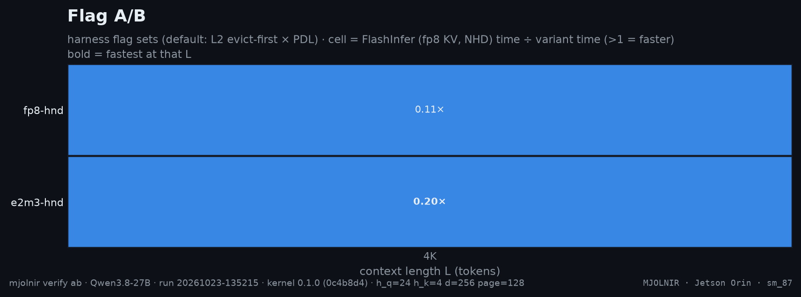

# Flag A/B

> any harness flag sets, ncu + wall clock (default: evict-first x PDL) · `mjolnir verify ab` · run `20261023-135215`

## The question

A general-purpose A/B for harness flags. The sm_87 default run compares the KV formats themselves — fp8 vs e2m3 on HND pages — the Thor's launch knobs (evict-first, PDL) do not exist on Ampere.


## How it is measured

Any `name:flags|name:flags` list (`--variants`), ncu at every L plus a wall-clock row.

## Result



- Fastest variant at the most context lengths: **`e2m3-hnd`** (1 of 1).
- Best geomean vs FlashInfer: **`e2m3-hnd`** (0.20×); worst: `fp8-hnd` (0.11×).

| variant | flags | 4K | geomean |
|---|---|--:|--:|
| `fp8-hnd` | `--kv_format fp8 --kv_layout hnd` | $\color{#dc2626}{0.11\times}$ | $\color{#dc2626}{0.11\times}$ |
| `e2m3-hnd` | `--kv_format e2m3 --kv_layout hnd` | **$\color{#dc2626}{0.20\times}$** | $\color{#dc2626}{0.20\times}$ |

<details>
<summary>How the % and × here are calculated</summary>

- Each cell = **reference time ÷ variant time** (Nsight Compute kernel time, decode + merge, base clocks, cold L2, same run, same L). `1.10×` = the variant needs 1 ÷ 1.10 = 91% of the reference's time; below 1 it is slower.
- **geomean** = exp(mean of ln(ratio)) over the context lengths; **bold** = the fastest variant at that L.
- Green ≥ 1.03, grey within ±3% (`NOISE_PCT`, the run-to-run spread of a same-run ratio), red ≤ 0.97.

</details><br />


**Wall clock** (harness median, cold L2, b=1; Δ vs the first variant):

| L | fp8-hnd | e2m3-hnd |
|---|--:|--:|
| **4K** | 467.5&nbsp;µs | 352.9&nbsp;µs $\color{#16a34a}{\text{−24.5\\%}}$ |

<details>
<summary>How the % and × here are calculated</summary>

- Wall-clock median per launch over the stage's iterations (CUDA events), every variant in the same run.
- **%** = (variant − first column) ÷ first column × 100 — the change in **time**: negative = faster. `−6.0%` = 6% less time than the first column.
- Green = at least 3% less time, red = at least 3% more, grey = within ±3% (`NOISE_PCT`).

</details><br />


<sub>Rendered from [`benchmarks/raw/verify/ab/20261023-135215.json`](../../../../benchmarks/raw/verify/ab/20261023-135215.json). Ratios: FlashInfer time ÷ variant time; green = faster beyond the ±3% noise band, red = slower, gray = within noise.</sub>

## How to read it

Use it for any idea: change a flag in the harness, run `mjolnir verify ab --variants ...`, and the heatmap shows where it wins. Custom runs are saved but never replace this page's default chart.

## Reproduce

```bash
mjolnir verify ab
mjolnir verify ab --variants "base:|mine:--my_flag 1" --ls "8192 65536 262144"
```

## Ideas to try

- anything — this is the experiment slot. `mjolnir autoresearch` uses it to test agent-proposed changes.

Found something? Open a PR with the raw JSON from `benchmarks/raw/verify/` — see [CONTRIBUTING](../../../../.github/CONTRIBUTING.md).

---

[← Programmatic dependent launch](pdl.md) · [case study](../README.md#-kernel)
