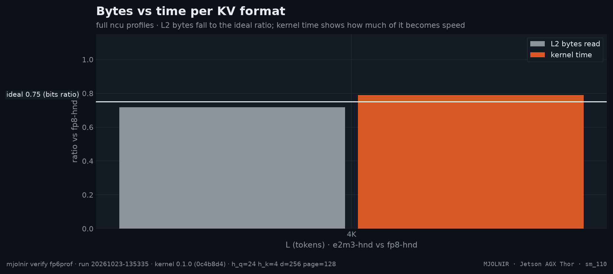

# Full profiles per KV format

> full ncu profiles: L2 sectors vs requests vs time, warp stalls, per KV format · `mjolnir verify fp6prof` · run `20261023-135335`

## The question

fp6 reads 25% fewer bytes than fp8 — so why is it not 25% faster? A full Nsight Compute profile per KV format answers where the time goes.

## How it is measured

`ncu --set full` on 3 launches of the decode kernel per format and L (cold L2, base clocks). Reported: the **fastest launch's** metrics — time, stall mix and bytes from one self-consistent replay. Identical launches of this kernel flip up to ~25% in kernel time under replay (CTA-residency modes, at every L and format), so a mean over a few launches mixes the modes and invents per-L holes that wall clock does not show; the fastest launch is the one the wall-clock harness medians see. The `.ncu-rep` files stay in the run's log directory for Nsight Compute's *Add Baseline* view.

## Result



- `e2m3-hnd`: kernel time **0.79×** the baseline for 0.75× the bytes — 84% of the byte saving becomes speed (mean over L).

| L | variant | bits | kernel time | time ratio | L2 bytes ratio | ideal | bytes / L2 request | top stall (cycles/instr) |
|---|---|--:|--:|--:|--:|--:|--:|---|
| **4K** | `fp8-hnd` | 8 | 689.3&nbsp;µs | 1.00 | 1.00 | 1.00 | 149 B | selected 1.0 |
| **4K** | `e2m3-hnd` | 6 | 544.6&nbsp;µs | 0.79 | 0.72 | 0.75 | 86 B | selected 1.0 |

<details>
<summary>How the % and × here are calculated</summary>

- **time ratio** = this row's Nsight Compute kernel time ÷ the first row's at the same L; **L2 bytes ratio** = L2 read sectors ÷ the first row's; **ideal** = this row's KV bits ÷ the first row's — the ratio a purely bandwidth-bound kernel would show.
- **bytes / L2 request** = 32 B × L2 read sectors ÷ L2 read requests.

</details><br />

<sub>Rendered from [`benchmarks/raw/verify/fp6prof/20261023-135335.json`](../../../../benchmarks/raw/verify/fp6prof/20261023-135335.json). Ratios: FlashInfer time ÷ variant time; green = faster beyond the ±3% noise band, red = slower, gray = within noise.</sub>

## How to read it

- **L2 bytes ratio ≈ the ideal (bits) ratio** → no padding or over-fetch: the TMA reads exactly the packed bytes;
- **kernel time well above the bytes ratio** → the limit is not bandwidth. The *bytes per L2 request* column shows fp6 rows arriving as more, smaller requests (the TMA's sub-byte unpack path);
- the stall column shows what warps wait on — long scoreboard = waiting for memory.

## Reproduce

```bash
mjolnir verify fp6prof
mjolnir verify fp6prof --variants "fp8-hnd:--kv_format fp8 --kv_layout hnd|e2m3-hnd:--kv_format e2m3 --kv_layout hnd" --ls 65536
```

## Ideas to try

- **Tried:** a TMA box that keeps fp6 requests at 128 B (SW128 smem atoms, autoresearch run 1) — ~5% faster at 64K–256K, slower at short L; gated at ≥ 64K it is +1.7% overall. At long L e2m3 is already close to its byte ratio, so request size is not the main limit there.
- **Tried:** TMA-warp block-table readahead (a rolling page window refilled N tiles ahead of the TMA issue; task/flashinfer-0.7.2-sm110-analysis.md E2a) — correct but no win: wall ratios move ±2–4% around zero at 16K–128K, and the `long_scoreboard` share does not drop. The stall is not the block table. The implementation and its A/B raw are preserved in git history (`39fa326`).
- **Open:** the uniform ~10–15% shortfall vs the byte ratio at every L (the latency side of the whole kernel: L2 at 17–25% of peak, `long_scoreboard` the top stall); ring depth chosen per L at runtime. The ranked list with commands is [`research/program.md`](../../../../research/program.md).
- **Not worth it:** unpacking fp6 in registers instead of the TMA — the nvfp4 convert warpgroup shows what a conversion pass costs (0.48–0.69× FlashInfer).

Found something? Open a PR with the raw JSON from `benchmarks/raw/verify/` — see [CONTRIBUTING](../../../../.github/CONTRIBUTING.md).

---

[← Speculative decoding](spec.md) · [case study](../README.md#kernel) · [KV ring depth →](ring.md)
