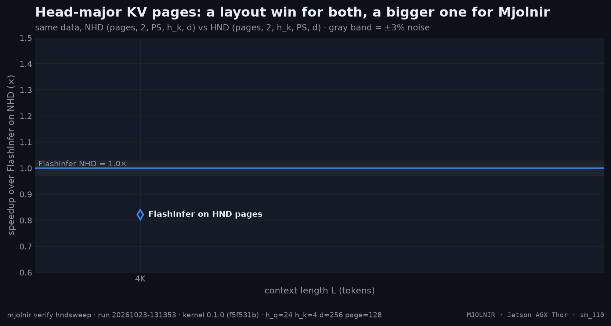

# Head-major pages

> FlashInfer on NHD and HND vs Mjolnir on HND — is HND a kernel win or a layout win? · `mjolnir verify hndsweep` · run `20261023-131353`

## The question

Mjolnir reads K/V from **head-major (HND)** pages, where each KV head's page is one contiguous block, instead of vLLM's default token-major layout. Is that a kernel advantage, or a layout that would make FlashInfer just as fast?

## How it is measured

Same data in both layouts: the FlashInfer driver generates the cache once in NHD order `(pages, 2, PS, h_k, d)` and transposes it to HND `(pages, 2, h_k, PS, d)`; Mjolnir (fp8 KV) runs on HND. All legs are relative to FlashInfer on NHD.

## Result



- **Mjolnir (fp8 KV, HND)** vs FlashInfer (fp8 KV, NHD): geomean **0.10×**, from 0.10× (L=4K) to 0.10× (L=4K); faster beyond the ±3% noise band at 0 of 1 context lengths.
- **FlashInfer (fp8 KV, HND)** vs FlashInfer (fp8 KV, NHD): geomean **0.82×**, from 0.82× (L=4K) to 0.82× (L=4K); faster beyond the ±3% noise band at 0 of 1 context lengths.

| L | FlashInfer | FlashInfer HND | Mjolnir fp8 | fp8 vs FI | fp8 vs FI-HND |
|---|--:|--:|--:|--:|--:|
| **4K** | **105.3&nbsp;µs** | 128.2&nbsp;µs | 1.04&nbsp;ms | $\color{#dc2626}{0.10\times}$ | $\color{#dc2626}{0.12\times}$ |
| geomean |  |  |  | $\color{#dc2626}{0.10\times}$ | $\color{#dc2626}{0.12\times}$ |

<details>
<summary>How the % and × here are calculated</summary>

- **Time per decode step** = Nsight Compute kernel time (`gpu__time_duration`) of the decode kernel **plus** its split-KV merge kernel, at base clocks with a cold L2, median over the iterations. The reference legs — FlashInfer, plus FlashAttention 4 hd256 where the platform has that leg — are measured the same way, at the same L, in the same run.
- **Speedup ×** = reference time ÷ Mjolnir time. `1.24×` means Mjolnir needs 1 ÷ 1.24 = 81% of the reference's time per step (19% less time); below 1 the reference is faster.
- **Geomean over L** = exp(mean of ln(speedup at each L)): every context length weighs the same, and one large ratio cannot dominate the way it would in an arithmetic mean.
- **Colors / "beyond the noise band"**: green = speedup ≥ 1.03, grey = within ±3%, red ≤ 0.97. ±3% (`NOISE_PCT`) is how far a same-run ratio moves between repeated runs on a dedicated board.

</details><br />

<sub>Rendered from [`benchmarks/raw/verify/hndsweep/20261023-131353.json`](../../../../benchmarks/raw/verify/hndsweep/20261023-131353.json). Ratios: FlashInfer time ÷ variant time; green = faster beyond the ±3% noise band, red = slower, gray = within noise.</sub>

## How to read it

If FlashInfer-HND climbed to Mjolnir's line, HND would be a layout win only. The gap between the two HND lines is what the kernel itself adds: TMA boxes of one head's contiguous page stream in longer DRAM bursts, which Mjolnir's pipeline converts into speed more fully than FlashInfer's.

In vLLM, `VLLM_KV_CACHE_LAYOUT=HND` allocates this layout (`mjolnir serve` sets it for MJOLNIR configs). vLLM's interleaved `(B, H, N, 2D)` layout is head-major too, but K and V alternate per row, so each stream reads every other block — see [kvfmt](kvfmt.md).

## Reproduce

```bash
mjolnir verify hndsweep
```

## Ideas to try

- FlashInfer at page size 16 and 64, where its native vLLM path runs: `mjolnir verify hndsweep --page-size 16` (and `--page-size 64`).

Found something? Open a PR with the raw JSON from `benchmarks/raw/verify/` — see [CONTRIBUTING](../../../../.github/CONTRIBUTING.md).

---

[← Headline L-sweep](sweep.md) · [case study](../README.md#kernel) · [KV layouts and formats →](kvfmt.md)
