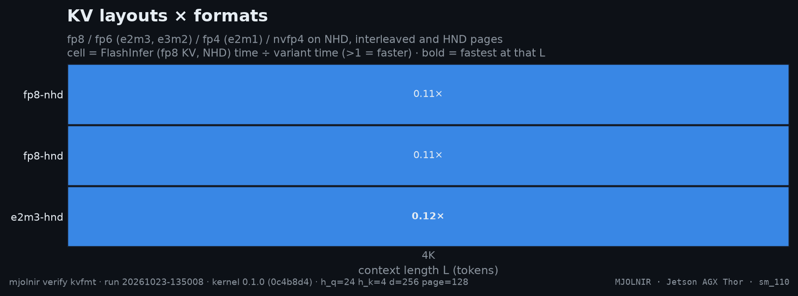
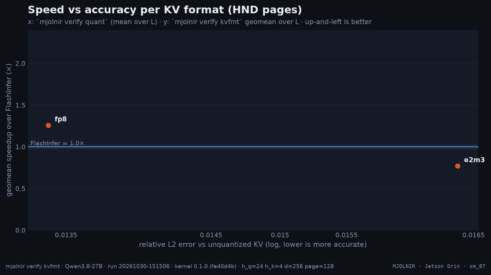

# KV layouts and formats

> fp8 / fp6 / fp4 / nvfp4 KV on NHD / interleaved / HND pages (ncu + wall clock) · `mjolnir verify kvfmt` · run `20261023-135008`

## The question

How many bits does a KV element need, and which page layout streams them best? The `sm_87` mma kernel reads fp8 (e4m3) and fp6 (e2m3) KV — the fp8 rows dequantize in shared memory on the `mma.m16n8k16` path, the fp6 rows ride the packed 6-bit LUT — so its sweep is fp8 vs e2m3 on NHD and HND pages.

## How it is measured

Every variant runs at every L with the harness default otherwise; FlashInfer on NHD and HND are the references. A wall-clock row (harness median, cold L2) adds what ncu cannot see — launch gaps. The tradeoff chart pairs each format's speed with its accuracy from [quant](quant.md).

## Result





- Fastest variant at the most context lengths: **`e2m3-hnd`** (1 of 1).
- Best geomean vs FlashInfer: **`e2m3-hnd`** (0.12×); worst: `fp8-hnd` (0.11×).

| variant | flags | 4K | geomean |
|---|---|--:|--:|
| `fp8-nhd` | `--kv_format fp8 --kv_layout nhd` | $\color{#dc2626}{0.11\times}$ | $\color{#dc2626}{0.11\times}$ |
| `fp8-hnd` | `--kv_format fp8 --kv_layout hnd` | $\color{#dc2626}{0.11\times}$ | $\color{#dc2626}{0.11\times}$ |
| `e2m3-hnd` | `--kv_format e2m3 --kv_layout hnd` | **$\color{#dc2626}{0.12\times}$** | $\color{#dc2626}{0.12\times}$ |

<details>
<summary>How the % and × here are calculated</summary>

- Each cell = **reference time ÷ variant time** (Nsight Compute kernel time, decode + merge, base clocks, cold L2, same run, same L). `1.10×` = the variant needs 1 ÷ 1.10 = 91% of the reference's time; below 1 it is slower.
- **geomean** = exp(mean of ln(ratio)) over the context lengths; **bold** = the fastest variant at that L.
- Green ≥ 1.03, grey within ±3% (`NOISE_PCT`, the run-to-run spread of a same-run ratio), red ≤ 0.97.

</details><br />


**Wall clock** (harness median, cold L2, b=1; Δ vs the first variant):

| L | fp8-nhd | fp8-hnd | e2m3-hnd |
|---|--:|--:|--:|
| **4K** | 460.0&nbsp;µs | 471.7&nbsp;µs $\color{grey}{\text{+2.5\\%}}$ | 353.3&nbsp;µs $\color{#16a34a}{\text{−23.2\\%}}$ |

<details>
<summary>How the % and × here are calculated</summary>

- Wall-clock median per launch over the stage's iterations (CUDA events), every variant in the same run.
- **%** = (variant − first column) ÷ first column × 100 — the change in **time**: negative = faster. `−6.0%` = 6% less time than the first column.
- Green = at least 3% less time, red = at least 3% more, grey = within ±3% (`NOISE_PCT`).

</details><br />


<sub>Rendered from [`benchmarks/raw/verify/kvfmt/20261023-135008.json`](../../../../benchmarks/raw/verify/kvfmt/20261023-135008.json). Ratios: FlashInfer time ÷ variant time; green = faster beyond the ±3% noise band, red = slower, gray = within noise.</sub>

## How to read it

- **layout**: fp8 on NHD vs interleaved vs HND isolates the page layout;
- **format**: on HND, e2m3 reads 25% fewer bytes than fp8 — compare the measured speedup with that ideal (and see [fp6prof](fp6prof.md) for why fp6 realizes less of it);
- the tradeoff chart is the decision: up-and-left wins; e2m3 is the harness default because it sits next to fp8 on accuracy.

## Reproduce

```bash
mjolnir verify kvfmt
mjolnir verify kvfmt --variants "e2m3:--kv_format e2m3"
```

## Ideas to try

- close the hd128 gap (the top integration item): the mma serves head_size 256 only, and fp6 stays hd256-only — a 96-byte row splits into non-integral 4-byte lane slices.

Found something? Open a PR with the raw JSON from `benchmarks/raw/verify/` — see [CONTRIBUTING](../../../../.github/CONTRIBUTING.md).

---

[← Head-major pages](hndsweep.md) · [case study](../README.md#kernel) · [KV format accuracy →](quant.md)
