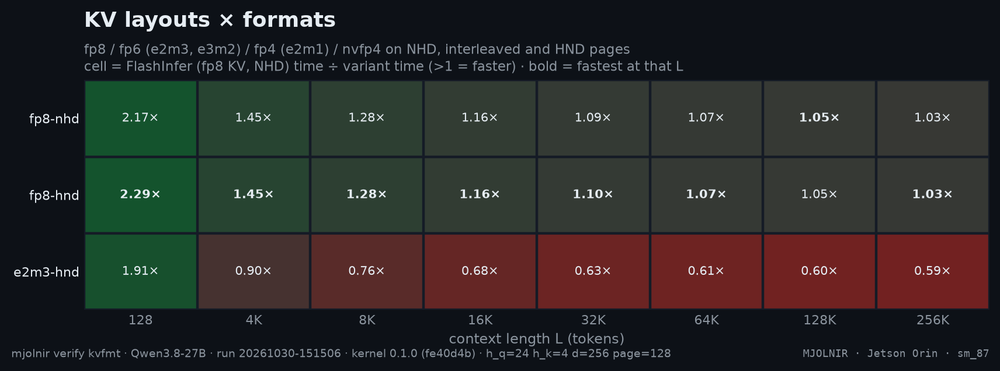
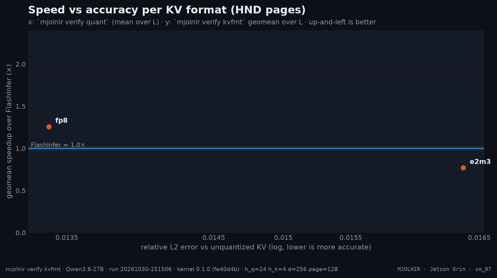

# KV layouts and formats

> fp8 / fp6 / fp4 / nvfp4 KV on NHD / interleaved / HND pages (ncu + wall clock) · `mjolnir verify kvfmt` · run `20261105-175927`

## The question

How many bits does a KV element need, and which page layout streams them best? The `sm_87` mma kernel serves fp8 (e4m3) KV — fp6 is blocked on the arch (the e2m3 ring never paid on sm_87) — so its sweep is the fp8 HND reference against the fp8 NHD layout.

## How it is measured

Every variant runs at every L with the harness default otherwise; FlashInfer on NHD and HND are the references. A wall-clock row (harness median, cold L2) adds what ncu cannot see — launch gaps. The tradeoff chart pairs each format's speed with its accuracy from [quant](quant.md).

## Result





- Fastest variant at the most context lengths: **`fp8-hnd`** (7 of 8).
- Best geomean vs FlashInfer: **`fp8-hnd`** (1.25×); worst: `fp8-nhd` (1.24×).
- All variants sit within 1% of each other — inside the noise band.

| variant | flags | 128 | 4K | 8K | 16K | 32K | 64K | 128K | 256K | geomean |
|---|---|--:|--:|--:|--:|--:|--:|--:|--:|--:|
| `fp8-nhd` | `--kv_format fp8 --kv_layout nhd` | $\color{#16a34a}{2.17\times}$ | **$\color{#16a34a}{1.43\times}$** | $\color{#16a34a}{1.27\times}$ | $\color{#16a34a}{1.15\times}$ | $\color{#16a34a}{1.10\times}$ | $\color{#16a34a}{1.07\times}$ | $\color{#16a34a}{1.04\times}$ | $\color{grey}{1.03\times}$ | $\color{#16a34a}{\mathbf{1.24\times}}$ |
| `fp8-hnd` | `--kv_format fp8 --kv_layout hnd` | **$\color{#16a34a}{2.28\times}$** | $\color{#16a34a}{1.42\times}$ | **$\color{#16a34a}{1.27\times}$** | **$\color{#16a34a}{1.15\times}$** | **$\color{#16a34a}{1.10\times}$** | **$\color{#16a34a}{1.07\times}$** | **$\color{#16a34a}{1.05\times}$** | **$\color{#16a34a}{1.03\times}$** | $\color{#16a34a}{\mathbf{1.25\times}}$ |

<details>
<summary>How the % and × here are calculated</summary>

- Each cell = **reference time ÷ variant time** (Nsight Compute kernel time, decode + merge, base clocks, cold L2, same run, same L). `1.10×` = the variant needs 1 ÷ 1.10 = 91% of the reference's time; below 1 it is slower.
- **geomean** = exp(mean of ln(ratio)) over the context lengths; **bold** = the fastest variant at that L.
- Green ≥ 1.03, grey within ±3% (`NOISE_PCT`, the run-to-run spread of a same-run ratio), red ≤ 0.97.

</details><br />


**Wall clock** (harness median, cold L2, b=1; Δ vs the first variant):

| L | fp8-nhd | fp8-hnd |
|---|--:|--:|
| **128** | 66.5&nbsp;µs | 66.5&nbsp;µs $\color{grey}{\text{0.0\\%}}$ |
| **4K** | 87.3&nbsp;µs | 87.6&nbsp;µs $\color{grey}{\text{+0.4\\%}}$ |
| **8K** | 136.9&nbsp;µs | 137.3&nbsp;µs $\color{grey}{\text{+0.3\\%}}$ |
| **16K** | 231.1&nbsp;µs | 229.7&nbsp;µs $\color{grey}{\text{−0.6\\%}}$ |
| **32K** | 418.2&nbsp;µs | 416.7&nbsp;µs $\color{grey}{\text{−0.4\\%}}$ |
| **64K** | 791.3&nbsp;µs | 796.1&nbsp;µs $\color{grey}{\text{+0.6\\%}}$ |
| **128K** | 1.54&nbsp;ms | 1.54&nbsp;ms $\color{grey}{\text{−0.1\\%}}$ |
| **256K** | 3.02&nbsp;ms | 3.01&nbsp;ms $\color{grey}{\text{−0.2\\%}}$ |

<details>
<summary>How the % and × here are calculated</summary>

- Wall-clock median per launch over the stage's iterations (CUDA events), every variant in the same run.
- **%** = (variant − first column) ÷ first column × 100 — the change in **time**: negative = faster. `−6.0%` = 6% less time than the first column.
- Green = at least 3% less time, red = at least 3% more, grey = within ±3% (`NOISE_PCT`).

</details><br />


<sub>Rendered from [`benchmarks/raw/verify/kvfmt/20261105-175927.json`](../../../../benchmarks/raw/verify/kvfmt/20261105-175927.json). Ratios: FlashInfer time ÷ variant time; green = faster beyond the ±3% noise band, red = slower, gray = within noise.</sub>

## How to read it

- **layout**: fp8 on NHD vs interleaved vs HND isolates the page layout;
- **format**: fp8 is the served format (fp6 blocked on the arch — the e2m3 ring never paid on sm_87); the HND/NHD pair is the decision axis;
- the tradeoff chart is the decision: up-and-left wins.

## Reproduce

```bash
mjolnir verify kvfmt
```

## Ideas to try

- fp6 hd128: the e2m3 D2 recipe's byte-lane phase is static per thread (64 groups/row); a per-iteration phase would serve hd128's 32.
- fp4 (e2m1) KV — measured and refuted on this board (2026-11-01): the 4-bit dequant cost exceeds the byte cut in every arrangement (tile, fragment, and the mixed fp8-K/fp4-V); the formats shipped in `4b3ace5`/`fe84d72` and were removed in `6163b85`. A revival needs hardware fp4 (sm_110+) or a vLLM cache-format change.

Found something? Open a PR with the raw JSON from `benchmarks/raw/verify/` — see [CONTRIBUTING](../../../../.github/CONTRIBUTING.md).

---

[← Head-major pages](hndsweep.md) · [case study](../README.md#-kernel) · [KV format accuracy →](quant.md)
