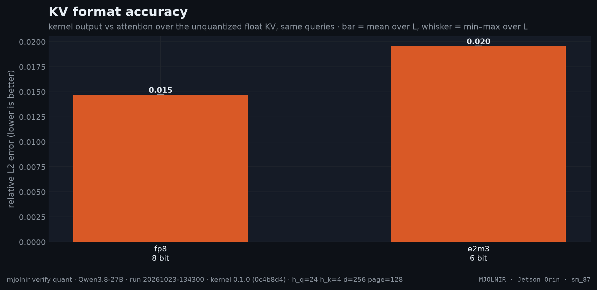

# KV format accuracy

> relative L2 error of each KV format vs unquantized KV, at every L · `mjolnir verify quant` · run `20261023-134300`

## The question

What does each KV format cost in accuracy? Speed from fewer bits is only worth it if attention output stays close to the unquantized result.

## How it is measured

The harness generates float K/V, quantizes them to each format (per-KV-head descale; NVFP4 uses its per-16 scales + a global scale), runs the kernel, and reports the **relative L2 error of the output vs attention over the unquantized float KV** with the same queries. fp8 is quantized the same way, so every format starts from the same data. Two sequences per L; the kernel must still agree with its emulator (the stage records that too).

## Result



- `fp8`: mean relative L2 error **0.015** (1.0× fp8's 0.015).
- `e2m3`: mean relative L2 error **0.020** (1.3× fp8's 0.015).

| format | bits | 4K | mean |
|---|--:|--:|--:|
| `fp8` | 8 | 0.0147 | **0.0147** |
| `e2m3` | 6 | 0.0196 | **0.0196** |

<sub>Rendered from [`benchmarks/raw/verify/quant/20261023-134300.json`](../../../../benchmarks/raw/verify/quant/20261023-134300.json). Ratios: FlashInfer time ÷ variant time; green = faster beyond the ±3% noise band, red = slower, gray = within noise.</sub>

## How to read it

fp8 is the floor every format is compared with (it is what vLLM serves). An error a few percent above fp8 is in the same regime; several times fp8 changes model outputs and needs an end-to-end eval before use.

## Reproduce

```bash
mjolnir verify quant
```

## Ideas to try

- end-to-end evals for fp4 KV on a real model (`mjolnir bench accuracy` — the fp6 KV rows already live in [accuracy](accuracy.md));
- finer-grained scales for e2m1.

Found something? Open a PR with the raw JSON from `benchmarks/raw/verify/` — see [CONTRIBUTING](../../../../.github/CONTRIBUTING.md).

---

[← KV layouts and formats](kvfmt.md) · [case study](../README.md#-kernel) · [KV cache capacity →](kv-cache-size.md)
