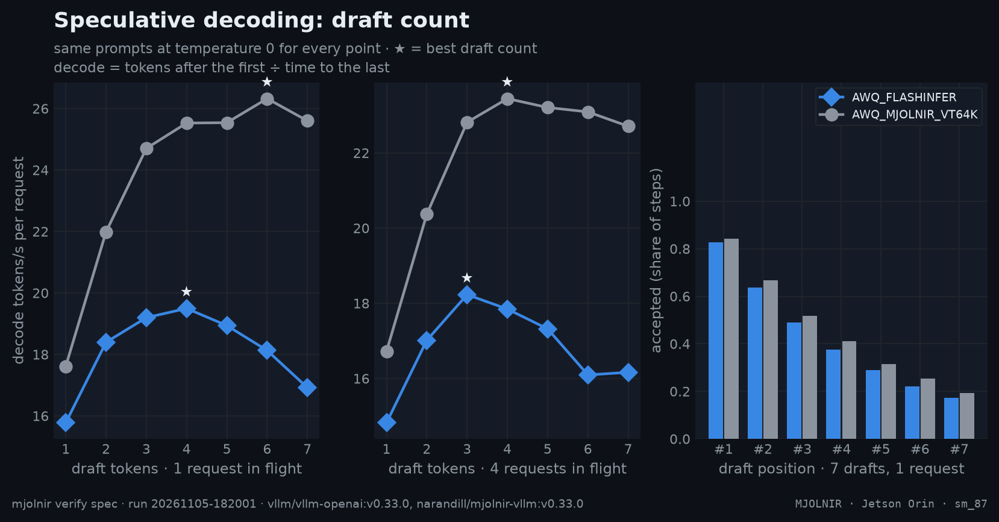

# Speculative decoding

> MTP acceptance per draft position and decode t/s for 1-N draft tokens, per config — the best draft count · `mjolnir verify spec` · run `20261105-182001`

## The question

Every config serves Qwen3.8-27B with its MTP head proposing draft tokens that one forward pass of the full model then verifies. Two numbers decide the decode rate: how many tokens a verify step yields (1 + the drafts accepted) and how long the step takes. Each extra draft adds one forward of the draft head — on this model a bf16 MTP layer plus the bf16 lm_head, ~3 GB of reads — so more drafts are only worth it while the last one is still accepted often enough. And does the Mjolnir kernel (fp8 Q, fp6 KV) change what gets accepted?

## How it is measured

For every config and every draft count k the server is started with `--speculative-config` overridden to k (the rest of the config unchanged; the server restarts per point). After two warm-up requests, a fixed prompt set — code, maths, prose, translation, tables, one ~8K-token context — is sent at **temperature 0**, so every point decodes the same text, once per concurrency level. Around each block the stage reads vLLM's speculative-decoding counters:

- **tokens per step** = 1 + accepted ÷ drafts (what one verify forward yields);
- **acceptance per position** = how often draft #1, #2, … was accepted (each needs all earlier ones accepted);
- **decode t/s per request** from the stream: tokens after the first ÷ time from the first to the last token; **aggregate t/s** = all generated tokens ÷ the block's wall time.

## Result



- AWQ_FLASHINFER, 1 request: best with **4 drafts** — 19.5 t/s per request, 3.51 tokens per step, +1.6% vs 3 drafts.
- AWQ_FLASHINFER, 4 requests: best with **3 drafts** — 18.2 t/s per request, 3.13 tokens per step.
- AWQ_MJOLNIR_VT64K, 1 request: best with **6 drafts** — 26.3 t/s per request, 4.01 tokens per step, +6.6% vs 3 drafts.
- AWQ_MJOLNIR_VT64K, 4 requests: best with **4 drafts** — 23.4 t/s per request, 3.49 tokens per step, +2.8% vs 3 drafts.

| config | c | drafts | tokens/step | accept @1 | accept @2 | accept @3 | accept @4 | accept @5 | accept @6 | accept @7 | decode t/s/req | aggregate t/s | TTFT |
|---|--:|--:|--:|--:|--:|--:|--:|--:|--:|--:|--:|--:|--:|
| AWQ_FLASHINFER | 1 | 1 | 1.89 | 0.89 |  |  |  |  |  |  | 15.8 | 14.5 | 1.52 s |
| AWQ_FLASHINFER | 1 | 2 | 2.59 | 0.87 | 0.72 |  |  |  |  |  | 18.4 | 16.4 | 1.66 s |
| AWQ_FLASHINFER | 1 | 3 | 3.06 | 0.86 | 0.68 | 0.53 |  |  |  |  | 19.2 | 17.0 | 1.69 s |
| AWQ_FLASHINFER | 1 | 4 **★** | 3.51 | 0.86 | 0.69 | 0.54 | 0.42 |  |  |  | 19.5 | 17.1 | 1.73 s |
| AWQ_FLASHINFER | 1 | 5 | 3.78 | 0.85 | 0.68 | 0.54 | 0.40 | 0.32 |  |  | 18.9 | 16.6 | 1.75 s |
| AWQ_FLASHINFER | 1 | 6 | 3.94 | 0.84 | 0.67 | 0.51 | 0.39 | 0.31 | 0.23 |  | 18.1 | 15.8 | 1.80 s |
| AWQ_FLASHINFER | 1 | 7 | 4.01 | 0.83 | 0.64 | 0.49 | 0.38 | 0.29 | 0.22 | 0.17 | 16.9 | 14.7 | 1.83 s |
| AWQ_FLASHINFER | 4 | 1 | 1.88 | 0.88 |  |  |  |  |  |  | 14.8 | 47.7 | 0.65 s |
| AWQ_FLASHINFER | 4 | 2 | 2.56 | 0.87 | 0.70 |  |  |  |  |  | 17.0 | 54.7 | 0.60 s |
| AWQ_FLASHINFER | 4 | 3 **★** | 3.13 | 0.87 | 0.71 | 0.56 |  |  |  |  | 18.2 | 59.8 | 0.75 s |
| AWQ_FLASHINFER | 4 | 4 | 3.45 | 0.85 | 0.68 | 0.52 | 0.40 |  |  |  | 17.8 | 59.0 | 0.68 s |
| AWQ_FLASHINFER | 4 | 5 | 3.70 | 0.83 | 0.66 | 0.51 | 0.38 | 0.31 |  |  | 17.3 | 58.0 | 0.69 s |
| AWQ_FLASHINFER | 4 | 6 | 3.84 | 0.82 | 0.63 | 0.48 | 0.38 | 0.30 | 0.23 |  | 16.1 | 53.0 | 0.83 s |
| AWQ_FLASHINFER | 4 | 7 | 4.18 | 0.85 | 0.67 | 0.52 | 0.41 | 0.31 | 0.24 | 0.18 | 16.2 | 53.3 | 1.03 s |
| AWQ_MJOLNIR_VT64K | 1 | 1 | 1.88 | 0.87 |  |  |  |  |  |  | 17.6 | 16.0 | 1.50 s |
| AWQ_MJOLNIR_VT64K | 1 | 2 | 2.55 | 0.86 | 0.70 |  |  |  |  |  | 22.0 | 19.1 | 1.79 s |
| AWQ_MJOLNIR_VT64K | 1 | 3 | 3.08 | 0.85 | 0.68 | 0.55 |  |  |  |  | 24.7 | 21.0 | 1.81 s |
| AWQ_MJOLNIR_VT64K | 1 | 4 | 3.45 | 0.85 | 0.67 | 0.52 | 0.41 |  |  |  | 25.5 | 21.5 | 1.81 s |
| AWQ_MJOLNIR_VT64K | 1 | 5 | 3.68 | 0.83 | 0.65 | 0.50 | 0.38 | 0.31 |  |  | 25.5 | 20.7 | 2.16 s |
| AWQ_MJOLNIR_VT64K | 1 | 6 **★** | 4.01 | 0.84 | 0.66 | 0.51 | 0.42 | 0.33 | 0.26 |  | 26.3 | 21.2 | 2.16 s |
| AWQ_MJOLNIR_VT64K | 1 | 7 | 4.20 | 0.84 | 0.67 | 0.52 | 0.41 | 0.31 | 0.25 | 0.19 | 25.6 | 20.8 | 2.13 s |
| AWQ_MJOLNIR_VT64K | 4 | 1 | 1.88 | 0.88 |  |  |  |  |  |  | 16.7 | 53.9 | 0.53 s |
| AWQ_MJOLNIR_VT64K | 4 | 2 | 2.57 | 0.86 | 0.71 |  |  |  |  |  | 20.4 | 67.3 | 0.45 s |
| AWQ_MJOLNIR_VT64K | 4 | 3 | 3.12 | 0.87 | 0.70 | 0.56 |  |  |  |  | 22.8 | 75.1 | 0.55 s |
| AWQ_MJOLNIR_VT64K | 4 | 4 **★** | 3.49 | 0.84 | 0.68 | 0.54 | 0.43 |  |  |  | 23.4 | 78.7 | 0.49 s |
| AWQ_MJOLNIR_VT64K | 4 | 5 | 3.73 | 0.84 | 0.66 | 0.52 | 0.39 | 0.31 |  |  | 23.2 | 78.1 | 0.49 s |
| AWQ_MJOLNIR_VT64K | 4 | 6 | 3.96 | 0.84 | 0.66 | 0.52 | 0.40 | 0.31 | 0.24 |  | 23.1 | 77.0 | 0.58 s |
| AWQ_MJOLNIR_VT64K | 4 | 7 | 4.12 | 0.84 | 0.66 | 0.52 | 0.40 | 0.30 | 0.23 | 0.18 | 22.7 | 74.9 | 0.58 s |

<details>
<summary>How the % and × here are calculated</summary>

- **tokens/step** = 1 + accepted draft tokens ÷ verify steps, from vLLM's speculative-decoding counters read before and after the block; **accept @i** = the share of verify steps whose i-th draft was accepted.
- **decode t/s per request** = (generated tokens − 1) ÷ (time of the last token − time of the first token); **aggregate t/s** = all generated tokens ÷ the block's wall time.
- ★ = the draft count with the highest decode t/s for that config and concurrency.

</details><br />

<sub>Rendered from [`benchmarks/raw/verify/spec/20261105-182001.json`](../../../../benchmarks/raw/verify/spec/20261105-182001.json). ★ = the draft count with the highest decode t/s per request for that config and concurrency.</sub>

## How to read it

Tokens per step rises with k but flattens as later positions are accepted less; the step cost rises linearly with k. The best k is where the next draft's acceptance no longer pays for its forward. If the Mjolnir configs accept fewer tokens per step than the official one on the same prompts, the kernel's numerics (fp8 Q, fp6 KV) shift the target model's distribution — that slows decode no matter how fast the kernel is. Cheaper drafts (an fp8 lm_head, an fp8 MTP layer) move the optimum to more drafts: re-run after such changes.

## Reproduce

```bash
mjolnir serve down                                         # restarts per point — the GPU must be yours
mjolnir verify spec                                        # 4 configs × k = 1..4, 1 and 4 requests
mjolnir verify spec --legs mjolnir:NVFP4_MJOLNIR_E2M3 --drafts "2 3"
```

## Ideas to try

- an fp8 MTP layer (the draft head is still bf16 — the lm_head is already fp8 via `MJOLNIR_LM_HEAD`), then `mjolnir verify spec`;
- per-request adaptive draft length (stop drafting when the draft's confidence drops).

Found something? Open a PR with the raw JSON from `benchmarks/raw/verify/` — see [CONTRIBUTING](../../../../.github/CONTRIBUTING.md).

---

[← KV cache capacity](kv-cache-size.md) · [case study](../README.md#-kernel) · [Full profiles per KV format →](fp6prof.md)
