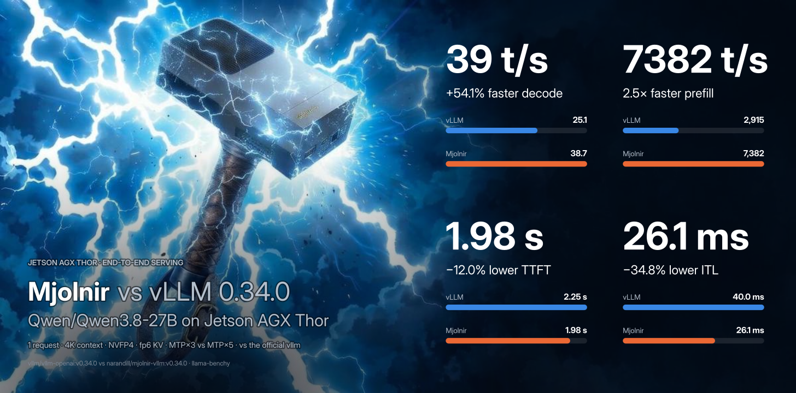
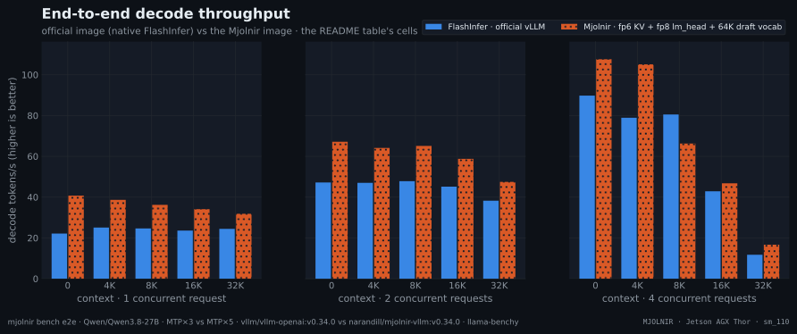
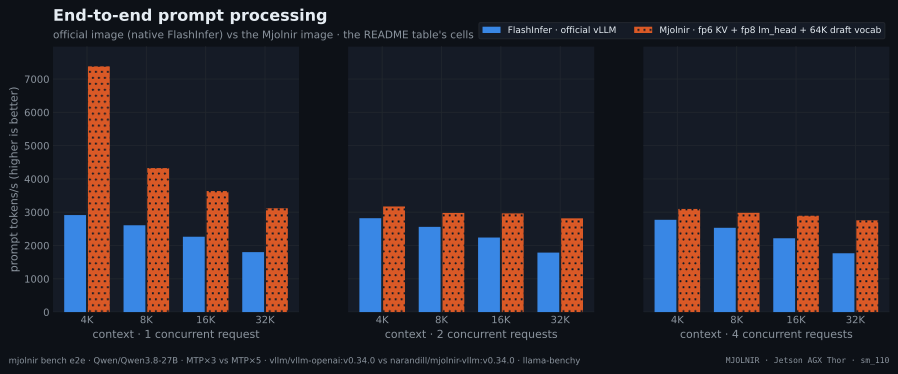

  

#  Jetson AGX Thor

> **supported** platform · `sm_110` · host requirements: JetPack 7.x · [all platforms](../README.md)

Thor is the platform Mjolnir is built for: the `t5` kernel family — CuTe DSL
on `tcgen05` tensor cores, TMEM and TMA — is written for its 20 SMs, 2 CTAs
per SM, 32 MiB L2 and 273 GB/s of LPDDR5X, and every default config,
calibration and benchmark in the repo pins to it. The kernel serves through
the `MJOLNIR` attention backend (prefill and mixed steps run on the image's
FlashAttention 4 fallback), with the fp6 `e2m3` KV cache as the serving
default.

## Serving on Jetson AGX Thor

## Measured Models

One row per model in `configs/` — the config the platform's overlays serve
by default (the model page's quickstart rule) and the pair's measured
speeds. Per-config availability lives on each [model page](../../../configs/).

<table width="100%">
  <thead>
    <tr><th align="left" width="250">model</th><th align="center" width="250">default config</th><th align="center" width="250">decode</th><th align="center" width="250">prefill</th></tr>
  </thead>
  <tbody>
    <tr><td align="left"><a href="../../../configs/Qwen/Qwen3.8-27B/README.md"><code>Qwen/Qwen3.8-27B</code></a></td><td align="center"><a href="../../../configs/Qwen/Qwen3.8-27B/NVFP4_MJOLNIR_E2M3_LMH8_VT64K/README.md"><code>NVFP4_MJOLNIR_E2M3_LMH8_VT64K</code></a></td><td align="center">✅ 40.7 t/s</td><td align="center">4325.4 t/s</td></tr>
    <tr><td align="left"><a href="../../../configs/nvidia/Qwen3.6-35B-A3B/README.md"><code>nvidia/Qwen3.6-35B-A3B</code></a></td><td align="center"><a href="../../../configs/nvidia/Qwen3.6-35B-A3B/NVFP4_MJOLNIR_E2M3_LMH8_VT64K/README.md"><code>NVFP4_MJOLNIR_E2M3_LMH8_VT64K</code></a></td><td align="center">✅ 126.2 t/s</td><td align="center">7575.5 t/s</td></tr>
    <tr><td align="left"><a href="../../../configs/nvidia/Qwen3.8-Flash-Next/README.md"><code>nvidia/Qwen3.8-Flash-Next</code></a></td><td align="center"><a href="../../../configs/nvidia/Qwen3.8-Flash-Next/NVFP4_SFP8/README.md"><code>NVFP4_SFP8</code></a></td><td align="center">❌ 40.5 t/s</td><td align="center">2991.0 t/s</td></tr>
    <tr><td align="left"><a href="../../../configs/thinkingmachines/Inkling-2-Mini/README.md"><code>thinkingmachines/Inkling-2-Mini</code></a></td><td align="center"><a href="../../../configs/thinkingmachines/Inkling-2-Mini/NVFP4/README.md"><code>NVFP4</code></a></td><td align="center">✅ 40.9 t/s</td><td align="center">4304.8 t/s</td></tr>
  </tbody>
</table>

> ✅ at least one of the model's configs serves natively on the platform · — no config targets it. Speeds (when shown): decode tokens/s at 1 request / 0 context and prefill tokens/s at 1 request / 8K context — the fastest-by-decode serving config's latest merged run, its name in the cells' hover title · from [benchmarks/history.jsonl](../../../benchmarks/history.jsonl).
##  Kernel

Mjolnir on Jetson AGX Thor, measured chapter by chapter and pinned to the
headline model (Qwen/Qwen3.8-27B) — every chart and table rendered
from raw results in [`benchmarks/raw/verify/`](../../../benchmarks/raw/verify/)
by `mjolnir plot --readme`; every chapter ends with the command that
reproduces it.

> No headline run in this checkout yet — `mjolnir verify bench`.

| # | chapter | question | status |
|---|---|---|---|
| 1 | [Correctness matrix](kernel/correctness.md) | kernel vs the bit-faithful emulator: every layout, format, page size, q_len, Q dtype | ✅ run `20261122-164644` |
| 2 | [Headline L-sweep](kernel/sweep.md) | Mjolnir vs FlashInfer, fp8 KV — same-run kernel medians | ✅ run `20261122-164701` |
| 3 | [Head-major pages](kernel/hndsweep.md) | FlashInfer on NHD and HND vs Mjolnir on HND — is HND a kernel win or a layout win? | ✅ run `20261122-164714` |
| 4 | [KV layouts and formats](kernel/kvfmt.md) | fp8 / fp6 / fp4 / nvfp4 KV on NHD / interleaved / HND pages (ncu + wall clock) | ✅ run `20261122-164733` |
| 5 | [KV format accuracy](kernel/quant.md) | relative L2 error of each KV format vs unquantized KV, at every L | ✅ run `20261122-164808` |
| 6 | [KV cache capacity](kernel/kv-cache-size.md) | tokens of KV each config fits (vLLM's startup sizing), and the concurrency that buys per context | ✅ run `20261122-170331` |
| 7 | [Speculative decoding](kernel/spec.md) | MTP acceptance per draft position and decode t/s for 1-N draft tokens, per config — the best draft count | ✅ run `20261014-182829` |
| 8 | [Full profiles per KV format](kernel/fp6prof.md) | full ncu profiles: L2 sectors vs requests vs time, warp stalls, per KV format | ✅ run `20261122-164920` |
| 9 | [KV ring depth](kernel/ring.md) | TMA→MMA ring depth (--kv_stages) sweep at every L | ✅ run `20261122-164815` |
| 10 | [L2 prefetch](kernel/prefetch.md) | TMA L2 prefetch distance (--l2_prefetch) sweep | ✅ run `20261122-164835` |
| 11 | [Programmatic dependent launch](kernel/pdl.md) | PDL on/off wall clock (decode overlaps the previous kernel; merge launches early) | ✅ run `20261122-164849` |
| 12 | [Flag A/B](kernel/ab.md) | any harness flag sets, ncu + wall clock (default: evict-first x PDL) | ✅ run `20261122-164857` |
| 13 | [Accuracy](kernel/accuracy.md) | Does a serving config keep the model's answers? Tool calling (standard + Hard Mode), GSM8K / MMLU / IFEval on demand — `mjolnir bench accuracy` | ✅ run `20261123-125540` |

###  Mjolnir Kernel

All kernel numbers are **ncu kernel time** (decode + split-KV merge), cold L2, base clocks, one sequence with 24 query / 4 KV heads, head dim 256, 128-token pages — the attention shape of Qwen3.8-27B — at **every context length from 128 to 256K tokens**.
Measured on a dedicated Thor: a same-run ratio repeats within ±3% between runs, see [`docs/methodology/benchmarking.md`](../../../docs/methodology/benchmarking.md).

| leg | config | what runs | KV cache |
|---|---|---|---|
| **Mjolnir · e2m3 KV** | `NVFP4_MJOLNIR_E2M3_LMH8_VT64K` | Mjolnir kernel + fp8 lm_head + 64K MTP drafter | e2m3, HND pages |
| **Mjolnir · fp8 KV** | `NVFP4_MJOLNIR` | Mjolnir kernel | fp8 e4m3, HND pages |
| **FlashInfer · fp8 KV** | `NVFP4` | The fastest official vllm  FlashInfer for `sm_110` | fp8 e4m3, NHD pages |
| **FlashAttention&nbsp;4 · hd256 fp8** | `NVFP4_FA4hd256` | FA4 hd256 as our image serves it — the patched FA4: 1-CTA decode carve-out, no SplitKV (structural in vLLM 's vendored kernel) | fp8 e4m3 Q+KV, NHD pages |
| **FlashAttention&nbsp;2 · bf16 KV** | `NVFP4_FA2` | FA2 — on demand (`--legs fa2`); stock vLLM 's `sm_110` default | bf16 $\color{grey}\scriptstyle\text{(FA2 has no fp8 KV)}$ |

| L | FlashInfer | FA4 hd256 | Mjolnir fp8 | Mjolnir e2m3 | fp8 vs FI | e2m3 vs FI | fp8 vs FA4 | e2m3 vs FA4 |
|---|--:|--:|--:|--:|--:|--:|--:|--:|
| geomean |  |  |  |  | — | — | — | — |

> Bold = fastest at that `L`. Ratio columns: baseline time ÷ this kernel's time (green = faster beyond noise).

## End to end

The official vLLM image vs Mjolnir on Jetson AGX Thor — the headline model's
own history (`latest_pair`), decode tokens/s per request at 1 request.

| official | Mjolnir | official t/s | Mjolnir t/s | change | at |
|---|---|--:|--:|--:|---|
| `NVFP4` | `NVFP4_MJOLNIR_E2M3_LMH8_VT64K` | 24.4 | 31.8 | +30.3% | 32K |

Each cell: official → **Mjolnir** and the relative change of the value — **throughput change** for decode and prefill, **latency change** for TTFT and ITL.

| context | requests | decode (t/s, ↑) $\color{grey}\scriptstyle\text{throughput change}$ | prefill (t/s, ↑) $\color{grey}\scriptstyle\text{throughput change}$ | TTFT (ms, ↓) $\color{grey}\scriptstyle\text{latency change}$ | ITL (ms, ↓) $\color{grey}\scriptstyle\text{latency change}$ |
|--:|--:|--:|--:|--:|--:|
| no ctx | 1 | 22.1 → **40.7** $\color{#16a34a}{\text{+84.1\\%}}$ | — | 836 → **669** $\color{#16a34a}{\text{−20.0\\%}}$ | 47.4 → **24.9** $\color{#16a34a}{\text{−47.5\\%}}$ |
| 4K | 1 | 25.1 → **38.7** $\color{#16a34a}{\text{+54.1\\%}}$ | 2,915 → **7,382** $\color{#16a34a}{\text{+153.2\\%}}$ | 2,253 → **1,983** $\color{#16a34a}{\text{−12.0\\%}}$ | 40.0 → **26.1** $\color{#16a34a}{\text{−34.8\\%}}$ |
| 8K | 1 | 24.6 → **36.2** $\color{#16a34a}{\text{+47.0\\%}}$ | 2,609 → **4,325** $\color{#16a34a}{\text{+65.8\\%}}$ | 4,070 → **3,515** $\color{#16a34a}{\text{−13.7\\%}}$ | 41.1 → **28.0** $\color{#16a34a}{\text{−31.8\\%}}$ |
| 16K | 1 | 23.6 → **34.1** $\color{#16a34a}{\text{+44.6\\%}}$ | 2,264 → **3,635** $\color{#16a34a}{\text{+60.5\\%}}$ | 8,287 → **6,219** $\color{#16a34a}{\text{−25.0\\%}}$ | 42.5 → **29.8** $\color{#16a34a}{\text{−30.0\\%}}$ |
| 32K | 1 | 24.4 → **31.8** $\color{#16a34a}{\text{+30.3\\%}}$ | 1,801 → **3,118** $\color{#16a34a}{\text{+73.1\\%}}$ | 19,473 → **12,312** $\color{#16a34a}{\text{−36.8\\%}}$ | 41.4 → **31.5** $\color{#16a34a}{\text{−23.8\\%}}$ |
| no ctx | 2 | 47.2 → **67.1** $\color{#16a34a}{\text{+42.2\\%}}$ | — | 1,333 → **1,230** $\color{#16a34a}{\text{−7.7\\%}}$ | 40.1 → **28.5** $\color{#16a34a}{\text{−29.0\\%}}$ |
| 4K | 2 | 47.0 → **64.1** $\color{#16a34a}{\text{+36.4\\%}}$ | 2,821 → **3,172** $\color{#16a34a}{\text{+12.5\\%}}$ | 4,296 → **3,829** $\color{#16a34a}{\text{−10.9\\%}}$ | 40.9 → **28.8** $\color{#16a34a}{\text{−29.7\\%}}$ |
| 8K | 2 | 47.8 → **65.1** $\color{#16a34a}{\text{+36.2\\%}}$ | 2,559 → **2,979** $\color{#16a34a}{\text{+16.4\\%}}$ | 7,942 → **6,749** $\color{#16a34a}{\text{−15.0\\%}}$ | 40.9 → **28.8** $\color{#16a34a}{\text{−29.5\\%}}$ |
| 16K | 2 | 45.1 → **58.8** $\color{#16a34a}{\text{+30.2\\%}}$ | 2,240 → **2,965** $\color{#16a34a}{\text{+32.4\\%}}$ | 16,399 → **12,380** $\color{#16a34a}{\text{−24.5\\%}}$ | 42.7 → **31.1** $\color{#16a34a}{\text{−27.2\\%}}$ |
| 32K | 2 | 38.3 → **47.5** $\color{#16a34a}{\text{+24.1\\%}}$ | 1,787 → **2,817** $\color{#16a34a}{\text{+57.7\\%}}$ | 38,602 → **24,062** $\color{#16a34a}{\text{−37.7\\%}}$ | 47.0 → **35.5** $\color{#16a34a}{\text{−24.4\\%}}$ |
| no ctx | 4 | 89.8 → **107.6** $\color{#16a34a}{\text{+19.9\\%}}$ | — | 2,591 → **2,379** $\color{#16a34a}{\text{−8.2\\%}}$ | 41.5 → **30.6** $\color{#16a34a}{\text{−26.4\\%}}$ |
| 4K | 4 | 78.9 → **105.1** $\color{#16a34a}{\text{+33.2\\%}}$ | 2,772 → **3,098** $\color{#16a34a}{\text{+11.7\\%}}$ | 8,716 → **7,777** $\color{#16a34a}{\text{−10.8\\%}}$ | 45.2 → **31.8** $\color{#16a34a}{\text{−29.7\\%}}$ |
| 8K | 4 | 80.5 → **66.3** $\color{#dc2626}{\text{−17.7\\%}}$ | 2,533 → **2,982** $\color{#16a34a}{\text{+17.7\\%}}$ | 16,028 → **12,895** $\color{#16a34a}{\text{−19.5\\%}}$ | 45.1 → **39.1** $\color{#16a34a}{\text{−13.4\\%}}$ |
| 16K | 4 | 42.9 → **46.8** $\color{#16a34a}{\text{+9.1\\%}}$ | 2,217 → **2,894** $\color{#16a34a}{\text{+30.5\\%}}$ | 31,760 → **23,418** $\color{#16a34a}{\text{−26.3\\%}}$ | 57.2 → **49.4** $\color{#16a34a}{\text{−13.7\\%}}$ |
| 32K | 4 | 11.7 → **16.7** $\color{#16a34a}{\text{+42.3\\%}}$ | 1,767 → **2,755** $\color{#16a34a}{\text{+55.9\\%}}$ | 64,923 → **40,102** $\color{#16a34a}{\text{−38.2\\%}}$ | 156.8 → **116.8** $\color{#16a34a}{\text{−25.5\\%}}$ |

> official: `vllm/vllm-openai:v0.34.0 · NVFP4 (vLLM 0.34.0 (official image))` · Mjolnir: `narandill/mjolnir-vllm:v0.34.0 · NVFP4_MJOLNIR_E2M3_LMH8_VT64K (Mjolnir fp6 KV + fp8 lm_head + 64K draft vocab)` · TTFT = time to first token; ITL = inter-token latency (1000 / per-request decode rate) · from [`benchmarks/history.jsonl`](../../../benchmarks/history.jsonl).

How the % and × here are calculated

- **Throughput** (decode, prefill — tokens/s, higher is better): change = (Mjolnir − official) ÷ official × 100. `+57%` = 1.57× the tokens per second. On the infographic a change of +100% or more is written as the multiple Mjolnir ÷ official (`+200%` = `3×`).
- **Latency** (TTFT, ITL — milliseconds, lower is better): change = (Mjolnir − official) ÷ official × 100, so a negative value is a **latency reduction**: `−27%` = 27% fewer milliseconds. It is *not* the reciprocal speedup official ÷ Mjolnir − 1, which reads larger for the same pair.
- **Values**: the mean over the measured runs per cell (6 measured after 2 warm-ups, llama-benchy): decode = generated tokens ÷ generation time per request (summed over requests at higher concurrency), prefill = prompt tokens ÷ prompt-processing time, TTFT = time to the first content token, ITL = 1000 ÷ the per-request decode rate.
- **Colors**: green = better by at least 3%, grey = within ±3% (`E2E_NOISE_PCT`), red = worse by at least that. With speculative decoding a single decode cell moves more between runs (acceptance depends on the prompt), so repeat (`--repeat`) before reading a few-% difference.

 

##  How the kernel works

A decode step is one query token per sequence against the whole KV cache: at 64K tokens that is 128 MiB of K and V per layer, read once. The design goal is to keep the LPDDR5X busy and everything else out of the way.

| | design choice | why on Thor |
|---|---|---|
| ⚙️ | **Warp-specialized `tcgen05` pipeline** — a TMA warp streams K/V pages through an SMEM ring, an MMA warp runs `S = QKᵀ` and `O += PV` on the tensor cores into TMEM, softmax warpgroups read S from TMEM and write P | the tensor cores and TMEM keep scores off the register file; the TMA engine walks the page table so the SMs never issue loads |
| 📐 | **Occupancy-pinned split-KV** — every step fills exactly 2 CTAs × 20 SMs; long sequences split into chunks, a small reduction kernel merges them | one full wave at every L; a fixed padded grid replays under full CUDA graphs |
| 🧊 | **fp8 everything** — Q quantized per (sequence, KV head) on the fly, fp8 KV, P stored as e4m3 | one MMA kind, no conversion warps, half the KV bytes of bf16 |
| 🗂️ | **Head-major (HND) pages** — each KV head's page is one contiguous block | longer DRAM bursts per TMA box: [hndsweep](kernel/hndsweep.md) |
| 🪶 | **6-bit KV (e2m3) read directly by the MMA** (`kind::f8f6f4`, TMA unpacks to byte containers) | 25% fewer bytes at near-fp8 accuracy: [kvfmt](kernel/kvfmt.md), [quant](kernel/quant.md), [capacity](kernel/kv-cache-size.md) |
| 🚿 | **L2 evict-first on K/V loads**, a 2-stage ring for fp6 | KV is streamed once; keep L2 for the rest of the model: [ring](kernel/ring.md), [ab](kernel/ab.md) |

The full walkthrough — one chapter per experiment, each with its chart, data table and the command that reproduces it — is the chapter index under [Kernel](#-kernel) above.

##  What's in the Mjolnir image

[`narandill/mjolnir-vllm`](https://hub.docker.com/r/narandill/mjolnir-vllm) = the official `vllm/vllm-openai:v` image + the `mjolnir-kernel` package + a hand-adapted [patch stack for Thor](../../../docker/vllm-thor/PATCHES.md) — the full inventory lives there and in the image's Docker Hub description. Tags follow the upstream vLLM version.

Explore every number in [the interactive charts](https://GoBrrr-ai.github.io/mjolnir/#platform=thor).
