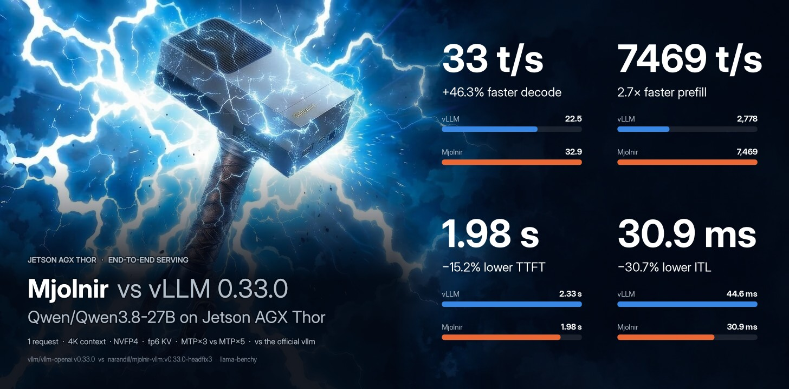
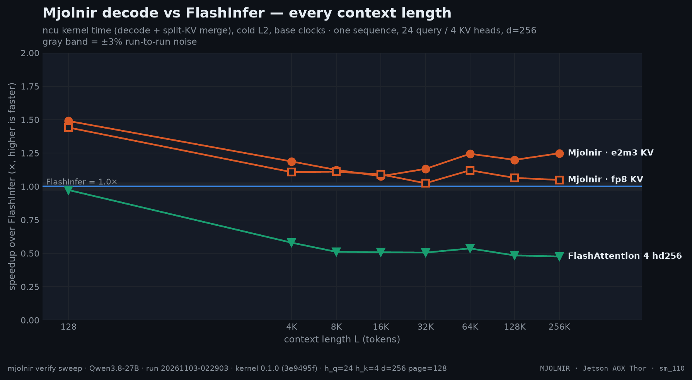
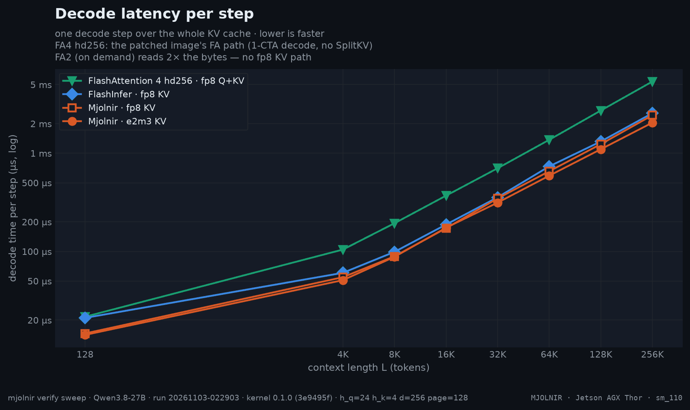
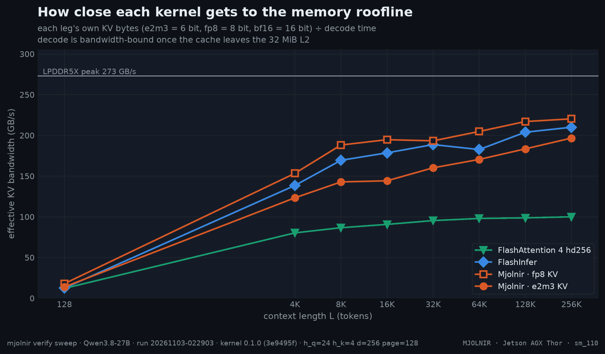
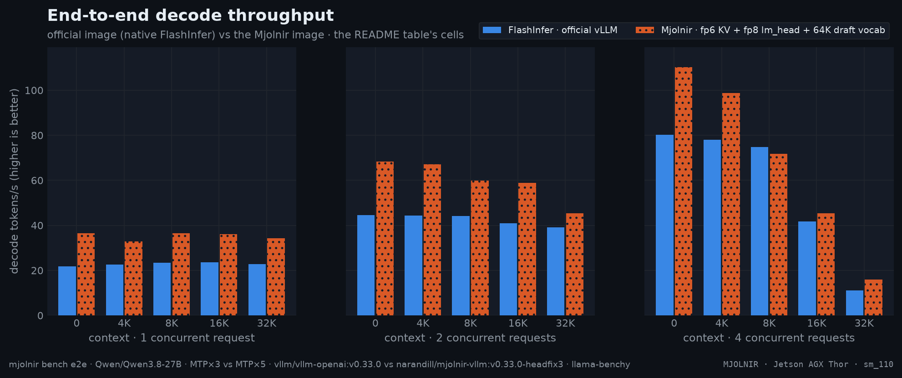
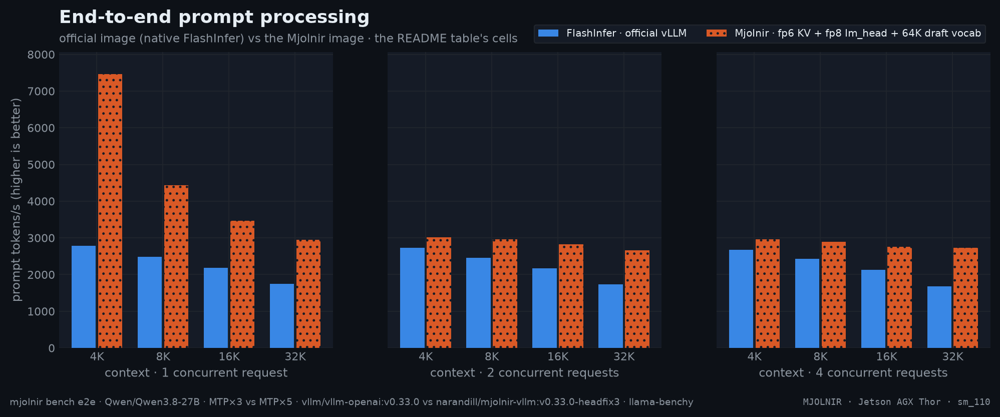

  

#  Jetson AGX Thor

> **supported** platform · `sm_110` · host requirements: JetPack 7.x · [all platforms](../README.md)

Thor is the platform Mjolnir is built for: the `t5` kernel family — CuTe DSL
on `tcgen05` tensor cores, TMEM and TMA — is written for its 20 SMs, 2 CTAs
per SM, 32 MiB L2 and 273 GB/s of LPDDR5X, and every default config,
calibration and benchmark in the repo pins to it. The kernel serves through
the `MJOLNIR` attention backend (prefill and mixed steps run on the image's
FlashAttention 4 fallback), with the fp6 `e2m3` KV cache as the serving
default.

## Serving on Jetson AGX Thor

## Measured Models

One row per model in `configs/` — the config the platform's overlays serve
by default (the model page's quickstart rule) and the pair's measured
speeds. Per-config availability lives on each [model page](../../../configs/).

<table width="100%">
  <thead>
    <tr><th align="left" width="250">model</th><th align="center" width="250">default config</th><th align="center" width="250">decode</th><th align="center" width="250">prefill</th></tr>
  </thead>
  <tbody>
    <tr><td align="left"><a href="../../../configs/Qwen/Qwen3.8-27B/README.md"><code>Qwen/Qwen3.8-27B</code></a></td><td align="center"><a href="../../../configs/Qwen/Qwen3.8-27B/NVFP4_MJOLNIR_E2M3_LMH8_VT64K/README.md"><code>NVFP4_MJOLNIR_E2M3_LMH8_VT64K</code></a></td><td align="center">✅ 36.4 t/s</td><td align="center">4427.6 t/s</td></tr>
    <tr><td align="left"><a href="../../../configs/nvidia/Qwen3.6-35B-A3B/README.md"><code>nvidia/Qwen3.6-35B-A3B</code></a></td><td align="center"><a href="../../../configs/nvidia/Qwen3.6-35B-A3B/NVFP4_MJOLNIR_E2M3_LMH8_VT64K/README.md"><code>NVFP4_MJOLNIR_E2M3_LMH8_VT64K</code></a></td><td align="center">✅ 126.2 t/s</td><td align="center">7575.5 t/s</td></tr>
  </tbody>
</table>

> ✅ at least one of the model's configs serves natively on the platform · — no config targets it. Speeds (when shown): decode tokens/s at 1 request / 0 context and prefill tokens/s at 1 request / 8K context — the fastest-by-decode serving config's latest merged run, its name in the cells' hover title · from [benchmarks/history.jsonl](../../../benchmarks/history.jsonl).
##  Kernel

Mjolnir on Jetson AGX Thor, measured chapter by chapter and pinned to the
headline model (Qwen/Qwen3.8-27B) — every chart and table rendered
from raw results in [`benchmarks/raw/verify/`](../../../benchmarks/raw/verify/)
by `mjolnir plot --readme`; every chapter ends with the command that
reproduces it.

**Where it stands:** 1.21× FlashInfer (geomean over L = 128 4K 8K 16K 32K 64K 128K 256K), 2.17× FlashAttention 4 hd256 (fp8 Q+KV, as the patched image serves it: 1-CTA decode, no SplitKV), 97 / 97 correctness checks — run `20261103-022903`.

How the % and × here are calculated

- **Time per decode step** = Nsight Compute kernel time (`gpu__time_duration`) of the decode kernel **plus** its split-KV merge kernel, at base clocks with a cold L2, median over the iterations. The reference legs — FlashInfer, plus FlashAttention 4 hd256 where the platform has that leg — are measured the same way, at the same L, in the same run.
- **Speedup ×** = reference time ÷ Mjolnir time. `1.24×` means Mjolnir needs 1 ÷ 1.24 = 81% of the reference's time per step (19% less time); below 1 the reference is faster.
- **Geomean over L** = exp(mean of ln(speedup at each L)): every context length weighs the same, and one large ratio cannot dominate the way it would in an arithmetic mean.
- **Colors / "beyond the noise band"**: green = speedup ≥ 1.03, grey = within ±3%, red ≤ 0.97. ±3% (`NOISE_PCT`) is how far a same-run ratio moves between repeated runs on a dedicated board.

 

| # | chapter | question | status |
|---|---|---|---|
| 1 | [Correctness matrix](kernel/correctness.md) | kernel vs the bit-faithful emulator: every layout, format, page size, q_len, Q dtype | ✅ run `20261103-023822` |
| 2 | [Headline L-sweep](kernel/sweep.md) | Mjolnir vs FlashInfer, fp8 KV — same-run kernel medians | ✅ run `20261103-022903` |
| 3 | [Head-major pages](kernel/hndsweep.md) | FlashInfer on NHD and HND vs Mjolnir on HND — is HND a kernel win or a layout win? | ✅ run `20261012-203356` |
| 4 | [KV layouts and formats](kernel/kvfmt.md) | fp8 / fp6 / fp4 / nvfp4 KV on NHD / interleaved / HND pages (ncu + wall clock) | ✅ run `20261012-203801` |
| 5 | [KV format accuracy](kernel/quant.md) | relative L2 error of each KV format vs unquantized KV, at every L | ✅ run `20261012-205732` |
| 6 | [KV cache capacity](kernel/kv-cache-size.md) | tokens of KV each config fits (vLLM's startup sizing), and the concurrency that buys per context | ✅ run `20261013-124353` |
| 7 | [Speculative decoding](kernel/spec.md) | MTP acceptance per draft position and decode t/s for 1-N draft tokens, per config — the best draft count | ✅ run `20261014-182829` |
| 8 | [Full profiles per KV format](kernel/fp6prof.md) | full ncu profiles: L2 sectors vs requests vs time, warp stalls, per KV format | ✅ run `20261017-212447` |
| 9 | [KV ring depth](kernel/ring.md) | TMA→MMA ring depth (--kv_stages) sweep at every L | ✅ run `20261012-210506` |
| 10 | [L2 prefetch](kernel/prefetch.md) | TMA L2 prefetch distance (--l2_prefetch) sweep | ✅ run `20261012-211441` |
| 11 | [Programmatic dependent launch](kernel/pdl.md) | PDL on/off wall clock (decode overlaps the previous kernel; merge launches early) | ✅ run `20261012-212058` |
| 12 | [Flag A/B](kernel/ab.md) | any harness flag sets, ncu + wall clock (default: evict-first x PDL) | ✅ run `20261012-212748` |
| 13 | [Accuracy](kernel/accuracy.md) | Does a serving config keep the model's answers? Tool calling (standard + Hard Mode), GSM8K / MMLU / IFEval on demand — `mjolnir bench accuracy` | ✅ run `20261017-210613` |

###  Mjolnir Kernel

All kernel numbers are **ncu kernel time** (decode + split-KV merge), cold L2, base clocks, one sequence with 24 query / 4 KV heads, head dim 256, 128-token pages — the attention shape of Qwen3.8-27B — at **every context length from 128 to 256K tokens**.
Measured on a dedicated Thor: a same-run ratio repeats within ±3% between runs, see [`docs/methodology/benchmarking.md`](../../../docs/methodology/benchmarking.md).

| leg | config | what runs | KV cache |
|---|---|---|---|
| **Mjolnir · e2m3 KV** | `NVFP4_MJOLNIR_E2M3_LMH8_VT64K` | Mjolnir kernel + fp8 lm_head + 64K MTP drafter | e2m3, HND pages |
| **Mjolnir · fp8 KV** | `NVFP4_MJOLNIR` | Mjolnir kernel | fp8 e4m3, HND pages |
| **FlashInfer · fp8 KV** | `NVFP4` | The fastest official vllm 0.33.0 FlashInfer for `sm_110` | fp8 e4m3, NHD pages |
| **FlashAttention&nbsp;4 · hd256 fp8** | `NVFP4_FA4hd256` | FA4 hd256 as our image serves it — the patched FA4: 1-CTA decode carve-out, no SplitKV (structural in vLLM 0.33.0's vendored kernel) | fp8 e4m3 Q+KV, NHD pages |
| **FlashAttention&nbsp;2 · bf16 KV** | `NVFP4_FA2` | FA2 — on demand (`--legs fa2`); stock vLLM 0.33.0's `sm_110` default | bf16 $\color{grey}\scriptstyle\text{(FA2 has no fp8 KV)}$ |

| L | FlashInfer | FA4 hd256 | Mjolnir fp8 | Mjolnir e2m3 | fp8 vs FI | e2m3 vs FI | fp8 vs FA4 | e2m3 vs FA4 |
|---|--:|--:|--:|--:|--:|--:|--:|--:|
| **128** | 21.1&nbsp;µs | 21.6&nbsp;µs | 14.6&nbsp;µs | **14.1&nbsp;µs** | $\color{#16a34a}{\mathbf{1.44\times}}$ | $\color{#16a34a}{\mathbf{1.49\times}}$ | $\color{#16a34a}{\mathbf{1.48\times}}$ | $\color{#16a34a}{\mathbf{1.53\times}}$ |
| **4K** | 60.6&nbsp;µs | 104.5&nbsp;µs | 54.7&nbsp;µs | **51.0&nbsp;µs** | $\color{#16a34a}{\mathbf{1.11\times}}$ | $\color{#16a34a}{\mathbf{1.19\times}}$ | $\color{#16a34a}{\mathbf{1.91\times}}$ | $\color{#16a34a}{\mathbf{2.05\times}}$ |
| **8K** | 99.0&nbsp;µs | 193.8&nbsp;µs | 89.2&nbsp;µs | **88.1&nbsp;µs** | $\color{#16a34a}{\mathbf{1.11\times}}$ | $\color{#16a34a}{\mathbf{1.12\times}}$ | $\color{#16a34a}{\mathbf{2.17\times}}$ | $\color{#16a34a}{\mathbf{2.20\times}}$ |
| **16K** | 187.9&nbsp;µs | 370.0&nbsp;µs | **172.3&nbsp;µs** | 174.5&nbsp;µs | $\color{#16a34a}{\mathbf{1.09\times}}$ | $\color{#16a34a}{\mathbf{1.08\times}}$ | $\color{#16a34a}{\mathbf{2.15\times}}$ | $\color{#16a34a}{\mathbf{2.12\times}}$ |
| **32K** | 355.7&nbsp;µs | 703.8&nbsp;µs | 347.2&nbsp;µs | **314.2&nbsp;µs** | $\color{grey}{1.02\times}$ | $\color{#16a34a}{\mathbf{1.13\times}}$ | $\color{#16a34a}{\mathbf{2.03\times}}$ | $\color{#16a34a}{\mathbf{2.24\times}}$ |
| **64K** | 735.0&nbsp;µs | 1.37&nbsp;ms | 655.4&nbsp;µs | **590.5&nbsp;µs** | $\color{#16a34a}{\mathbf{1.12\times}}$ | $\color{#16a34a}{\mathbf{1.24\times}}$ | $\color{#16a34a}{\mathbf{2.09\times}}$ | $\color{#16a34a}{\mathbf{2.32\times}}$ |
| **128K** | 1.32&nbsp;ms | 2.72&nbsp;ms | 1.24&nbsp;ms | **1.10&nbsp;ms** | $\color{#16a34a}{\mathbf{1.06\times}}$ | $\color{#16a34a}{\mathbf{1.20\times}}$ | $\color{#16a34a}{\mathbf{2.20\times}}$ | $\color{#16a34a}{\mathbf{2.48\times}}$ |
| **256K** | 2.56&nbsp;ms | 5.37&nbsp;ms | 2.44&nbsp;ms | **2.05&nbsp;ms** | $\color{#16a34a}{\mathbf{1.05\times}}$ | $\color{#16a34a}{\mathbf{1.25\times}}$ | $\color{#16a34a}{\mathbf{2.20\times}}$ | $\color{#16a34a}{\mathbf{2.62\times}}$ |
| geomean |  |  |  |  | $\color{#16a34a}{\mathbf{1.12\times}}$ | $\color{#16a34a}{\mathbf{1.21\times}}$ | $\color{#16a34a}{\mathbf{2.01\times}}$ | $\color{#16a34a}{\mathbf{2.17\times}}$ |

> Bold = fastest at that `L`. Ratio columns: baseline time ÷ this kernel's time (green = faster beyond noise).

## End to end

The official vLLM image vs Mjolnir on Jetson AGX Thor — the headline model's
own history (`latest_pair`), decode tokens/s per request at 1 request.

| official | Mjolnir | official t/s | Mjolnir t/s | change | at |
|---|---|--:|--:|--:|---|
| `NVFP4` | `NVFP4_MJOLNIR_E2M3_LMH8_VT64K` | 22.7 | 34.2 | +50.9% | 32K |

Each cell: official → **Mjolnir** and the relative change of the value — **throughput change** for decode and prefill, **latency change** for TTFT and ITL.

| context | requests | decode (t/s, ↑) $\color{grey}\scriptstyle\text{throughput change}$ | prefill (t/s, ↑) $\color{grey}\scriptstyle\text{throughput change}$ | TTFT (ms, ↓) $\color{grey}\scriptstyle\text{latency change}$ | ITL (ms, ↓) $\color{grey}\scriptstyle\text{latency change}$ |
|--:|--:|--:|--:|--:|--:|
| no ctx | 1 | 21.7 → **36.4** $\color{#16a34a}{\text{+67.9\\%}}$ | — | 896 → **708** $\color{#16a34a}{\text{−21.0\\%}}$ | 47.7 → **27.6** $\color{#16a34a}{\text{−42.2\\%}}$ |
| 4K | 1 | 22.5 → **32.9** $\color{#16a34a}{\text{+46.3\\%}}$ | 2,778 → **7,469** $\color{#16a34a}{\text{+168.9\\%}}$ | 2,334 → **1,979** $\color{#16a34a}{\text{−15.2\\%}}$ | 44.6 → **30.9** $\color{#16a34a}{\text{−30.7\\%}}$ |
| 8K | 1 | 23.4 → **36.4** $\color{#16a34a}{\text{+55.4\\%}}$ | 2,485 → **4,428** $\color{#16a34a}{\text{+78.2\\%}}$ | 4,243 → **3,467** $\color{#16a34a}{\text{−18.3\\%}}$ | 42.9 → **27.7** $\color{#16a34a}{\text{−35.5\\%}}$ |
| 16K | 1 | 23.7 → **36.2** $\color{#16a34a}{\text{+52.9\\%}}$ | 2,178 → **3,465** $\color{#16a34a}{\text{+59.1\\%}}$ | 8,585 → **6,475** $\color{#16a34a}{\text{−24.6\\%}}$ | 42.6 → **27.9** $\color{#16a34a}{\text{−34.6\\%}}$ |
| 32K | 1 | 22.7 → **34.2** $\color{#16a34a}{\text{+50.9\\%}}$ | 1,746 → **2,943** $\color{#16a34a}{\text{+68.6\\%}}$ | 20,068 → **12,986** $\color{#16a34a}{\text{−35.3\\%}}$ | 44.3 → **29.3** $\color{#16a34a}{\text{−33.8\\%}}$ |
| no ctx | 2 | 44.6 → **68.3** $\color{#16a34a}{\text{+53.1\\%}}$ | — | 1,428 → **1,248** $\color{#16a34a}{\text{−12.6\\%}}$ | 43.0 → **27.7** $\color{#16a34a}{\text{−35.7\\%}}$ |
| 4K | 2 | 44.4 → **67.2** $\color{#16a34a}{\text{+51.4\\%}}$ | 2,727 → **3,017** $\color{#16a34a}{\text{+10.6\\%}}$ | 4,442 → **4,076** $\color{#16a34a}{\text{−8.2\\%}}$ | 43.1 → **28.5** $\color{#16a34a}{\text{−33.7\\%}}$ |
| 8K | 2 | 44.1 → **59.8** $\color{#16a34a}{\text{+35.8\\%}}$ | 2,453 → **2,967** $\color{#16a34a}{\text{+21.0\\%}}$ | 8,286 → **6,784** $\color{#16a34a}{\text{−18.1\\%}}$ | 43.7 → **30.6** $\color{#16a34a}{\text{−30.1\\%}}$ |
| 16K | 2 | 40.9 → **58.8** $\color{#16a34a}{\text{+43.8\\%}}$ | 2,166 → **2,829** $\color{#16a34a}{\text{+30.6\\%}}$ | 16,951 → **12,949** $\color{#16a34a}{\text{−23.6\\%}}$ | 46.1 → **30.8** $\color{#16a34a}{\text{−33.1\\%}}$ |
| 32K | 2 | 39.2 → **45.3** $\color{#16a34a}{\text{+15.6\\%}}$ | 1,738 → **2,655** $\color{#16a34a}{\text{+52.8\\%}}$ | 39,691 → **25,600** $\color{#16a34a}{\text{−35.5\\%}}$ | 46.9 → **36.8** $\color{#16a34a}{\text{−21.6\\%}}$ |
| no ctx | 4 | 80.1 → **110.3** $\color{#16a34a}{\text{+37.7\\%}}$ | — | 2,757 → **2,514** $\color{#16a34a}{\text{−8.8\\%}}$ | 44.7 → **30.9** $\color{#16a34a}{\text{−31.0\\%}}$ |
| 4K | 4 | 78.0 → **98.9** $\color{#16a34a}{\text{+26.7\\%}}$ | 2,681 → **2,958** $\color{#16a34a}{\text{+10.3\\%}}$ | 9,009 → **8,144** $\color{#16a34a}{\text{−9.6\\%}}$ | 46.0 → **33.4** $\color{#16a34a}{\text{−27.4\\%}}$ |
| 8K | 4 | 74.8 → **71.7** $\color{#dc2626}{\text{−4.1\\%}}$ | 2,434 → **2,893** $\color{#16a34a}{\text{+18.8\\%}}$ | 16,676 → **13,444** $\color{#16a34a}{\text{−19.4\\%}}$ | 47.4 → **39.8** $\color{#16a34a}{\text{−15.9\\%}}$ |
| 16K | 4 | 41.6 → **45.3** $\color{#16a34a}{\text{+8.8\\%}}$ | 2,133 → **2,755** $\color{#16a34a}{\text{+29.1\\%}}$ | 33,024 → **24,775** $\color{#16a34a}{\text{−25.0\\%}}$ | 59.6 → **51.2** $\color{#16a34a}{\text{−14.1\\%}}$ |
| 32K | 4 | 11.1 → **16.0** $\color{#16a34a}{\text{+44.7\\%}}$ | 1,679 → **2,726** $\color{#16a34a}{\text{+62.4\\%}}$ | 67,684 → **41,074** $\color{#16a34a}{\text{−39.3\\%}}$ | 171.4 → **120.5** $\color{#16a34a}{\text{−29.7\\%}}$ |

> official: `vllm/vllm-openai:v0.33.0 · NVFP4 (vLLM 0.33.0 (official image))` · Mjolnir: `narandill/mjolnir-vllm:v0.33.0-headfix3 · NVFP4_MJOLNIR_E2M3_LMH8_VT64K (Mjolnir fp6 KV + fp8 lm_head + 64K draft vocab)` · TTFT = time to first token; ITL = inter-token latency (1000 / per-request decode rate) · from [`benchmarks/history.jsonl`](../../../benchmarks/history.jsonl).

How the % and × here are calculated

- **Throughput** (decode, prefill — tokens/s, higher is better): change = (Mjolnir − official) ÷ official × 100. `+57%` = 1.57× the tokens per second. On the infographic a change of +100% or more is written as the multiple Mjolnir ÷ official (`+200%` = `3×`).
- **Latency** (TTFT, ITL — milliseconds, lower is better): change = (Mjolnir − official) ÷ official × 100, so a negative value is a **latency reduction**: `−27%` = 27% fewer milliseconds. It is *not* the reciprocal speedup official ÷ Mjolnir − 1, which reads larger for the same pair.
- **Values**: the mean over the measured runs per cell (6 measured after 2 warm-ups, llama-benchy): decode = generated tokens ÷ generation time per request (summed over requests at higher concurrency), prefill = prompt tokens ÷ prompt-processing time, TTFT = time to the first content token, ITL = 1000 ÷ the per-request decode rate.
- **Colors**: green = better by at least 3%, grey = within ±3% (`E2E_NOISE_PCT`), red = worse by at least that. With speculative decoding a single decode cell moves more between runs (acceptance depends on the prompt), so repeat (`--repeat`) before reading a few-% difference.

 

##  How the kernel works

A decode step is one query token per sequence against the whole KV cache: at 64K tokens that is 128 MiB of K and V per layer, read once. The design goal is to keep the LPDDR5X busy and everything else out of the way.

| | design choice | why on Thor |
|---|---|---|
| ⚙️ | **Warp-specialized `tcgen05` pipeline** — a TMA warp streams K/V pages through an SMEM ring, an MMA warp runs `S = QKᵀ` and `O += PV` on the tensor cores into TMEM, softmax warpgroups read S from TMEM and write P | the tensor cores and TMEM keep scores off the register file; the TMA engine walks the page table so the SMs never issue loads |
| 📐 | **Occupancy-pinned split-KV** — every step fills exactly 2 CTAs × 20 SMs; long sequences split into chunks, a small reduction kernel merges them | one full wave at every L; a fixed padded grid replays under full CUDA graphs |
| 🧊 | **fp8 everything** — Q quantized per (sequence, KV head) on the fly, fp8 KV, P stored as e4m3 | one MMA kind, no conversion warps, half the KV bytes of bf16 |
| 🗂️ | **Head-major (HND) pages** — each KV head's page is one contiguous block | longer DRAM bursts per TMA box: [hndsweep](kernel/hndsweep.md) |
| 🪶 | **6-bit KV (e2m3) read directly by the MMA** (`kind::f8f6f4`, TMA unpacks to byte containers) | 25% fewer bytes at near-fp8 accuracy: [kvfmt](kernel/kvfmt.md), [quant](kernel/quant.md), [capacity](kernel/kv-cache-size.md) |
| 🚿 | **L2 evict-first on K/V loads**, a 2-stage ring for fp6 | KV is streamed once; keep L2 for the rest of the model: [ring](kernel/ring.md), [ab](kernel/ab.md) |

The full walkthrough — one chapter per experiment, each with its chart, data table and the command that reproduces it — is the chapter index under [Kernel](#-kernel) above.

##  What's in the Mjolnir image

[`narandill/mjolnir-vllm:v0.33.0`](https://hub.docker.com/r/narandill/mjolnir-vllm) = the official `vllm/vllm-openai:v0.33.0` image + the `mjolnir-kernel` package + a hand-adapted [patch stack for Thor](../../../docker/vllm-thor/PATCHES.md) — the full inventory lives there and in the image's Docker Hub description. Tags follow the upstream vLLM version.

Explore every number in [the interactive charts](https://GoBrrr-ai.github.io/mjolnir/#platform=thor).
