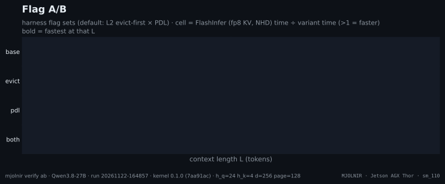

# Flag A/B

> any harness flag sets, ncu + wall clock (default: evict-first x PDL) · `mjolnir verify ab` · run `20261122-164857`

## The question

A general-purpose A/B for harness flags. The default run compares the L2 **evict-first** cache policy on K/V loads and PDL, alone and together.


## How it is measured

Any `name:flags|name:flags` list (`--variants`), ncu at every L plus a wall-clock row. Evict-first marks K/V lines as streaming so they do not displace the rest of the model's working set in the 32 MiB L2.

## Result




| variant | flags | geomean |
|---|---|--:|
| `base` | `--kv_evict_first 0` | — |
| `evict` | `--kv_evict_first 1` | — |
| `pdl` | `--kv_evict_first 0 --pdl` | — |
| `both` | `--kv_evict_first 1 --pdl` | — |

<details>
<summary>How the % and × here are calculated</summary>

- Each cell = **reference time ÷ variant time** (Nsight Compute kernel time, decode + merge, base clocks, cold L2, same run, same L). `1.10×` = the variant needs 1 ÷ 1.10 = 91% of the reference's time; below 1 it is slower.
- **geomean** = exp(mean of ln(ratio)) over the context lengths; **bold** = the fastest variant at that L.
- Green ≥ 1.03, grey within ±3% (`NOISE_PCT`, the run-to-run spread of a same-run ratio), red ≤ 0.97.

</details><br />


<sub>Rendered from [`benchmarks/raw/verify/ab/20261122-164857.json`](../../../../benchmarks/raw/verify/ab/20261122-164857.json). Ratios: FlashInfer time ÷ variant time; green = faster beyond the ±3% noise band, red = slower, gray = within noise.</sub>

## How to read it

Use it for any idea: change a flag in the harness, run `mjolnir verify ab --variants ...`, and the heatmap shows where it wins. Custom runs are saved but never replace this page's default chart.

## Reproduce

```bash
mjolnir verify ab
mjolnir verify ab --variants "base:|mine:--my_flag 1" --ls "8192 65536 262144"
```

## Ideas to try

- anything — this is the experiment slot. `mjolnir autoresearch` uses it to test agent-proposed changes.

Found something? Open a PR with the raw JSON from `benchmarks/raw/verify/` — see [CONTRIBUTING](../../../../.github/CONTRIBUTING.md).

---

[← Programmatic dependent launch](pdl.md) · [case study](../README.md#-kernel)
