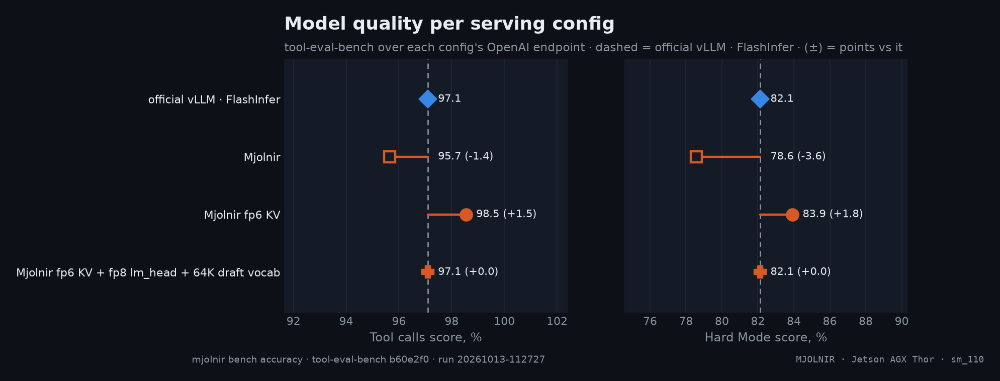
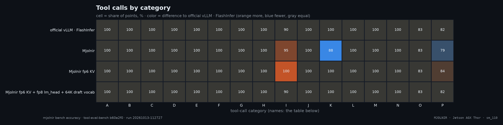

# Accuracy

> Does a serving config keep the model's answers? Tool calling (standard + Hard Mode), and GSM8K / MMLU / IFEval on demand · `mjolnir bench accuracy` · runs `20261013-112727`, `20261017-131320`, `20261017-180105`, `20261017-210613`

## The question

Every speed-up on the Mjolnir image changes numbers the model computes with: the KV cache is stored in 6 bits (fp6 e2m3, calibrated per-channel scales) instead of 8, the query enters the attention MMA in fp8, and the opt-in `…_LMH8` configs read the 248K-row lm_head in fp8 instead of bf16. Logprob smoke tests bound the per-token error; they do not say whether the model still picks the right tool, passes the right arguments, follows a multi-step plan or solves the problem. That is what this chapter measures, per serving config, against native FlashInfer on the official vLLM image.

Speculative decoding (MTP) does not enter here: the draft only proposes tokens and the full model accepts or rejects them, so the output distribution is the target model's either way — a trimmed draft vocabulary (`…_VT32K`, `…_VT64K`) changes speed, never answers.

## How it is measured

`mjolnir bench accuracy` serves each config in turn (the server restarts per leg) and runs [tool-eval-bench](https://github.com/SeraphimSerapis/tool-eval-bench) (pinned commit) against its OpenAI endpoint:

- **Tool calls** — the standard 69 scenarios, categories A–O: tool selection, parameter precision, multi-step chains, refusal, error recovery, localization, instruction following, safety and prompt injection, 52-tool namespaces, planning, structured output. Each scenario scores 2 (pass), 1 (partial) or 0; the score is points ÷ maximum.
- **Hard Mode** — the 28 adversarial, stateful and transactional scenarios (category P), scored the same way.
- **GSM8K, MMLU, IFEval** — the same adapter's accuracy plugins, when the run forwards them (accuracy in %, IFEval at prompt level).

Sampling is greedy (temperature 0) with a fixed seed, so two configs see the same prompts and differ only through the numerics. Scenarios the endpoint failed (timeouts, errors, or a feature its pre-run probe found missing) are dropped from that leg's score instead of counted as zero — the **completion** column. A delta between two legs that dropped different scenarios scores both on the larger max, the dropped points counting as zero, and is marked ‡.

## Result



- **Qwen3.8-27B · Mjolnir · fp8 KV** vs Qwen3.8-27B · official vLLM · FlashInfer · fp8 KV: Tool calls -1.4, Hard Mode -3.6 points (4 scenarios scored lower, 2 higher of 97).
- **Qwen3.8-27B · Mjolnir · fp6 e2m3 KV** vs Qwen3.8-27B · official vLLM · FlashInfer · fp8 KV: Tool calls +1.5, Hard Mode +1.8 points (0 scenarios scored lower, 3 higher of 97).
- **Qwen3.8-27B · Mjolnir · fp6 e2m3 KV + fp8 lm_head + 64K draft vocab** vs Qwen3.8-27B · official vLLM · FlashInfer · fp8 KV: Tool calls -0.7, Hard Mode +3.6 points (3 scenarios scored lower, 3 higher of 97).
- **Qwen3.6-35B-A3B · Mjolnir · fp6 e2m3 KV** vs Qwen3.6-35B-A3B · official vLLM · FlashInfer + DFlash · fp8 KV: Tool calls +0.0, Hard Mode +0.0 points (3 scenarios scored lower, 2 higher of 97).
- **Qwen3.6-35B-A3B · Mjolnir · fp6 e2m3 KV + fp8 lm_head + 64K draft vocab** vs Qwen3.6-35B-A3B · official vLLM · FlashInfer + DFlash · fp8 KV: Tool calls +0.7, Hard Mode -3.6 points (4 scenarios scored lower, 3 higher of 97).

| config | KV | Tool calls % | Hard Mode % | completion |
|---|---|--:|--:|--:|
| **Qwen3.8-27B · official vLLM · FlashInfer · fp8 KV** | fp8 | 97.1 | 82.1 | 100% |
| Qwen3.8-27B · Mjolnir · fp8 KV | fp8 | 95.7 (-1.4) | 78.6 (-3.6) | 100% |
| Qwen3.8-27B · Mjolnir · fp6 e2m3 KV | fp6 e2m3 | 98.5 (+1.5) | 83.9 (+1.8) | 100% |
| Qwen3.8-27B · Mjolnir · fp6 e2m3 KV + fp8 lm_head + 64K draft vocab | fp6 e2m3 | 96.4 (-0.7) | 85.7 (+3.6) | 100% |
| **Qwen3.6-35B-A3B · official vLLM · FlashInfer + DFlash · fp8 KV** | fp8 | 90.6 | 76.8 | 100% |
| Qwen3.6-35B-A3B · Mjolnir · fp6 e2m3 KV | fp6 e2m3 | 90.6 (+0.0) | 76.8 (+0.0) | 100% |
| Qwen3.6-35B-A3B · Mjolnir · fp6 e2m3 KV + fp8 lm_head + 64K draft vocab | fp6 e2m3 | 91.3 (+0.7) | 73.2 (-3.6) | 100% |

<details>
<summary>How the % and × here are calculated</summary>

- **Score** = points ÷ maximum points × 100, each scenario 2 (pass), 1 (partial) or 0 (fail); GSM8K / MMLU = accuracy in %; IFEval = prompt-level accuracy in %.
- **(±)** = this row's score − the baseline row's score, in percentage **points**, not a relative change: 86.5 vs 88.0 is −1.5 points (a relative change would be −1.7%).
- **n** = runs averaged (`--trials`); **completion** = the share of scenarios the endpoint answered — compare rows only at equal completion.

</details><br />

<sub>Score in %, (±) = points vs the bold row of the same model (**Qwen3.8-27B · official vLLM · FlashInfer · fp8 KV / Qwen3.6-35B-A3B · official vLLM · FlashInfer + DFlash · fp8 KV**), never across models; n = averaged runs (`--trials`). Each row takes every suite from the newest run that measured it. tool-eval-bench arguments: Tool calls: `run --hardmode --seed 42 --timeout 600`; Hard Mode: `run --hardmode --seed 42 --timeout 600`. Rendered from [`benchmarks/raw/accuracy/20261013-112727/accuracy.json`](../../../../benchmarks/raw/accuracy/20261013-112727/accuracy.json), [`benchmarks/raw/accuracy/20261017-131320/accuracy.json`](../../../../benchmarks/raw/accuracy/20261017-131320/accuracy.json), [`benchmarks/raw/accuracy/20261017-180105/accuracy.json`](../../../../benchmarks/raw/accuracy/20261017-180105/accuracy.json), [`benchmarks/raw/accuracy/20261017-210613/accuracy.json`](../../../../benchmarks/raw/accuracy/20261017-210613/accuracy.json).</sub>

### By tool-call category



| category | Qwen3.8-27B · official vLLM · FlashInfer · fp8 KV | Qwen3.8-27B · Mjolnir · fp8 KV | Qwen3.8-27B · Mjolnir · fp6 e2m3 KV | Qwen3.8-27B · Mjolnir · fp6 e2m3 KV + fp8 lm_head + 64K draft vocab | Qwen3.6-35B-A3B · official vLLM · FlashInfer + DFlash · fp8 KV | Qwen3.6-35B-A3B · Mjolnir · fp6 e2m3 KV | Qwen3.6-35B-A3B · Mjolnir · fp6 e2m3 KV + fp8 lm_head + 64K draft vocab |
|---|--:|--:|--:|--:|--:|--:|--:|
| A · Tool Selection | 100 | 100 | 100 | 100 | 100 | 100 | 100 |
| B · Parameter Precision | 100 | 100 | 100 | 100 | 100 | 100 | 100 |
| C · Multi-Step Chains | 100 | 100 | 100 | 100 | 100 | 100 | 100 |
| D · Restraint & Refusal | 100 | 100 | 100 | 100 | 83 | 100 | 83 |
| E · Error Recovery | 100 | 100 | 100 | 100 | 83 | 83 | 83 |
| F · Localization | 100 | 100 | 100 | 100 | 100 | 100 | 100 |
| G · Structured Reasoning | 100 | 100 | 100 | 100 | 100 | 100 | 100 |
| H · Instruction Following | 100 | 100 | 100 | 100 | 100 | 100 | 100 |
| I · Context & State | 90 | 95 | 100 | 90 | 85 | 70 | 75 |
| J · Code Patterns | 100 | 100 | 100 | 100 | 100 | 100 | 100 |
| K · Safety & Boundaries | 100 | 88 | 100 | 96 | 85 | 92 | 92 |
| L · Toolset Scale | 100 | 100 | 100 | 100 | 88 | 88 | 88 |
| M · Autonomous Planning | 100 | 100 | 100 | 100 | 83 | 83 | 100 |
| N · Creative Composition | 100 | 100 | 100 | 100 | 100 | 100 | 100 |
| O · Structured Output | 83 | 83 | 83 | 83 | 83 | 83 | 83 |
| P · Hard Mode | 82 | 79 | 84 | 86 | 77 | 77 | 73 |

<sub>Share of points per category, %. A category has 2–10 scenarios: one scenario moving from pass to partial shifts it by 5–25 points — read single cells as anecdotes, the totals as the result.</sub>


## How to read it

A quantization that hurts the model shows up as lower scores across categories, not as one cell: tool-call scenarios are deterministic at temperature 0, but a single changed token early in a long chain can flip a scenario either way, so a few points of difference between two configs is within what one different token can do. Before reading a gap as damage, repeat both legs (`-- run --hardmode --trials 3`, scores averaged) and look at which scenarios moved: changes spread over many categories in one direction point at the numerics; a handful of flips in both directions is noise.

## Reproduce

```bash
mjolnir serve down                                           # restarts per leg — the GPU must be yours
mjolnir bench accuracy                                       # the default legs (mjolnir_cli/legs.py): standard + Hard Mode
mjolnir bench accuracy --backends vllm/vllm-openai:v0.32.0-ubuntu2404:NVFP4,NVFP4_MJOLNIR_E2M3,NVFP4_MJOLNIR_E2M3_LMH8_VT64K
mjolnir bench accuracy -- run --hardmode --no-think --trials 3          # anything after -- goes to tool-eval-bench
mjolnir bench accuracy -- --gsm8k --mmlu --ifeval --skip-tool-eval      # the accuracy plugins, same adapter
mjolnir bench accuracy --no-restart --backends NVFP4_MJOLNIR_E2M3       # the running server, as one leg
```

A bare config runs on the Mjolnir image; `<image>:<config>` pins the image (as in `bench ab`). tool-eval-bench runs from the pinned commit through `uvx` (`$MJOLNIR_TOOL_EVAL_BENCH` overrides the command); its SQLite database, Markdown reports with full traces and the server log stay next to `accuracy.json`, untracked.

---

[← case study](README.md) · [Speculative decoding](spec.md)
