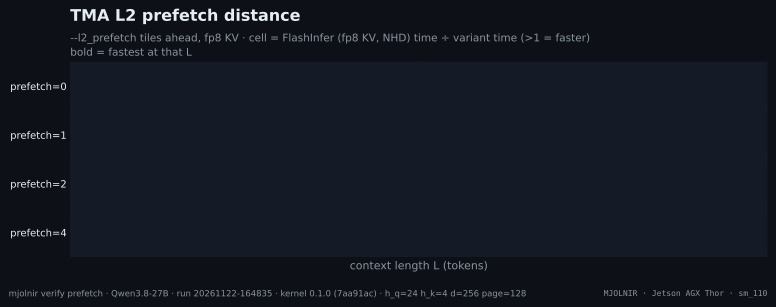

# L2 prefetch

> TMA L2 prefetch distance (--l2_prefetch) sweep · `mjolnir verify prefetch` · run `20261122-164835`

## The question

Does prefetching K/V into L2 ahead of the TMA loads help? `--l2_prefetch k` issues `cute.prefetch` for the tile k tiles ahead.

## How it is measured

Distances 0 (off), 1, 2, 4 on fp8 KV (the prefetch path is not wired for NVFP4) at every L.

## Result




| variant | flags | geomean |
|---|---|--:|
| `prefetch=0` | `--kv_format fp8 --l2_prefetch 0` | — |
| `prefetch=1` | `--kv_format fp8 --l2_prefetch 1` | — |
| `prefetch=2` | `--kv_format fp8 --l2_prefetch 2` | — |
| `prefetch=4` | `--kv_format fp8 --l2_prefetch 4` | — |

<details>
<summary>How the % and × here are calculated</summary>

- Each cell = **reference time ÷ variant time** (Nsight Compute kernel time, decode + merge, base clocks, cold L2, same run, same L). `1.10×` = the variant needs 1 ÷ 1.10 = 91% of the reference's time; below 1 it is slower.
- **geomean** = exp(mean of ln(ratio)) over the context lengths; **bold** = the fastest variant at that L.
- Green ≥ 1.03, grey within ±3% (`NOISE_PCT`, the run-to-run spread of a same-run ratio), red ≤ 0.97.

</details><br />

<sub>Rendered from [`benchmarks/raw/verify/prefetch/20261122-164835.json`](../../../../benchmarks/raw/verify/prefetch/20261122-164835.json). Ratios: FlashInfer time ÷ variant time; green = faster beyond the ±3% noise band, red = slower, gray = within noise.</sub>

## How to read it

Prefetch helps only when DRAM is idle between bursts. With an occupancy-pinned grid that keeps the memory system saturated, a prefetch mostly duplicates traffic; a distance that is slower than 0 beyond the noise band is a regression.

## Reproduce

```bash
mjolnir verify prefetch
```

## Ideas to try

- prefetch only the first tiles of each split (warm-up), not the steady state.

Found something? Open a PR with the raw JSON from `benchmarks/raw/verify/` — see [CONTRIBUTING](../../../../.github/CONTRIBUTING.md).

---

[← KV ring depth](ring.md) · [case study](../README.md#-kernel) · [Programmatic dependent launch →](pdl.md)
