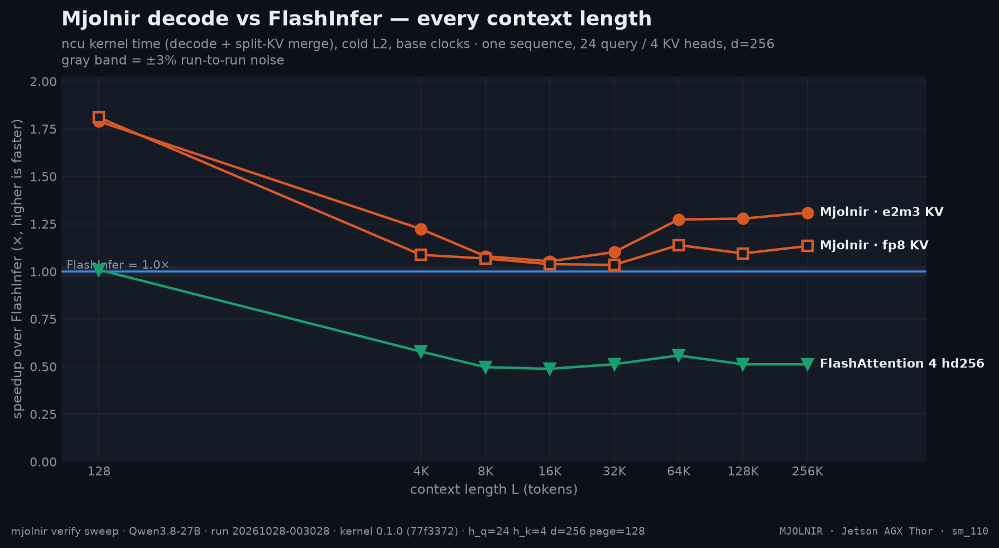

# Headline L-sweep

> Mjolnir vs FlashInfer (FA4 hd256 on Thor, FA2-TC on Orin), fp8 KV — ncu kernel time on Thor, events-timed where there is no ncu · `mjolnir verify sweep` · run `20261028-003028`

## The question

The headline: how fast is one decode step with Mjolnir against the platform's stock reference — at every context length from 128 to 256K tokens? Short contexts are latency-bound (launch, plan, merge), long ones bandwidth-bound; a decode kernel has to win both.

## How it is measured

- one sequence, 24 query / 4 KV heads, head dim 256, 128-token pages in random order — the hd256 attention shape of Qwen3.8-27B;
- **ncu kernel time** of the decode kernel(s) + the split-KV merge, averaged over 50 launches, `--cache-control all` (cold L2: every launch reads KV from DRAM) and `--clock-control base`;
- legs: **Mjolnir e2m3** (the kernel's fastest config), **Mjolnir fp8** (the `NVFP4_MJOLNIR` config; the default serves e2m3), **FlashInfer** tensor-core decode as vLLM calls it (fp8 KV, NHD pages), **FlashAttention 4 hd256** via `vllm_flash_attn` (`fa_version=4`, fp8 Q+KV) — as the `NVFP4_FA4hd256` config serves it on the Mjolnir image, which carries the patched FA4;
- bandwidth = each leg's *own* KV bytes ÷ time (e2m3 = 6 bit, fp8 = 8 bit, bf16 = 16 bit);

## Result




- **Mjolnir (e2m3 KV, HND)** vs FlashInfer (fp8 KV, NHD): geomean **1.25×**, from 1.05× (L=16K) to 1.79× (L=128); faster beyond the ±3% noise band at 8 of 8 context lengths.
- **Mjolnir (fp8 KV, HND)** vs FlashInfer (fp8 KV, NHD): geomean **1.16×**, from 1.03× (L=32K) to 1.81× (L=128); faster beyond the ±3% noise band at 8 of 8 context lengths.
- **FlashAttention 4 hd256 (fp8 Q+KV)** vs FlashInfer (fp8 KV, NHD): geomean **0.57×**, from 0.49× (L=16K) to 1.01× (L=128); faster beyond the ±3% noise band at 0 of 8 context lengths.

| L | FlashInfer | FA4 hd256 | Mjolnir fp8 | Mjolnir e2m3 | fp8 vs FI | e2m3 vs FI | fp8 vs FA4 | e2m3 vs FA4 |
|---|--:|--:|--:|--:|--:|--:|--:|--:|
| **128** | 23.9&nbsp;µs | 23.6&nbsp;µs | **13.2&nbsp;µs** | 13.3&nbsp;µs | $\color{#16a34a}{\mathbf{1.81\times}}$ | $\color{#16a34a}{\mathbf{1.79\times}}$ | $\color{#16a34a}{\mathbf{1.79\times}}$ | $\color{#16a34a}{\mathbf{1.77\times}}$ |
| **4K** | 60.5&nbsp;µs | 104.6&nbsp;µs | 55.6&nbsp;µs | **49.5&nbsp;µs** | $\color{#16a34a}{\mathbf{1.09\times}}$ | $\color{#16a34a}{\mathbf{1.22\times}}$ | $\color{#16a34a}{\mathbf{1.88\times}}$ | $\color{#16a34a}{\mathbf{2.11\times}}$ |
| **8K** | 94.5&nbsp;µs | 190.2&nbsp;µs | 88.5&nbsp;µs | **87.5&nbsp;µs** | $\color{#16a34a}{\mathbf{1.07\times}}$ | $\color{#16a34a}{\mathbf{1.08\times}}$ | $\color{#16a34a}{\mathbf{2.15\times}}$ | $\color{#16a34a}{\mathbf{2.17\times}}$ |
| **16K** | 180.8&nbsp;µs | 370.4&nbsp;µs | 174.1&nbsp;µs | **171.6&nbsp;µs** | $\color{#16a34a}{\mathbf{1.04\times}}$ | $\color{#16a34a}{\mathbf{1.05\times}}$ | $\color{#16a34a}{\mathbf{2.13\times}}$ | $\color{#16a34a}{\mathbf{2.16\times}}$ |
| **32K** | 363.1&nbsp;µs | 708.4&nbsp;µs | 350.9&nbsp;µs | **329.4&nbsp;µs** | $\color{#16a34a}{\mathbf{1.03\times}}$ | $\color{#16a34a}{\mathbf{1.10\times}}$ | $\color{#16a34a}{\mathbf{2.02\times}}$ | $\color{#16a34a}{\mathbf{2.15\times}}$ |
| **64K** | 764.8&nbsp;µs | 1.37&nbsp;ms | 671.5&nbsp;µs | **600.5&nbsp;µs** | $\color{#16a34a}{\mathbf{1.14\times}}$ | $\color{#16a34a}{\mathbf{1.27\times}}$ | $\color{#16a34a}{\mathbf{2.04\times}}$ | $\color{#16a34a}{\mathbf{2.28\times}}$ |
| **128K** | 1.38&nbsp;ms | 2.69&nbsp;ms | 1.26&nbsp;ms | **1.08&nbsp;ms** | $\color{#16a34a}{\mathbf{1.09\times}}$ | $\color{#16a34a}{\mathbf{1.28\times}}$ | $\color{#16a34a}{\mathbf{2.14\times}}$ | $\color{#16a34a}{\mathbf{2.50\times}}$ |
| **256K** | 2.71&nbsp;ms | 5.29&nbsp;ms | 2.39&nbsp;ms | **2.07&nbsp;ms** | $\color{#16a34a}{\mathbf{1.13\times}}$ | $\color{#16a34a}{\mathbf{1.31\times}}$ | $\color{#16a34a}{\mathbf{2.22\times}}$ | $\color{#16a34a}{\mathbf{2.56\times}}$ |
| geomean |  |  |  |  | $\color{#16a34a}{\mathbf{1.16\times}}$ | $\color{#16a34a}{\mathbf{1.25\times}}$ | $\color{#16a34a}{\mathbf{2.04\times}}$ | $\color{#16a34a}{\mathbf{2.20\times}}$ |

<details>
<summary>How the % and × here are calculated</summary>

- **Time per decode step** = Nsight Compute kernel time (`gpu__time_duration`) of the decode kernel **plus** its split-KV merge kernel, at base clocks with a cold L2, median over the iterations. The reference legs — FlashInfer, plus FlashAttention 4 hd256 where the platform has that leg — are measured the same way, at the same L, in the same run.
- **Speedup ×** = reference time ÷ Mjolnir time. `1.24×` means Mjolnir needs 1 ÷ 1.24 = 81% of the reference's time per step (19% less time); below 1 the reference is faster.
- **Geomean over L** = exp(mean of ln(speedup at each L)): every context length weighs the same, and one large ratio cannot dominate the way it would in an arithmetic mean.
- **Colors / "beyond the noise band"**: green = speedup ≥ 1.03, grey = within ±3%, red ≤ 0.97. ±3% (`NOISE_PCT`) is how far a same-run ratio moves between repeated runs on a dedicated board.

</details><br />

<sub>Rendered from [`benchmarks/raw/verify/sweep/20261028-003028.json`](../../../../benchmarks/raw/verify/sweep/20261028-003028.json). Ratios: FlashInfer time ÷ variant time; green = faster beyond the ±3% noise band, red = slower, gray = within noise.</sub>

## How to read it

At L=128 the cache fits in one tile and time is mostly fixed cost: plan, launch, merge. From ~16K the cache no longer fits the 32 MiB L2 and every kernel converges toward the DRAM roofline — the remaining gap is how much of the peak each kernel sustains (bandwidth chart) and how many bytes it has to move (KV format). FA4 reads the same fp8 bytes as the other fp8 legs; the FA2 leg (available on demand via `--legs fa2`) pays twice the bytes — it has no fp8 KV path.

### FA4 hd256 as served: why the number is what it is

The FA4 leg times the kernel as the `NVFP4_FA4hd256` serving config runs it on the Mjolnir image (the only image with the FA4 hd256 + fp8 patch group; stock vLLM downgrades hd256 + quantized KV to FA2). That path is fixed, not tunable, on vLLM 0.32.0:

- **1-CTA decode carve-out** — the patched kernel's measured-best decode form: 2-CTA is correct but 1.56× slower at decode shapes (clean micro-bench, 2026-09-24), so decode-shaped calls (M ≤ 8) take the single-CTA cluster; prefill keeps 2-CTA.
- **No SplitKV at any layer** — the vendored hd256 kernel asserts `not is_split_kv` ("SM100 forward with head_dim=256 does not support SplitKV"), the dispatch clamps `num_splits = 1` for the dedicated hd256 kernel, and the backend pins `num_splits = 1`; the in-tree SplitKV machinery measured a **no-win on both cluster forms** (2-CTA slower in 40/40 cells; 1-CTA +18.6%/+6.4% at L=2048/4096 and at best noise-level at L=8192 — the per-CTA TMEM/MMA fixed cost replicates with the split count). Upstream #2916's hd256 SplitKV is not in this vendored FA4.
- **fp8 Q + KV with fp8 P·V** — the SM100/110 FA4 pipeline requires Q in fp8 alongside fp8 KV (verified: the kernel's output deviation vs an exact fp32 reference equals the fp8-P quantization floor, ~2.6% rel L2 at L=4096, and max abs is ~12× inside the patch's own fp8 tolerance).

With those pinned, the comparison is fair: FlashInfer remains the strongest stock baseline and Mjolnir the headline.

## Reproduce

```bash
mjolnir verify sweep
mjolnir verify sweep --legs fi,fa2,fi-hnd,mjolnir-fp8,mjolnir --ls "8192 65536"   # custom (not a headline run); fa2 = the on-demand bf16 baseline
```

## Ideas to try

- batch > 1 and varlen batches: `mjolnir verify sweep --batch 4 --q-len 4` (the MTP=3 verify shape at 4 concurrent requests), `--batches 8 --varlen` on the harness;
- page size 16 (what vLLM's FlashInfer backend uses on Jetson AGX Thor): `mjolnir verify sweep --page-size 16`.

Found something? Open a PR with the raw JSON from `benchmarks/raw/verify/` — see [CONTRIBUTING](../../../../.github/CONTRIBUTING.md).

---

[← Correctness matrix](correctness.md) · [case study](../README.md#-kernel) · [Head-major pages →](hndsweep.md)
