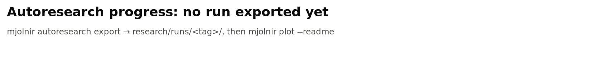

# Autoresearch

An autonomous experiment loop for the Mjolnir kernel's fp6 path (e2m3 KV on HND pages — what vLLM serves), after
[karpathy/autoresearch](https://github.com/karpathy/autoresearch): agents change one
file, a fixed harness scores the change, the change is kept only if the score
improves, and **every experiment lands on the ledger** — kept, discarded or crashed.

```bash
uv tool install mjolnir-cli            # or: uv sync, inside the checkout
npm i -g opencode-ai                   # https://opencode.ai — configure a provider first

mjolnir autoresearch init oct10        # branch autoresearch/oct10 + the baseline row
mjolnir autoresearch run               # OpenCode + the `autoresearch` agent; runs until you stop it
# … in the morning:
mjolnir autoresearch status
mjolnir autoresearch ledger --tail 30
mjolnir autoresearch export            # research/runs/oct10/ — commit it with the winning diff
```

Inside an OpenCode session, `/autoresearch` resumes the loop.

<picture>
  <source media="(prefers-color-scheme: dark)" srcset="progress-dark.png">
  
</picture>

*Rendered by `mjolnir plot` (and after every `evaluate`) from the live ledger,
else from the newest exported run in `runs/<tag>/`: every experiment's score,
the kept ones labelled on the running-best staircase, crashes as ×, and below
it the per-L split — each experiment's FlashInfer÷Mjolnir ratio at every L over
the baseline's (`ref?` marks an L where the FlashInfer reference itself jumped).
`mjolnir autoresearch chart` re-renders it.*

## The pieces

| | |
|---|---|
| [`program.md`](program.md) | the loop the orchestrator follows — the human-editable "research org" |
| `src/mjolnir/mjolnir/t5_decode.py` | the only file experiments change |
| `mjolnir autoresearch evaluate` | the fixed harness: quick correctness (12 cases × fp8/bf16 Q vs the emulator), then an ncu sweep of FlashInfer vs Mjolnir at the 8 headline L |
| score | per L, FlashInfer time ÷ Mjolnir time from the same run; the score is their geomean |
| decision | per L against the best kept row, computed by the harness, never by an agent: **keep** if correct, the geomean gains > 2%, the gain survives dropping its best L (> 1%) and at most one L is slower than the ±3% noise; an L where the FlashInfer reference jumped > 15% is set aside; **noisy** (re-evaluate) if that happens at > 2 L; else **discard** with the reason; **crash** if no score |
| `ledger.jsonl` / `ledger.tsv` | one row per experiment; untracked while the run is live so `git reset --hard` never rewinds it |
| `runs/<tag>/` | committed snapshots (`export`): the ledger + a `SUMMARY.md` |

## The team

Only the orchestrator ships with the repo ([`.opencode/agent/autoresearch.md`](../.opencode/agent/autoresearch.md)).
The four helpers below `explore` are **ids it may delegate to**: create your own OpenCode agents
with these ids in your global config (`~/.config/opencode/agent/<id>.md`) — your
model, your prompt, your tool limits — and the orchestrator's `task` permissions
already allow them. Missing ones are fine: the orchestrator does that step itself.

| agent | role | can |
|---|---|---|
| `autoresearch` | orchestrator (primary) | an open shell (minus server / container / repo-history commands), commit / reset the kernel file, delegate — never push, never edit directly |
| `explore` | built into OpenCode: fast read-only code / docs search | read |
| `arxiv-researcher` | ideas from papers, ranked by fit | read arXiv; returns arXiv ids for `--sources` |
| `web-researcher` | engineering facts: CuTe DSL, CUTLASS, FlashInfer, PTX | read the web; returns URLs |
| `python-engineer` | implements one hypothesis behind a flag | edit `t5_decode.py` only, py_compile, ruff |
| `debugger` | crash / correctness triage from the harness logs | read logs, edit `t5_decode.py`, quick correctness |

## A ledger row

```json
{"id": 7, "ts": "2026-10-11T03:12:40+00:00", "branch": "autoresearch/oct10", "commit": "3f2a91c",
 "status": "discard", "reason": "geomean +0.6% ≤ +2% (set aside, reference jumped: 256K)",
 "score": 1.4183, "best_before": 1.4102, "min_gain": 0.02, "correctness": "pass",
 "per_L": {"128": 1.02, "4096": 1.31, "…": "…"}, "vs_best": {"128": 0.99, "…": "…"},
 "fi_us": {"128": 21.5, "…": "…"}, "mj_us": {"128": 12.1, "…": "…"}, "agent": "python-engineer",
 "hypothesis": "fuse the split-KV merge into the last CTA per sequence (--merge_fused)",
 "sources": ["arXiv:2405.10480"], "verify_runs": {"correctness": "…", "sweep": "…"}}
```

`verify_runs` points at the raw `mjolnir.verify/1` results in
`benchmarks/raw/verify/`, so every number on the ledger can be re-plotted. These
runs are saved with `default: false`: an experiment never replaces a headline chart.

## Sharing a run

A kept win becomes a normal PR: the kernel diff, the exported `research/runs/<tag>/`,
and a fresh `mjolnir verify bench` so the README re-renders from headline data.
Negative results are just as welcome — a ledger of 40 discards tells the next
person what not to try. See [CONTRIBUTING](../.github/CONTRIBUTING.md).
