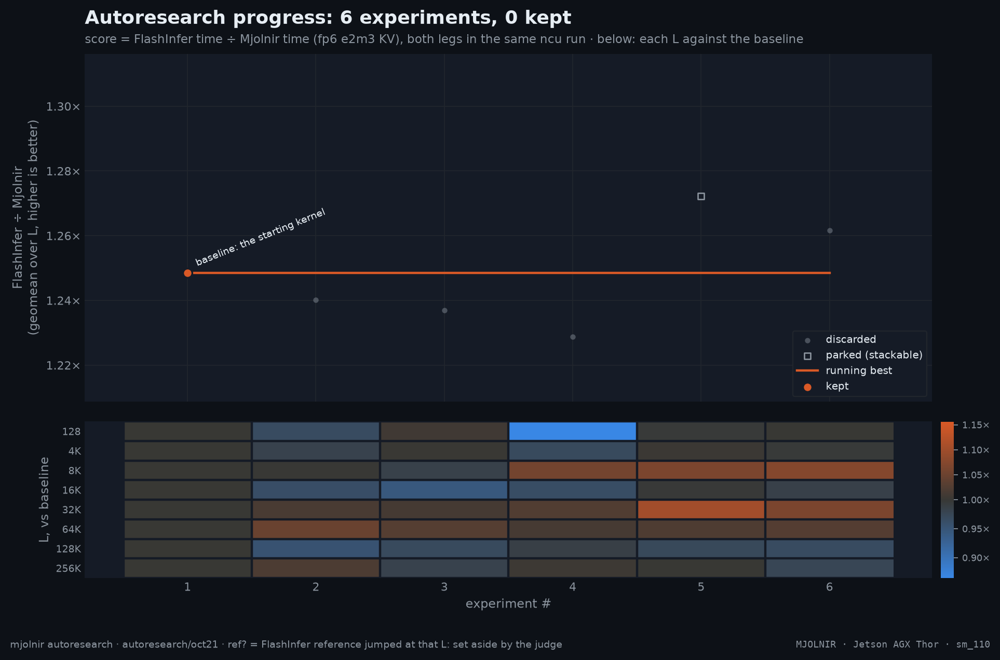

# autoresearch run `oct21`

- experiments: 6 (baseline 1, discard 4, parked 1)
- baseline: 1.2485× vs FlashInfer at `43c659b`
- best: **1.2485×** at `43c659b` — baseline: the starting kernel

| # | commit | status | score | why | agent | hypothesis | sources |
|--:|---|---|--:|---|---|---|---|
| 1 | `43c659b` | baseline | 1.2485 | the starting kernel | human | baseline: the starting kernel |  |
| 2 | `a9fd954` | discard | 1.2402 | geomean -0.7% ≤ +2% | orchestrator | Warm-up-only L2 prefetch as the default: each chunk's first iteration TMA-prefetches the next 2 KV tiles into L2, hiding the 2-stage fp6 ring's leading miss (block-table load + first TMA) without the duplicate traffic that cost the retired steady-state variant 7-27 percent at >=8K (prefetch.md 20261012-211441, fp8); expected mostly at 8K-32K where CTA chunks are 2-7 tiles; the steady-state arm is deleted (simpler); nvfp4 forces it off; the vLLM runner default stays 0 until a kept win | docs/platforms/thor/kernel/prefetch.md |
| 3 | `287f315` | discard | 1.2369 | geomean -0.9% ≤ +2% | python-engineer | Take the block-table loads off the TMA producer's critical path: each tile's page indices load once (hoisted out of the dk/dm stage loops) and the V arm reuses the previous iteration's K-arm pages instead of re-reading the block table (K runs exactly one tile ahead of V, so the addresses are identical); removes 1-3 dependent gmem loads per tile from the issue stream (fp6prof: long_scoreboard is the top stall); correctness errors bit-identical; --bt_page_reuse 0 restores the old reloads | docs/platforms/thor/kernel/fp6prof.md |
| 4 | `dcbc494` | discard | 1.2288 | geomean -1.6% ≤ +2% | python-engineer | Gated KV ring depth for fp6: the e2m3 harness config compiles a 4-stage ring and the producer paces itself at runtime (intra-CTA smem counter, one elected atomic add per a_consumer release, atomic-RMW re-reads in the spin) — chunks <= 13 tiles run the full ring (ring sweep 20261012-210506: deep wins 8K by +5-12% and 16K by +4-6%) while longer chunks are held to 2-stage behavior (shallow wins >= 32K by 6-15%); one compiled kernel, CUDA-graph safe (depth from the runtime chunk size); non-fp6 formats splice out bit-identically; --ring_uncapped isolates the cap | docs/platforms/thor/kernel/ring.md |
| 5 | `2f20c4f` | parked | 1.2722 | geomean +1.9% under the +2% bar but structured, +0.7% without its best L (32K) — parked for stacking | python-engineer | Gated KV ring depth for fp6, counter traffic gated to where the cap can bind: the e2m3 harness config compiles a 4-stage ring; chunks > 13 tiles pace the producer to 2-stage behavior (intra-CTA smem counter, one elected atomic add per a_consumer release, atomic-RMW spin re-reads) while chunks <= 13 tiles run a pure 4-stage ring with zero counter traffic — the previous row's fixed ~1.8us compound-predicate cost at 128 is gone (triad 20261021-154654 vs 20261021-160211: capped==base2==uncapped at 128); ring sweep 20261012-210506: deep wins 8K by +5-12%, shallow wins >= 32K; one compiled kernel, CUDA-graph safe; non-fp6 formats splice out bit-identically; --ring_uncapped folds the machinery out | docs/platforms/thor/kernel/ring.md |
| 6 | `fe34442` | discard | 1.2617 | geomean +1.1% under the bar and rests on 8K (+7.4%): +0.2% without it | python-engineer | batch: ar/parked/2f20c4f (4-stage fp6 ring + runtime producer pacing, counter gated to chunks > 13 tiles) + split coarsening for long batches (cap 8 chunks/seq when the longest sequence has >= 128 tiles — the request-rate-wall band where extra split CTAs cannot add throughput but every chunk writes an fp32 partial the merge reads back; L <= 8K untouched so the brick's 8K win is preserved; the kernel/merge handle any n_splits <= the unchanged 16-slot capacity) | docs/platforms/thor/kernel/ring.md task/research/arxiv-decode-round2-splits-merge.md |
