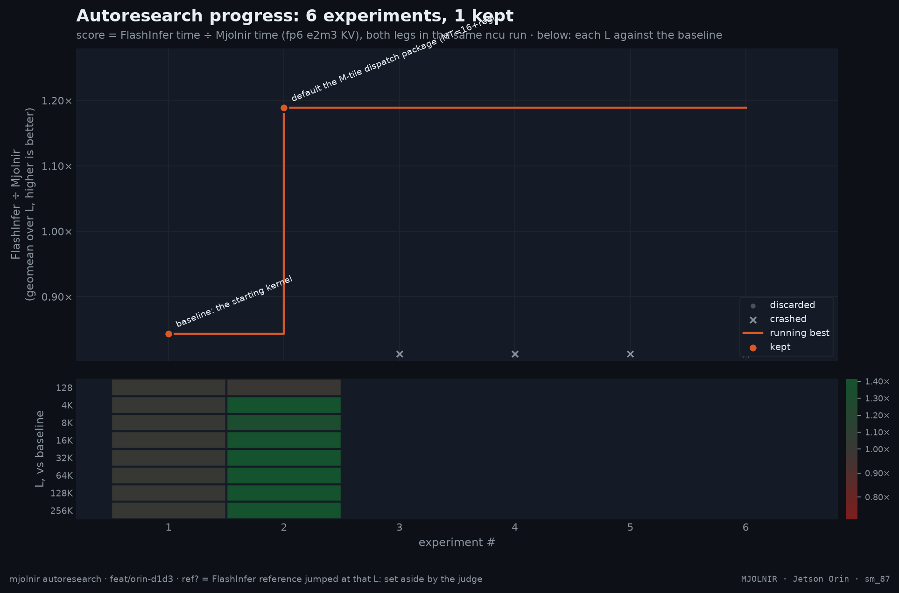

# autoresearch run `oct28`

- experiments: 6 (baseline 1, keep 1, note 4)
- baseline: 0.8436× vs FlashInfer at `e5d748d`
- best: **1.1886×** at `b7a6a8c` — default the M-tile dispatch package (MT=16+register-K for q_len<=2, MT=32 for q_len<=5): the 64-row tile's padded P/softmax/HMMA work per KV byte is 4x FI's at M=1; the package cut the 16K+ gap by a third on the first-Orin bands (design log sessions 4-5)

| # | commit | status | score | why | agent | hypothesis | sources |
|--:|---|---|--:|---|---|---|---|
| 1 | `e5d748d` | baseline | 0.8436 | the starting kernel | human | baseline: the starting kernel |  |
| 2 | `b7a6a8c` | keep | 1.1886 | geomean +40.9%, +36.2% without its best L (4K) | orchestrator | default the M-tile dispatch package (MT=16+register-K for q_len<=2, MT=32 for q_len<=5): the 64-row tile's padded P/softmax/HMMA work per KV byte is 4x FI's at M=1; the package cut the 16K+ gap by a third on the first-Orin bands (design log sessions 4-5) | research/runs/orin1/notes/mma-kernel-design-2.md |
| 3 | `0dc39e3` | note | — | B-quick REFUTED: +1.6/+3.1/+3.2/+3.5% at 4K/16K/64K/262K (OFF 122.75/372.16/1360.45/5290.05 vs ON 124.70/383.81/1404.16/5475.87 us). Mechanism: the smem caps residency at 2 CTAs (Block Limit Shared Mem 2 — the 3rd never launches) while the 168-reg compile adds +15.4% executed inst (41.17M->47.54M, rematerialization; local spills 0). The REGCAP alone on the smem-path fp6 is a pure loss; the design-2 GO verdict was for the regpath package (the smem-freeing one). 'More warps' is dead for fp6 -> the lever B rides on the warp-spec OVERLAP at the 2-CTA budget; the union-regs <= 255 is now the critical gate (the B0/B1 first compile). | orchestrator | the 3-CTA occupancy (the REGCAP) hides the fp6 dequant latency: the issue 0.374->0.5 recovers 10-20% at the long L | /tmp/opencode/bquick/verdict.txt /tmp/opencode/bquick/events_matrix.txt /tmp/opencode/bquick/ncu_regcap.txt task/handoff/notes/fp6-small-vs-fp8-why-and-how-20261028.md |
| 4 | `0dc39e3` | note | — | A0 GO via windowed-e2m3: ppl 6.3855 vs fp16 6.3863 (-0.01%, the fp8 class), greedy diff 10.2% ~= fp8's 9.6% (the metric's chaos floor), no degenerate loops. e3m2-lossy: ppl +0.10% passes but greedy 16.8% = e2m3's +6.2 pp (the budget +5) -> marginal NO-GO, the user's sign-off pending. e3m2-clamp: greedy 21.1% -> NO-GO (the below-floor bias shifts the decoding knife-edges). The eval: 61,440 wikitext-2 tokens, the 16K KV sliding window (the SDPA math-path scores are O(q*kv)), the oracle per-(layer, kv-head, channel) amax/max-code scales, the in-place per-update QDQ. | orchestrator | the e2m3's 2-bit exponent forces ~4 i/32v of LUT dequant on the issue-bound sm_87; the affine bit-plane format (the e3m2-recoded / the windowed-e2m3) reaches the fp8's dequant class (~1-1.5 i/32v) at the same 6-bit density | task/plan/a0-results.md task/plan/a0-results.raw.json task/plan/a0_kv_accuracy.py /tmp/opencode/a0/run.log |
| 5 | `0dc39e3` | note | — | A1 VERDICT: the lever A's assembly variant REFUTED. The bit-exact reference (a1_reference.py, 4 tests green) proved the exp-ADD mandatory (the OR eats the e's low bit), then the A0's re-run on the assembly's 4-octave codebook: the ppl 6.3967 (+0.16%) but the greedy 29.8% vs the 15.6% budget (~19-sigma). The mechanism: the bf16 subnormals (the e2m3's range extension to 5.9 octaves) are structurally incompatible with the per-group window (the exp pinned at 0 -> the wbase cannot ride the exp-ADD; the per-channel descale cannot absorb the per-group factor). R1 (the LUT-index): dead on the +4 ops/group. R2 (the affine windowed-e2m3): dead on the accuracy. R3 (the affine e3m2): the accuracy = the A0's e3m2_lossy's (the greedy 16.8%, the marginal +6.2 pp fail) - the user's call. The RECOMMENDATION: park the lever A (refuted-by-accuracy); the lever B (the warp-spec, the B0 GO) becomes the primary. The honest count: the assembly 32 ops/iteration (~4.0 i/32v) vs the today's ~35-40 (~4.4-5.0): the -10-20% + the LSU relief - the real but modest. | orchestrator | the e2m3's 2-bit exponent forces ~4 i/32v of LUT dequant on the issue-bound sm_87; the affine bit-plane format (the e3m2-recoded / the windowed-e2m3) reaches the fp8's dequant class (~1-1.5 i/32v) at the same 6-bit density | task/plan/a1_layout.md task/plan/a1_reference.py task/plan/a0-asm-results.log /tmp/opencode/a0/run_asm.log |
| 6 | `0dc39e3` | note | — | B1 VERDICT: the lever B (the warp-spec) PARKED - refuted-by-resources (shared memory). The implementation (kernel_small fp6 non-rp only: the producers dequant the stage i+1 tile into the second bf16 bank while the all-4-warps mma reads bank i%2; the named full/empty barriers ids 4-7; the prologue bank-0 fill; the dequant extracted into _dequant_tile) is CORRECT - first-compile green: rel_err 0.00192/0.00194/0.00167 (M=1/2/4, L=4K/64K) == the baseline class, and the flag-OFF extraction is bit-faithful (122.27/371.36/1360.03/5303.97 us == the campaign baselines). The resources: 254 regs (<= 255, the B0's union-regs analysis HELD) but the smem 82.43 -> 117.25 KB -> occupancy_limit_shared_mem = 1 CTA (WS=0: 2) -> the measured 274.21 us @ 4K = 2.24x SLOWER (the latency-hiding warps halve). ROOT CAUSE: the B0 memo assumed STAGE_ROWS=16, the actual SR=32 doubles every tile: the ring is +33.8 KB (not +16.5) and the 2-CTA headroom over the 82.43 KB baseline is ~13.6 KB - even the minimal V-only ring (+16.4 KB) cannot fit. SECONDARY: the w3 structure is a structural wash at M=1 (the producers run 2x the dequant AND the gemms - the straggler by construction); the w2 that could win needs the same banks. NOTES: MJOLNIR_WARPSPEC stays default-off in the _mma_variant() key (the REGCAP precedent); the runner bumped to +s4 (the pre-s4 cache entries orphaned; also fixed the WS=1 runs silently reusing the WS=0 cubins - the flag was inert in the shared-container runs before the fix). The levers A and B are both parked -> the campaign's kernel-side path is exhausted under the 2-CTA smem budget; the residual fp6-vs-fp8 gap (~1.4-1.75x) needs a format-level or cache-layout-level change (out of scope per the oct21 finding). | orchestrator | the warp-spec overlap (the producers dequant the stage i+1 tile into the second bf16 ring while all 4 warps mma the stage i) hides the fp6 dequant behind the mma at the 2-CTA budget: the issue 0.374 -> 0.5-0.6, closing a third of the fp6-vs-fp8 gap |  |
