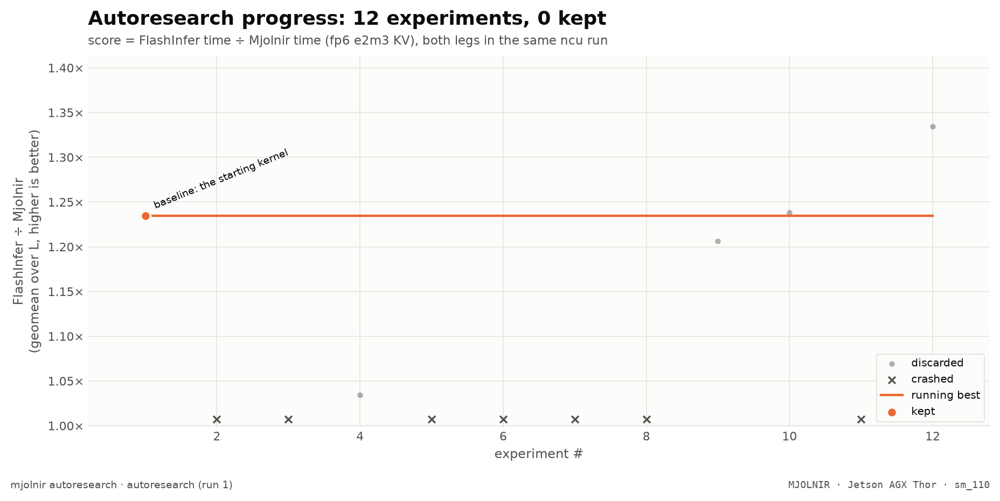

# autoresearch run 1 (2026-10-13/14)

- experiments: 12 (baseline 1, crash 7, discard 4)
- baseline: 1.2346× vs FlashInfer at `eefa370`; nothing kept
- imported from the run's `ledger.tsv`: the per-L numbers were not part of that snapshot, so the chart has no per-L panel (rows from `mjolnir autoresearch export` carry them)
- what it taught, and what to try next: [`research/program.md`](../../program.md)

| # | commit | status | score | hypothesis |
|--:|---|---|--:|---|
| 1 | `eefa370` | baseline | 1.2346 | baseline: the starting kernel |
| 2 | `3668413` | crash | — | Fused the split-KV merge into the decode kernel: the last chunk of each (head, tile, seq) group spins on a per-group counter and merges the gmem partials in its epilogue, removing the ~7us reduction launch (14% of the step at 4K, 9% at 8K per the 20261011 sweep) |
| 3 | `6eeea44` | crash | — | Fused the split-KV merge into the decode kernel (re-run after the arg-binding fix): last chunk per (head, tile, seq) group spins on a per-group counter and merges the gmem partials in its epilogue, removing the ~7us reduction launch (14% of the step at 4K, 9% at 8K per the 20261011 sweep) |
| 4 | `45c7bc0` | discard | 1.0344 | Fused the split-KV merge into the decode kernel (re-run after the name-collision fix: inv_l and v shadowed decode-scope containers), last chunk per (head, tile, seq) group spins on a per-group counter and merges the gmem partials in its epilogue, removing the ~7us reduction launch (14% of the step at 4K, 9% at 8K per the 20261011 sweep) |
| 5 | `73c7a45` | crash | — | Split KV at 64-row sub-tile granularity to use all 40 CTAs at 4K/8K (finer critical path): the plan splits in 64-row units and work items hold a 64-row row range; the CTA streams the covering 128-row tiles and masks the rows it does not own (sibling chunks re-load shared tiles). Expect critical path 3.5 vs 4 GEMM tiles at 4K (~12% step), ~7% at 8K. Source: in-repo program.md item #2 (2026-10-11 verify bench) |
| 6 | `53b0e52` | crash | — | wide fp6 KV TMA: rebuild the e2m3/e3m2 KV ring with explicit SW128 smem swizzle atoms (like the fp8 ring) to yield 128-B L2 requests instead of the MMA-derived SW64 64-B requests; closes the fp6prof gap from 0.89x (kernel time) toward 0.75x (bytes) at long L |
| 7 | `d1074b5` | crash | — | wide fp6 KV TMA (fixed): rebuild the e2m3/e3m2 KV ring with explicit K_SW128 smem swizzle atoms (like the fp8 ring) to yield 128-B L2 requests instead of the MMA-derived SW64 64-B requests; closes the fp6prof gap from 0.89x (kernel time) toward 0.75x (bytes) at long L |
| 8 | `c99442c` | crash | — | wide fp6 KV TMA (fixed v2): derive the e2m3/e3m2 KV ring smem layout from an fp8-style MMA (major_mode_size=128 -> SW128) so the L2 requests are 128 B like fp8 instead of the MMA-derived SW64 64 B; closes the fp6prof gap from 0.89x toward 0.75x at long L |
| 9 | `1d3bcbd` | discard | 1.2062 | wide fp6 KV TMA (fixed v3): derive SW128 smem layout via fp8-style MMA + fall through to the PS==blk_tile_s TMA branch (derived box); e2m3/e3m2 KV ring now issues 128-B L2 requests like fp8 instead of 64 B; closes the fp6prof 0.89x->0.75x gap at long L |
| 10 | `1d3bcbd` | discard | 1.2383 | wide fp6 KV TMA (operator-directed re-run to confirm the long-L win / short-L regression split): e2m3/e3m2 KV ring with SW128 smem layout + derived TMA box; first run scored 1.2062 (discard) with 64K-256K up (1.19-1.29x) but 128-16K down (SW128 TMA setup overhead dominates the small ring) |
| 11 | `50ad3ce` | crash | — | gated wide fp6 KV TMA: stream the SW128 (128-B L2 request) ring iff seq_len >= 64K, capturing the long-L win (64K-256K 1.19-1.32x vs baseline 1.02-1.20x) with zero short-L cost (4K/8K stay on the narrow SW64 ring); the 16K 'loss' in the all-L runs was a FlashInfer-side bimodality artifact, not a Mjolnir regression |
| 12 | `e2d09c2` | discard | 1.3342 | gated wide fp6 KV TMA (L>=64K): stream the SW128 (128-B L2 request) ring iff seq_len >= 64K, capturing the long-L win (64K-256K 1.19-1.32x vs baseline 1.02-1.20x) with zero short-L cost (4K/8K/16K/32K stay on the narrow SW64 ring); fixes the all-L discard (1.2383) whose short-L loss was 4K/8K SW128 overhead + a FlashInfer-side 16K bimodality artifact. Legalization fix: no TMA-atom PHI (each cute.copy uses a single clean atom). VERDICT: neutral — FlashInfer-side false positive (FI 262144 outlier 4660µs); clean rerun 1.2554 < keep bar; program.md #7 EXHAUSTED (64-B gap not recoverable via wider SW128). |
